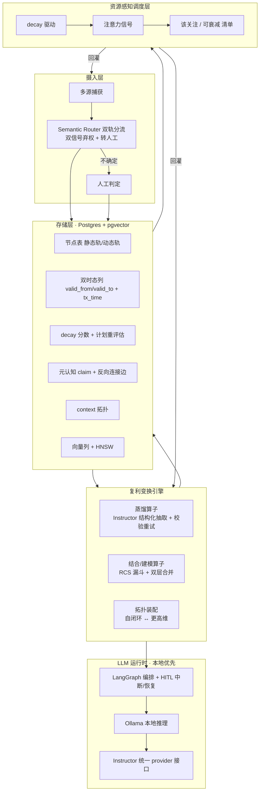

# ZKnowledgeCompounding · 架构设计 v0.1

> 状态：**草案 v1.0**（v0.8 + 与 PRD v0.2 校准 round 1 + **Spike 06 context 拓扑装配已回填 §5（D1/D2）** + **Spike 07 复利度量口径已回填 §5（D3 `citation` 表 / D4 `node.archived_at`）** + **Spike 08 到期分流已回填 §5（D5 `review_queue` 表）** + **Spike 09 `review_interval` 自动设定已回填 §5（D6 双列 / D7 `interval_adjustment` 表）并新增 §6.5**，见 §9 项 6 / §10 项 2-3,4,5；待 zj 复核）
> 上游：PRD v0.1（已认可）+ 四份 sealed 调研报告
> 定位：把调研结论固化为**可执行的技术架构与选型决策**，作为进入 spike 的依据。

## 证据来源（可追溯）

| 报告 | 文件 | reportHash |
|---|---|---|
| 开源候选覆盖调研 | `docs/research/oss-coverage-2026-10-28-draft.md` | `50924a7c…` |
| 结论修订说明 | `docs/research/oss-coverage-amendment-2026-10-29.md` | — |
| 存储 / 生命周期载体（T1.1/T1.2/T1.3） | `docs/research/storage-lifecycle-2026-10-28-draft.md` | `0e8de561…` |
| 蒸馏 / LLM 编排（T3.1/T3.3） | `docs/research/distill-llm-2026-10-29-draft.md` | `0d044028…` |
| 分流 / 结合算子（T0.1/T3.2） | `docs/research/combine-classify-2026-10-29-draft.md` | `3e35b70b…` |
| Spike 01 双轨 schema + decay | `spikes/spike-01-dual-track-decay/README.md` | 18 tests passed |
| Spike 02 双轨分流判定（含限定） | `spikes/spike-02-dual-track-routing/README.md` | 9 tests passed（结论带限定，见 §8）；**真编码器复核已完成（Ollama nomic/qwen3，HF 被墙改走本地栈）** |
| Spike 03 模糊路由 vs DecisionRouter | `spikes/spike-03-vague-routing/README.md` | 9 tests（1 expectedFailure：nomic 3-way 不安全）；**推荐 DecisionRouter 作主方案** |
| Spike 04 蒸馏闭环 | `spikes/spike-04-distill-loop/README.md` | 9 tests passed；§6.4 两条约束（append-only / produced_by 级联）作为 schema 级验收通过；checkpoint 落同库 PG |
| Spike 05 结合算子 | `spikes/spike-05-combine-operator/README.md` | 9 tests passed + e2e；RCS 漏斗 + 引用强制 + 级联撤销验证通过；**1.5B 产物为摘要堆砌（模型规模问题，记账）** |
| Spike 06 context 拓扑装配 | `spikes/spike-06-context-assembly/README.md` | 10 tests passed；**§5 偏差回填**：D1 `scope` 实为 ENUM `context_scope`（比 `text` 严格）、D2 `member_nodes uuid[]` 弃用→改 `context_member` junction（带 `produced_by`+`weight`，接入级联撤销） |
| Spike 07 复利度量口径 | `spikes/spike-07-compounding-metrics/README.md` | 9 tests passed；**§5 偏差回填**：D3 新增 `citation` 表（复用率双向溯源）、D4 `node.archived_at` 列；实现 5 个复利度量（连接密度/复用率/方法论产出/衰减可控/复利系数） |
| Spike 08 到期分流规则 | `spikes/spike-08-expiry-routing/README.md` | 9 tests passed；**§5 偏差回填**：D5 仅新增 `review_queue` 表（规则本身无需新信号列，良性范围收敛）；三态分流（ARCHIVE/DISTILL/ABSTAIN）+ 注意力预算降级 + 孤儿强制弃权 |
| Spike 09 `review_interval` 自动设定 | `spikes/spike-09-review-interval/README.md` | 22 tests passed；**§5 偏差回填**：D6 `node.baseline_interval` + `node.interval_source`（人工设定豁免自动化）、D7 `interval_adjustment` 审计表（带 `produced_by` 可整体回滚）；新增 §6.5 三层规则（L1 基线 / L2 预算归一化 / L3 AIMD 反馈）；**两条实测发现**：decay-only 反馈恒为 no-op、收敛目标 `H/0.6` |
| Cordis（@deepseek-ai/cordis）研究 | ZHarness 项目内 Cordis 文档化研究（**非 sealed 报告，跨项目复用**） | — |

---

## 1. Know Why：要解决的问题

- 高吞吐积累**两类异构信息**：静态（事实型/长生命周期/可演进）与动态（存活型/短生命周期/快速腐化/占注意力）。
- 复利发生在**变换层**而非存储层：结合 → 建模/方法论；蒸馏 → 元认知 + topic 组织 + 反向连接；拓扑装配 → 自闭环 ↔ 更高维 context。
- 硬约束：**长期时间精力有限、短期注意力有限** → 系统必须自己决定"此刻该关注什么、什么可安全衰减"。
- 现有工具（OneNote / Obsidian / llm-wiki / gbrain / OKF 等）各自只优化单一维度，无一能一站式承担。

## 2. 术语约定（防混用，务必遵守）

- **双轨（dual-track）** = 信息类型 + 生命周期分类（静态 / 动态），核心语义是**衰减率与注意力成本**。
- **双时态（bitemporal）** = 时态数据建模机制（valid time + transaction time），核心语义是**事实演进与溯源审计**。
- 二者**不等价**：双时态只覆盖"静态轨的事实可更新/溯源"，**不覆盖动态轨的腐化与注意力稀缺**。
- 文档中禁止互换；引入双时态 ≠ 解决双轨问题。

## 3. 第一性不变量

1. **两类信息原生双轨建模**，生命周期与操作语义分离，不在同一张"笔记表"里混同。
2. **ZKC 拥有三项核心语义**（任何候选都不提供，必须自建）：双轨标签定义、decay 衰减模型、稀缺注意力调度。
3. **存储是可替换的基础设施 seam**，不是架构中心；变换语义与调度策略属于 ZKC 自己。
4. **所有变换产物必须可溯源**（能回溯到来源条目），否则无法复用，也就无法形成复利。
5. **默认本地/离线优先**（个人数据 + 隐私），云端能力只作为可切换的 provider。

## 4. 总体架构



## 5. 数据模型（草案）

```sql
CREATE TYPE track AS ENUM ('static','dynamic','unrouted');

-- 节点：双轨 + 双时态 + 衰减
CREATE TABLE node (
  id                uuid PRIMARY KEY,
  track             track NOT NULL,
  routing_confidence real,           -- 分流置信度（未校准/弃权时为 NULL）
  title             text, content text,
  -- 双时态（服务静态轨的事实演进与溯源）
  valid_from        timestamptz, valid_to timestamptz,
  tx_from           timestamptz NOT NULL, tx_to timestamptz,
  -- 衰减（服务动态轨的腐化）
  decay_score       real,            -- 0..1，越大越腐化
  review_interval   interval,        -- **生效**重评估周期 = baseline × 预算因子（见 §6.5）
  baseline_interval interval,        -- L1 个体基线（未被预算缩放污染，审计用；D6）
  interval_source   text NOT NULL DEFAULT 'auto' CHECK (interval_source IN ('auto','human')),
                                     -- 'human' = 人工设定，豁免一切自动改写（D6）
  last_reviewed_at  timestamptz,
  archived_at       timestamptz,     -- 已归档（衰减可控信号，D4）
  -- 调度
  attention_signal  real,            -- 该关注程度（ZKC 自研）
  embedding         vector(1024)     -- pgvector
);

-- 元认知 claim（蒸馏产物，必须带来源）
CREATE TABLE meta_claim (
  id uuid PRIMARY KEY,
  statement text NOT NULL,
  level text,                        -- 元 / 方法 / 事实
  confidence real,
  evidence_refs uuid[] NOT NULL      -- 溯源：来源 node id
);

-- 反向连接边（基于元认知建立）
CREATE TABLE edge (
  src uuid REFERENCES node(id),
  dst uuid REFERENCES node(id),
  kind text,                         -- derived_from / reverse_link
  weight real
);

-- context 拓扑（scope 为 ENUM，比 text 更严格；D1）
CREATE TYPE context_scope AS ENUM ('self_loop','higher_dim');

CREATE TABLE context (
  id          uuid PRIMARY KEY,
  scope       context_scope NOT NULL,   -- self_loop | higher_dim（D1：ENUM 强制，比 text 严格）
  title       text,                     -- 自闭环 / 更高维 context 的命名
  produced_by uuid REFERENCES transform(id) ON DELETE CASCADE,  -- 装配来源，可级联撤销
  tx_from     timestamptz NOT NULL DEFAULT now(),
  tx_to       timestamptz,              -- 闭合后填，append-only 投影（同 §6.4 双时态同构）
  member_nodes uuid[]                  -- 遗留数组列：保留但**弃用**（见 D2，改用 context_member）
);

-- context membership（D2：junction 表取代 member_nodes 数组）
-- 每行带 produced_by（哪个装配 transform 产出）+ weight（软归属），接入 spike 04/05 级联撤销
CREATE TABLE context_member (
  context_id  uuid REFERENCES context(id)  ON DELETE CASCADE,
  node_id     uuid REFERENCES node(id)     ON DELETE CASCADE,
  produced_by uuid REFERENCES transform(id) ON DELETE CASCADE,  -- NULL = 人审添加
  weight      real NOT NULL DEFAULT 1.0,
  added_at    timestamptz NOT NULL DEFAULT now(),
  PRIMARY KEY (context_id, node_id)
);
CREATE INDEX cm_context_idx  ON context_member (context_id);
CREATE INDEX cm_node_idx     ON context_member (node_id);
CREATE INDEX cm_produced_idx ON context_member (produced_by);

-- 引用埋点（T6.2 / D3）：记录「后续条目复用某 claim」，与 evidence_refs 方向相反，共同构成双向溯源。
-- 每行带 produced_by（可级联撤销），与 spike 04/05 不变量同构。
CREATE TABLE citation (
  id              uuid PRIMARY KEY DEFAULT gen_random_uuid(),
  citing_node_id  uuid REFERENCES node(id)       ON DELETE CASCADE,  -- 复用方（后续条目）
  cited_claim_id  uuid REFERENCES meta_claim(id) ON DELETE CASCADE,  -- 被复用的 claim
  produced_by     uuid REFERENCES transform(id)  ON DELETE CASCADE,  -- 产生引用的变换
  created_at      timestamptz NOT NULL DEFAULT now()
);
CREATE INDEX cit_citing_idx ON citation (citing_node_id);
CREATE INDEX cit_cited_idx  ON citation (cited_claim_id);
CREATE INDEX cit_prod_idx   ON citation (produced_by);

-- 到期分流人审网关（T5.x / D5）：让 ABSTAIN / DISTILL 结论可落地，与 spike 02/04 review gate 同构。
-- 设计发现：分流规则本身无需任何新信号列（全部复用 decay_score/evidence_refs/edge/context_member），
-- 故仅新增此操作性表。DISTILL 入队后由人/LLM 执行（MVP 不做自动蒸馏）。
CREATE TABLE review_queue (
  id         uuid PRIMARY KEY DEFAULT gen_random_uuid(),
  node_id    uuid REFERENCES node(id) ON DELETE CASCADE,
  action     text NOT NULL CHECK (action IN ('distill','archive','abstain')),
  reason     text,
  created_at timestamptz NOT NULL DEFAULT now(),
  resolved   bool NOT NULL DEFAULT false
);
CREATE INDEX rq_node_idx ON review_queue (node_id);
CREATE INDEX rq_open_idx ON review_queue (resolved) WHERE resolved = false;

-- review_interval 设定审计（D7）：append-only，每次改动带 kind/old/new/reason，
-- 并带 produced_by -> transform(id) ON DELETE CASCADE，使一次「预算归一化」批处理可整体回滚。
-- 对应 §6.5：interval 是「个体基线 × 全局预算因子」双层量，两层必须分别可审计。
CREATE TABLE interval_adjustment (
  id          uuid PRIMARY KEY DEFAULT gen_random_uuid(),
  node_id     uuid NOT NULL REFERENCES node(id)      ON DELETE CASCADE,
  kind        text NOT NULL CHECK (kind IN ('baseline','budget','feedback')),
  old_days    real,                       -- NULL 表示该条目此前无 interval
  new_days    real NOT NULL,
  reason      text NOT NULL,              -- 每次改动必须可解释
  produced_by uuid REFERENCES transform(id) ON DELETE CASCADE,  -- NULL = 人审/反馈触发
  created_at  timestamptz NOT NULL DEFAULT now()
);
CREATE INDEX ia_node_idx ON interval_adjustment (node_id);
CREATE INDEX ia_prod_idx ON interval_adjustment (produced_by);

-- 注意力预算观测埋点（§6.5.1）：budget 是容量，只能观测不能声明，且观测是删失的——
-- 日末有积压 = 撞到容量上限（completed 是确证）；日末已清空 = 供给不足（completed 只是下界）。
CREATE TABLE attention_observation (
  day             date PRIMARY KEY,
  pushed          int NOT NULL CHECK (pushed >= 0),           -- 当天进入注意力的条数（供给）
  completed       int NOT NULL CHECK (completed >= 0),        -- 当天实际完成复审的条数
  queue_remaining int NOT NULL CHECK (queue_remaining >= 0),  -- 日末未处理积压（>0 即饱和）
  labeled_completed int NOT NULL DEFAULT 0,                   -- D8：带结果标注的完成数（L3 闸门）
  CONSTRAINT labeled_le_completed CHECK (labeled_completed <= completed),
  created_at      timestamptz NOT NULL DEFAULT now()
);
```

要点：
- 静态轨主要用 `valid_from/valid_to` + `tx_from/tx_to` 表达**事实演进与溯源**；动态轨主要用 `decay_score` 表达**腐化**。两者在同一张表但语义分离，互不替代。
- 图遍历**先用递归 CTE / 邻接表**，不引入图数据库（保持 repository seam 可切 Kuzu / TerminusDB）。
- **decay 阈值（spike 01 已定）**：`SURFACE_THRESHOLD = 0.6`（进入注意力）、`ROT_THRESHOLD = 0.9`（已腐化），两者之间的时间即**行动窗口**。
- **有效复审节奏 = `SURFACE_THRESHOLD × review_interval`**（不是 `review_interval` 本身）→ 注意力需求 = `动态条目数 / (0.6 × interval)`，按 interval 直接算会低估约 40%。
- **context 成员关系（spike 06 已定，回填 §9 项 6）**：`context.scope` 实际为 **ENUM `context_scope`**（`self_loop`/`higher_dim`，比 §5 草图 `text` 更严格，D1）；`member_nodes uuid[]` 数组列保留但**弃用**，成员关系改用 **`context_member` junction 表**（每行带 `produced_by` + `weight`），以接入 spike 04/05 固化的「可溯源 / 级联撤销」不变量（D2）。`context` 自身也带 `produced_by`/`tx_from`/`tx_to`，使一次装配（一个 transform → 一个 context + 其成员）可整体级联撤销。`transform(id)` 由 spike-04 ext schema 定义。
- **引用埋点 + 衰减可控信号（spike 07 已定，回填 §9 项 ③）**：复用率无法仅用 `meta_claim.evidence_refs` 算出（其指向 claim 自身来源，方向相反），故新增 **`citation` 表**（后续条目 → claim 的引用，D3）构成双向溯源；`衰减可控` 的"已归档"分支需在 `node` 上加 **`archived_at` 列**（D4）。二者均带 `produced_by` 级联撤销，与既有不变量同构。据此实现五个复利度量（连接密度/复用率/方法论产出/衰减可控/复利系数），见 `spikes/spike-07-compounding-metrics/`。
- **到期分流规则（spike 08 已定，回填 §9 项 ⑤）**：到期动态节点（`track='dynamic' AND decay_score≥0.9`）的分流为确定性三态——已捕获(`evidence_refs` 含该节点)→ARCHIVE；有连接/在 context 且未捕获→DISTILL；孤儿或注意力预算高压→ABSTAIN（交人审，绝不静默丢弃）。**关键发现（D5，良性范围收敛）**：规则仅需既有信号列，**无需新增信号列**，故 §5 仅新增操作性 **`review_queue` 表**（ABSTAIN/DISTILL 入队，与 spike 02/04 review gate 同构）。`attention_pressure` 真实来源、DISTILL 实际执行、孤儿 SLA 等仍 open。见 `spikes/spike-08-expiry-routing/`。
- 该 schema 已在 **PostgreSQL 16 + pgvector** 实测通过（spike 01）：含 `vector(1024)`、enum 类型、`uuid[]` 上的 GIN 索引；静态轨 `decay_score` 恒为 0；`meta_claim` 缺少 `evidence_refs` 会被 schema 拒绝（溯源在存储层强制）。
- **`review_interval` 自动设定（spike 09 已定，回填 §9 项 ④）**：interval 不是个体自由属性，而是**双层量** `生效 = 个体基线 × 全局预算因子`，规则见新增 §6.5。为此新增 **D6**（`node.baseline_interval` + `node.interval_source`，后者保护人工设定不被自动化改写）与 **D7**（`interval_adjustment` append-only 审计表，带 `produced_by` 可整体回滚）。预算本身由 **`attention_observation` 埋点统计估计**（新增表，见 §6.5.1）。

## 6. 核心子系统与选型

| 子系统 | 选型 | 依据 | 可替换 seam |
|---|---|---|---|
| 存储 | **Postgres + pgvector**（本地/自托管） | 依赖最少、可离线、事务/PITR 成熟；与 Utopia 已验证形态一致 | Kuzu（图变核心）/ TerminusDB（需原生版本控制） |
| 向量 | pgvector HNSW | 与元数据同库、可 JOIN | — |
| 双轨分流 | **DecisionRouter（本地 LLM 直接判定轨道）** + Semantic Router（校准路由 + 双信号弃权）作候选预过滤 | spike 03 验证：**DecisionRouter 主方案**——编码器无关、F1（模糊误提交=0）与 F2（长模糊对抗句 0 进 dynamic）均完美、覆盖 100%；3-way 路由仅在 qwen3 级（≥4096d）强编码器下安全，弱编码器（nomic 768d）出现 1 处模糊误提交+2 处轨道互混 → 仅作强编码器下的互补/置信度信号源，不作独立决策器 | Semantic Router（校准路由）/ Outlines / DSPy |
| 本地推理 | **Ollama** | 唯一原生本地/离线运行时，OpenAI 兼容层 | 任意 OpenAI 兼容端点 |
| 结构化抽取 | **Instructor**（Pydantic + 校验重试） | 唯一提供"文本→校验过的结构化对象"原语 | Outlines |
| 编排 / 人审 | **LangGraph**（图 + PG checkpoint + interrupt/resume） | 选型复核背书（2026-10-29）：唯一同时满足「checkpoint 落 PG 同库同 schema + 领域状态编辑级 HITL + 纯本地 Python 栈」；已知 gap 为无 durable execution（崩溃自动恢复），对人工驱动的蒸馏属 nice-to-have，非 blocker。Pydantic AI / Cordis 评估见 §6.4 与 §7 | 自研最小状态机 |
| 蒸馏语义 | **ZKC 自研** | 无候选提供"去繁→元认知+topic+反向连接" | — |
| 结合/建模 | **ZKC 自研程序**（复用 RCS 漏斗 + 双层合并；spike 05 已验证：引用强制 + 级联撤销跑通，1.5B 综合质量不足走强模型） | 无候选产出建模/方法论产物 | DSPy 作为编程模型 |
| 衰减 decay | **ZKC 自研 · 线性函数**（spike 01 已定） | 所有候选均无原生 TTL/腐化语义；spike 实测线性 rot=0%、行动窗口 6.3 天 | 指数（窗口更大但触发过晚） |
| 注意力调度 | **ZKC 自研** | 所有候选均不覆盖 | — |

### 6.1 蒸馏算子（T3.1）
`条目 → Instructor 结构化抽取（校验失败自动重试） → LangGraph 编排 → interrupt 暂停 → 人工确认/修改 → resume → 写入 meta_claim（带 evidence_refs）`
- 语义契约由 ZKC 定义：蒸馏结果必须是**元认知 claim + topic + 反向连接**，不是摘要。

### 6.2 结合/建模算子（T3.2）
实现为**显式程序**（DSPy 或 LangGraph），复用三种已验证模式：
1. **RCS 漏斗**（源自 PaperQA2）：top-k 检索 → 每源一条 query 条件下的上下文摘要 → LLM 重排打分 → 来源数上限 → 单次生成；
2. **双层合并**（源自 LightRAG）：local（实体级细节）+ global（关系链/更高维）；
3. **层级汇总思路**（源自 GraphRAG，**仅借鉴模式，不引入依赖**——项目处于维护模式）。
- 产出约束：**带来源引用的结构化建模产物**（Instructor 约束结构），非自由文本。

### 6.3 资源感知调度（spike 01 已校准）
- 输入：`decay_score`（腐化）+ `last_reviewed_at` + `attention_signal`。
- 输出：每日/每周「该关注 / 可安全衰减」清单。
- **decay 函数：线性** —— `min(1, elapsed / review_interval)`。spike 01 结论。
- **阈值**：`0.6` 进入注意力，`0.9` 判为已腐化；两者间隔即**行动窗口**（interval=21 天时为 **6.3 天**）。
- **否决阶梯衰减**：它在同一瞬间跨过两个阈值，行动窗口为 **0**——条目被推送时已经腐化（spike 实测 rot=100%）。这是函数形状问题，不是调参问题。
- **指数衰减可用但触发过晚**（interval=21 天时 27.8 天才进入注意力），与"快速腐化"语义相悖；若采用须调小 interval。
- **注意力预算是硬约束**：需求 = `动态条目数 / (0.6 × interval)`。预算低于需求时腐化**无解**（spike 实测 rot=100%），上线前必须反推校验。
- 策略：**保守起步，宁少勿错**——错误推送比不推送更伤注意力。
- **每日复审队列是调度层的产品面（PRD §6 流 C，2026-10-29 zj 同意纳入 MVP）**：调度层输出的「该关注」清单必须落成一个每天可操作的队列，且在处理时同时产出两个外生锚——**复审结果标注**（供 §6.5 L3）与**每日收口埋点**（供 §6.5.1 budget 估计）。**缺此界面，本节与 §6.5 / §6.5.1 的两个闭环都不携带信息**，调度退化为一次性静态规则。

### 6.4 模式借鉴：Cordis / DeepSeek Harness（仅模式，不引入依赖）
对编排层的选型复核（候选含 Pydantic AI、Agno、Temporal 等）结论：**LangGraph 维持为编排层**——ZKC 三硬约束（checkpoint 落 PG 同库同 schema、领域状态编辑级 HITL、纯本地 Python 栈）只有它同时满足；Pydantic AI 在 PG checkpoint（需自建 `BaseStatePersistence`）与 HITL 通用性上反而更弱。Cordis/dsh 经评估**不适合作为 ZKC 依赖**（见 §7），但作为**模式源**有三点可迁移：

1. **append-only 事件流 = SSOT，context 从流投影** ↔ **ZKC 双时态同构**：Cordis 用工业级实现印证了 ZKC 双时态建模方向——`transaction_time` 对应事件流的追加记录，`valid_time` 对应从流投影出的当前视图。ZKC 已在 schema 自建双时态（§5），此同构是**背书而非新依赖**；实现上意味着双时态写入应保持 append-only（不改写历史行，只闭合 `valid_to`/`tx_to`），与事件流语义一致。
2. **spatiotemporal composability（副作用可完全回滚）** → ZKC 的蒸馏 / 结合 / context 拓扑装配应借鉴：知识变换产物（claim、反向连接、context 边）须**可追溯、可撤销**——删除一个变换时其全部副作用随之撤走。落到数据模型：变换产物统一带 `produced_by`（变换实例 id），撤销按该 id 级联。
3. **「一切皆插件」的可替换边界** → 印证 ZKC 既有 seam 设计（storage seam 可切 Kuzu/TerminusDB、encoder seam TF-IDF→Ollama、provider seam 本地→强模型）；蒸馏/结合算子按同样边界保持可替换，不让编排层渗透领域语义。

**边界警示**：Cordis 的插件树 / patch 层级 / 事件流运行时对 ZKC 是**杀鸡用牛刀**——ZKC 蒸馏是确定的领域工作流（条目 → 结构化 claim → 人审 → 落 PG），需要的是被嵌入的领域工具（LangGraph），不是承载自己的通用 agent 平台。引入 dsh 会造成双栈分裂（Python 领域 + TS harness）且迫使 `decay_score`、`evidence_refs` 等一等公民语义塞进事件流抽象，丢失 schema 级校验。

### 6.5 `review_interval` 自动设定（spike 09 已定）

`review_interval` 的语义是「这条多久之后腐化」，自动设定它 = 预测腐化速率。**关键：它是双层量，不是个体自由属性**——注意力是硬预算（§6.3），个体最优之和不保证集体可行（需求 = `Σ 1/(0.6×Iᵢ)`，均匀时退化为 `n/(0.6×I)`）。因此规则分三层：

| 层 | 作用 | 规则 |
|---|---|---|
| **L1 基线**（个体） | 条目自身暗示的腐化速率 | 静态/已归档 → `NULL`；显式时间锚（"下周三""3 天内"…）→ clamp(horizon,1,180)（多锚取最早）；已捕获（claim/artifact evidence）→ 28d；`self_loop` → 3d；有 edge 或 `higher_dim` → 14d；孤儿 → 7d |
| **L2 预算归一化**（全局） | 压进注意力预算 | 需求 ≤ 预算则一条不动；否则按优先级升序延后（时间锚 3 > self_loop 2 > 有连接/共享 context 1 > 孤儿/已捕获 0），同优先级内**短 interval 先延后**，每步 ×2；`interval_source='human'` 永不自动改写；到 `MAX=180d` 仍超 → `infeasible=True` + `max_dynamic_items = budget×0.6×180` |
| **L3 反馈**（闭环） | 先验不可靠，用真实结果修正 | AIMD：复审时仍新鲜（decay<0.3）→ ×1.5；正好（0.3–0.9）→ 不变；已腐化（≥0.9）→ ×0.7；钳制 `[1d,180d]`。受**标注率闸门**约束（见下） |

**L3 标注率闸门（zj 定 ≥70%，2026-10-29）**：L3 只认显式结果标注（`still_valid`/`changed`/`stale`），不认 decay 数值。埋点新增 `labeled_completed`（D8），口径 = 滚动 7 天窗口内 `labeled_completed / completed`；窗口内完成复审 **< 10 次不判定**（样本不足，闸门放行，避免 warm-up 期冻结闭环）。**低于 70% → L3 停机**，interval 停在基线——宁可不动，也不能用无声的划过改写节奏；人工显式给定 verdict 时不受此限。

**诚实降级契约**：预算不足时**不做无限延后**。interval 远超真实半衰期 = 决定让这条腐化，该决定必须可见——故用 `infeasible` + `max_dynamic_items` 明确报告「必须缩小动态集合（回到 spike 08 的 DISTILL/ARCHIVE）」，而不是静默把 interval 拉到天上。

**⚠️ 两条 spike 实测发现（必须记账）**：
1. **decay-only 反馈是永久 no-op**：调度器按 `decay ≥ 0.6` 触发复审时，复审瞬间 decay 恒为 0.6 → 判定永远 `on_time` → interval 永不修正（仿真：真值 10d、初值 7d，40 轮后仍是 7.0d）。闭环**看似在跑、实则不携带信息**。修正只在复审由别的东西触发时发生（人主动打开、项目里程碑、预算饥饿导致延迟复审）或**复审时显式标注结果**（`still_valid`/`changed`/`stale`）→ **MVP 必须把复审做成带结果标注的动作**，否则 L3 是装饰。加显式标注后：2 步收敛并稳定（15.75d vs 目标 16.67d）。
2. **收敛目标是 `H/0.6` 而非真值 H**：复审发生在 `elapsed = 0.6×I`，要让复审落在真值 H 上需 `I* = H/0.6 ≈ 1.67H`。这是 `SURFACE_THRESHOLD=0.6` 的定义所致，不是 bug；想让复审更早发生应调 `SURFACE_THRESHOLD`，不是改 AIMD 因子。

Schema 增量 **D6**（`baseline_interval` + `interval_source`）与 **D7**（`interval_adjustment` 审计表，带 `produced_by` 可整体回滚）已回填 §5；**D8**（`attention_observation.labeled_completed`，L3 标注率闸门埋点）见 §6.5.1。见 `spikes/spike-09-review-interval/`。

### 6.5.1 `budget_per_day` 从使用习惯统计赋值（spike 09 切片 B）

预算是**容量**，只能被观测、不能被声明。zj 定调「通过一段时间统计使用习惯做赋值更新」，但这里有个必须先拆掉的陷阱：这是一个**删失观测**问题，且观测链**自指**。

- **删失**：日末**有积压**的日子 = 撞到容量上限，`completed` 是容量的**确证**；日末**已清空**的日子 = 供给不足，`completed` 只是**下界**。两类样本混在一起取平均，数字是错的。
- **自指**：`budget → L2 拉长 interval → 供给变少 → 观测到的复审变少 → budget 更低 → …`，每一步都有"数据支持"。

三道防线（已实现 + 仿真验证）：
1. **删失感知估计**：埋点 `attention_observation(day, pushed, completed, queue_remaining)`；只有饱和日参与点估计（取 `completed` 的 **p25**，保守）；无饱和日只报下界 `max(completed)`（`confidence='lower_bound'`）；无观测时 `confidence='none'`，**L2 完全不动**（warm-up）。
2. **单调护栏**：**非饱和日只能抬升预算，永不压低**（它只证明 capacity ≥ completed）；饱和日才允许下调。
3. **阻尼 EMA**（α=0.3，单次 ±30% 封顶）+ **校准期过度供给**：估计未确认时 L2 拟合目标取 `budget × 1.5`，确认后回到 1.0——否则供给恰好等于预算时队列天天清空，永远不产生饱和日，低估会被永久固化。

**仿真结论**（真值 3 条/天、60 条）：乐观冷启动 10 → **3.001**；悲观冷启动 1 → **2.999**（**双向收敛**）。护栏对照（12 条、真值容量 8、关闭 oversubscribe）：护栏 ON 保持 10 不动，OFF 降到 6（把"供给不足"误读为"容量不足"）。

**⚠️ 预判修正（记账）**：原以为正反馈会**无限塌陷到 0**，实测**不是**——存在稳定不动点，真实失败形态是**错误的稳定均衡**（预算固化在低于真实容量的水平 + interval 被无谓拉长），是"固化"不是"发散"。**结构性极限**：条目太少导致供给长期低于容量时，**容量不可观测**（oversubscribe 也抬不高供给），此时唯一正确行为是 L2 保持宽松、等条目积累。

**更一般的结构性认识**：任何自指闭环都需要至少一个**外生锚**——decay 是我们自己定义的（拉长 interval 就等于"不腐化"），需要 L3 的用户显式标注作外生锚；budget 观测到的真实完成数是另一个外生锚。缺锚的闭环只会自证。

**落地硬前提**：`pushed/completed/queue_remaining/labeled_completed` 需要真实 UI 每天写一次；没有"每日复审队列"界面，估计器会永远停在 `confidence='none'`、L3 闸门无样本，两个闭环都不启动。该界面已由 zj 于 2026-10-29 同意纳入 MVP（PRD §6 流 C）。

## 7. 被拒绝 / 延后的选项（含拒绝理由）

| 选项 | 决定 | 约束性理由 |
|---|---|---|
| 整体采纳某个开源知识应用 | 拒绝 | 无候选覆盖双轨/衰减/注意力；只做 unit-capability 复用 |
| Utopia / OpenWiki 作为待验证候选 | 重述为**模式源** | 存储报告已定 substrate，不再验证"适配度"，只迁移其双时态 schema 与 claim 结构 |
| 图数据库（Kuzu / TerminusDB）作为主存储 | 延后 | MVP 图遍历浅，递归 CTE 足够；保持 seam |
| LiteLLM | 延后 | proxy 需 PostgreSQL，MVP 无需多 provider 路由 |
| Argilla | 延后 | 维护模式 + PG/Redis 重依赖；人审先用 LangGraph interrupt |
| Langfuse | 延后 | ClickHouse/Redis 重依赖；先用轻量 score 表 |
| Electric / Automerge（多端同步） | 延后 | MVP 为单人单机 |
| XTDB | 待带外验证 | 最强双时态候选，但 pinned 编译器无法解析其 submodule 树 |
| Cordis / dsh（DeepSeek Harness）作为编排层依赖 | 拒绝，**重述为模式源**（见 §6.4） | 双栈分裂（Python 领域 + TS 运行时）；session 为自有 append-only 事件流，无法落 ZKC 的 PG 同库同 schema；HITL 仅轨迹级 resume/fork/replay，无领域状态编辑级中断；把 `decay_score`/`evidence_refs` 塞进事件流抽象会丢失 schema 级校验。可迁移的是模式：append-only 流↔双时态同构、副作用可回滚、插件化 seam |

## 8. 风险与未决

- **本地小模型蒸馏质量可能不足** → provider seam 保留：常规抽取本地，元认知步骤可切强模型。
- **分流错判污染生命周期**（spike 02 已细化）→ 强制弃权 + 人工兜底 + 记录置信度（`routing_confidence`，弃权为 NULL）+ 周期性重分类；并新增**双信号弃权**（相似度阈值 OR 信息量下限），因单信号不可分。
- **⚠️ Spike 02 限定条件（必须记账，不得外推）**
    1. **相似度不可分模糊/确定（词法编码器下）**：模糊均值 0.164 vs 明确 0.292，两者重叠（模糊最高 0.285 > 明确最低 0.164）；唯一能完全分离的信号是**信息量（去重 token 数）**（模糊 6.9 / 明确 25.0，模糊≤11、明确≥17）→ 故实现双信号弃权。
    2. **「0% 错判 / 100% 准确率」不可外推**：评估集模糊样本全为短句；对抗探针（长但模糊，ntok 47–58）**3/3 FALSE COMMIT**，且**全部误判为 dynamic** → 长度只是弱代理，信息量门在长模糊句失效。
    3. **系统性单向偏差**：所有 false commit 都指向 dynamic → 沉入动态轨 → 参与 decay → 变噪声并消耗注意力（与"错判污染生命周期"一致，且方向单向，风险被放大）。
    4. **真编码器复核已完成（2026-10-29，经 Ollama，因 HF 被墙）**：量化结论已用**真实语义编码器**复核——HuggingFace / FastEmbed(BGE) 在本环境被 `SSL EOF` / 超时 / 502 阻断，改用 ZKC MVP 栈的 Ollama 本地嵌入（`nomic-embed-text` 768 维 + `qwen3-embedding` 4096 维，`run_spike_ollama.py`）。两模型结果与词法编码器**一致**：① 模糊/确定相似度仍 **OVERLAP**（nomic 模糊 max 0.894 > 明确 min 0.563；qwen3 模糊 max 0.765 > 明确 min 0.477）→ 「相似度不可分」**不是词法假象**，双信号弃权在真编码器下仍必要；② 长模糊句单向误判为 dynamic **3/3 复现**（TF-IDF / nomic / qwen3 三编码器一致）→ 单向偏差真实存在，信息量门不可靠；③ 「0% 错判不可外推」获佐证：nomic 下 routed 准确率降至 80%、错判 20%。
    - 结论升级：**双信号弃权 + 显式"模糊"路由（或 DecisionRouter）在真实编码器下更显必要**，而非继续调阈值；原「词法编码器上成立」限定**撤销**→ 改为「真实语义编码器下同样成立」。
- **结合算子 LLM 成本高** → 来源上限 + 上下文摘要缓存 + 增量更新。
- **LangGraph 正在收敛为 runtime**（agent 构建移到 Deep Agents）→ 只用 graph/checkpoint/interrupt 原语并锁版本。
- **Semantic Router 1.x 有破坏性变更** → 锁版本 + 路由回归测试。
- **注意力预算不足** → 上线前按 `动态条目数 / (0.6 × interval)` 校验预算覆盖需求；不足时必须调大 interval 或减少动态条目，否则腐化无解（spike 实测 rot=100%）。
- **已定（spike 01）**：decay 函数形态 = **线性**；阶梯衰减已否决，指数为备选。
- **已定（spike 02）**：双轨分流**机制可行**——校准化路由 + 双信号弃权可正确分出明确条目（routed 准确率 100%、错判 0%、abstain 28.1%、8/8 模糊样本正确弃权）；弃权路径可转人工。**真编码器（Ollama nomic/qwen3）复核确认双信号弃权与单向偏差结论在真实语义嵌入下仍成立**（见 §8 限定 ④）。
- **未决（spike 02 限定）**：① **已定**——真编码器（Ollama nomic/qwen3）下模糊/确定仍 OVERLAP，双信号弃权在真实嵌入下仍必要、阈值仍适用；② **已定（spike 03）**——采用 **DecisionRouter（本地 LLM 直接判定轨道）作主方案**，而非显式 3-way 模糊路由：spike 03 验证 DecisionRouter 编码器无关、F1/F2 安全属性完美、覆盖 100%；3-way 路由仅在 qwen3 级强编码器下安全，弱编码器引入危险误提交，故降级为 DecisionRouter 的候选预过滤/置信度信号源；③ 静态/动态判定是否需要**时间词特征**（纯语义是否够，待定）；④ **已定**——真编码器复核已完成（经 Ollama，HF 被墙），量化结论不再仅限词法编码器。
- **已定（spike 09）**：`review_interval` 自动设定 = **三层规则**（L1 个体基线 / L2 全局预算归一化 / L3 复审反馈 AIMD）；interval 是**双层量**（个体基线 × 预算因子），因注意力预算是硬约束。见 §6.5。
- **已定（spike 09 切片 B）**：`budget_per_day` 由 `attention_observation` 埋点**统计估计**（删失感知 + 单调护栏 + 阻尼 EMA + 校准期 oversubscribe），仿真验证可从 10 或 1 双向收敛到真值。见 §6.5.1。
- **未决（通用）**：注意力信号的加权方式（现仅按 decay 排序）、复利度量的最终口径、切片 B 全部阈值（p25、α=0.3、±30%、×1.5）的校准。
- **未决（spike 09 限定，不得外推）**：① **L3 必须接显式复审结果标注**——decay-only 反馈在「按 decay 阈值调度」下恒为 no-op，永不修正基线；② 收敛目标为 `H/0.6`（SURFACE=0.6 的定义所致），不是真值 H；③ 所有阈值（预算 1.2/天、优先级序、×2 延后、±20% 容忍带、AIMD 1.5/0.7）为**占位**，振荡带约 ±50%，需真实数据校准；④ 已捕获条目在 spike 08 判为 ARCHIVE、在 spike 09 判为 28d，两条规则待统一。

## 9. 下一步（spike 清单）

1. ✅ **双轨 schema + decay spike（已完成）** —— 见 `spikes/spike-01-dual-track-decay/README.md`（18 tests passed）。结论：decay 选**线性**；**阶梯否决**（行动窗口 0）；不加调度 rot=100%、加调度后线性降至 0%；预算须覆盖 `n/(0.6×interval)`。DDL 已在 PG16+pgvector 实测通过，静态轨 decay 恒为 0，claim 无 evidence_refs 被拒。
2. ✅ **分流 spike（已完成，真编码器复核已解决）** —— 见 `spikes/spike-02-dual-track-routing/README.md`（9 tests passed）。结论：校准路由 + **双信号弃权**机制可行（routed 准确率 100%、错判 0%、abstain 28.1%、8/8 模糊正确弃权）；**限定条件**见 §8：词法编码器下相似度不可分模糊/确定、0% 错判不可外推（长模糊句 3/3 误判为 dynamic 且单向偏差）。**真编码器复核（2026-10-29）经 Ollama 完成**（HF/FastEmbed(BGE) 被墙改走本地栈）：nomic-embed-text 与 qwen3-embedding 两模型均复现 OVERLAP 与 3/3 单向误判 → 上述结论在真实语义嵌入下仍成立，原「词法编码器上成立」限定撤销。建议下一步用**显式"模糊"路由或 DecisionRouter** 替代继续调阈值。
3. ✅ **模糊路由 vs DecisionRouter spike（已完成）** —— 见 `spikes/spike-03-vague-routing/README.md`（9 tests，1 expectedFailure）。结论：验证 Spike 02 收尾的两条候选修复。**两条路径都修掉 F2（长模糊对抗句 0 进 dynamic）**；**DecisionRouter 主方案**——F1（模糊误提交=0）完美、F2 完美、覆盖 100%、编码器无关，契合 Ollama 栈（精度随模型规模可提，本环境仅 1.5B）；3-way 路由仅在 qwen3 级（≥4096d）强编码器下安全，nomic(768d) 出现 1 误提交+2 互混 → 降级为互补/置信度信号源。选型表（§6）与未决②已同步。
4. ✅ **蒸馏 spike（已完成）** —— 见 `spikes/spike-04-distill-loop/README.md`（9 tests passed）。Instructor+Ollama(qwen2.5-coder)+LangGraph interrupt/resume 全程无外部 API 跑通，checkpoint 落**同库 PG**（PostgresSaver，跨连接 resume 实测通过）。**§6.4 两条约束已作为 schema 级验收强制通过**：C1 双时态 append-only（修订=闭行+插行，历史行逐字段不变）、C2 produced_by 级联撤销（FK ON DELETE CASCADE，人工产物不受牵连）。**注意**：1.5B 蒸馏产物近复述而非元认知，印证 §8「本地小模型质量」风险——管线与约束已验证，语义质量走 provider seam 切强模型，属后续。
5. ✅ **结合 spike（已完成）** —— 见 `spikes/spike-05-combine-operator/README.md`（9 tests passed + e2e 演示）。RCS 漏斗（逐源条件化摘要→重排→来源上限）+ 双层合并 + **引用强制**（幻觉引用剔除、零引用断言删除、全失效抛错——无引用的建模产物不允许存在）跑通；复用 spike-04 的 transform/produced_by 级联撤销。**人工评估结论（诚实记账）**：1.5B 产物为「带引用的摘要堆砌」（一源一 claim、global 层复述、无跨源断言）→ **语义质量不达标，与 spike-04 同源：模型规模问题非架构问题**，走 provider seam 切强模型，选型不推翻。
6. **剩余 spike（与 PRD §9 对齐）**：① 强模型（≥7B）蒸馏/结合质量复测与质量口径定义（Spike 04/05）；② ✅ **`context` 拓扑装配 spike（已完成）** —— 见 `spikes/spike-06-context-assembly/README.md`（10 tests passed）。T4.1 发现（pgvector k-NN 可行，启发式过朴）+ T4.2 成员维护（junction 表 `context_member` 取代数组列，D1/D2 已回填 §5）；③ ✅ **复利度量口径 + 引用埋点（已完成）** —— 见 `spikes/spike-07-compounding-metrics/README.md`（9 tests passed）。T7.1 五指标（连接密度/复用率/方法论产出/衰减可控/复利系数）已定义并可计算，T6.2 新增 `citation` 表 + `node.archived_at`（D3/D4 已回填 §5）；④ ✅ **`review_interval` 自动设定规则（已完成）** —— 见 `spikes/spike-09-review-interval/README.md`（**44 tests passed**：切片 A 三层规则 22 + 切片 B `budget_per_day` 统计赋值 16）。切片 A切片 A：L1 个体基线（时间锚 > 已捕获 28d > self_loop 3d > 有连接/共享 context 14d > 孤儿 7d；静态轨 NULL）；L2 预算归一化（按优先级延后、人工设定豁免、`infeasible` 诚实报告 `max_dynamic_items`）；L3 复审反馈 AIMD（×1.5 / ×0.7）。**核心判断**：interval 是「个体基线 × 全局预算因子」的双层量，纯个体设定会违反注意力硬预算。**两条实测发现**：decay-only 反馈是永久 no-op（必须显式标注复审结果）、收敛目标为 `H/0.6` 而非真值 H。切片 B：`budget_per_day` 由 `attention_observation` 埋点统计估计（删失感知 + 单调护栏 + 阻尼 EMA + 校准期 oversubscribe），仿真可从 10 或 1 双向收敛到真值 3，详见 §6.5.1。§5 D6/D7 已回填，新增 §6.5 / §6.5.1；⑤ ✅ **到期条目「蒸馏 vs 归档」分流规则（已完成）** —— 见 `spikes/spike-08-expiry-routing/README.md`（9 tests passed）。三态分流（ARCHIVE/DISTILL/ABSTAIN）+ 注意力预算降级 + 孤儿强制弃权；规则不需新信号列（D5 仅新增 `review_queue` 表，良性范围收敛）；⑥ DecisionRouter 在 7~14B 下清晰项精度实测 + 混合置信度方案；⑦ **每日复审队列 UI（MVP 必选，PRD §6 流 C）**：`decay≥0.6` 清单 + 复审结果标注（`still_valid`/`changed`/`stale`）+ 每日收口埋点（`pushed`/`completed`/`queue_remaining`）——是 §6.5 L3 与 §6.5.1 budget 估计两个闭环唯一的外生锚载体，未交付则两者皆为装饰。

---

## 10. 与 PRD v0.2 校准 ledger（round 1 · 2026-10-29）

本轮校准把 PRD 从「v0.1 研究待做」状态追平到「v0.2 研究已回填」，确保两份文档不矛盾、决策可追溯。对账结果：

| PRD 章节 | 校准动作 | 与本文档一致性 |
|---|---|---|
| §2.0（新增）术语护栏 | 锚定「双轨≠双时态」 | 与本文 §2 完全一致 |
| §2.3 注意力预算 | 回填 Spike 01 量化约束 | 与本文 §6.3 一致 |
| §4 数据模型 | 概念模型 + 指向本文 §5 schema | 概念层（动静分离）与存储层（单表+track）是同一模型两视图，不矛盾 |
| §5 系统架构 | 标注概念图、指向本文 §4 | 本文 §4 为权威详细图 |
| §6/§7 选型与度量 | PRD 引用本文结论 | 一致 |
| §8 风险 | 回填 Spike 02/03/04/05 风险 | 与本文 §8 一致 |
| §9 下一步 | 研究标完成、列剩余 spike | 与本文 §9 剩余项一致 |

**未闭合项（双方共同 open，不在此轮强行闭合）**：
1. 强模型（≥7B）蒸馏/结合语义质量复测与质量口径定义（Spike 04/05）。
2. ✅ **`context` 拓扑装配 spike（已完成，2026-10-29）** —— T4.1/T4.2 验证通过（spike-06，10 tests passed），§5 D1/D2 偏差已回填，本条从 open 移除。
3. ✅ **复利度量口径（T7.1）+ 引用埋点（T6.2）（已完成，2026-10-29）** —— 见 spike-07（9 tests passed），§5 D3/D4 已回填，本条从 open 移除。
4. ✅ **`review_interval` 自动设定规则（已完成，2026-10-29）** —— 见 spike-09（**44 tests passed**：切片 A 22 + 切片 B 22），§5 D6/D7/D8 已回填、新增 §6.5 与 §6.5.1（`budget_per_day` 统计估计），本条从 open 移除。仍然 open 的是其**阈值校准与 L3 对「显式复审标注」的依赖**（见 §8 spike 09 限定）。
5. ✅ **到期条目「蒸馏 vs 归档」分流规则（已完成，2026-10-29）** —— 见 spike-08（9 tests passed），§5 D5 已回填（`review_queue` 表），本条从 open 移除。
6. DecisionRouter 在 7~14B 下清晰项精度实测 + 混合置信度方案。
7. **每日复审队列 UI（MVP 必选，PRD §6 流 C，2026-10-29 zj 已同意纳入）**：`decay≥0.6` 清单 + 复审结果标注（`still_valid`/`changed`/`stale`）+ 每日收口埋点（`pushed`/`completed`/`queue_remaining`）。它是 §6.5 L3 与 §6.5.1 budget 估计两个闭环唯一的**外生锚**载体，未交付则两者皆为装饰（interval 永久停在基线、budget 永久停在 warm-up）。待最小垂直切片排期时确定交互形态与标注完成率门槛。

> 以上均为"已识别未决"，非"被静默接受"。任何一方推进后同步回填两文档。

> 本文件的选型均可被 spike 结果推翻；被推翻处应记录偏差，不得静默接受。
