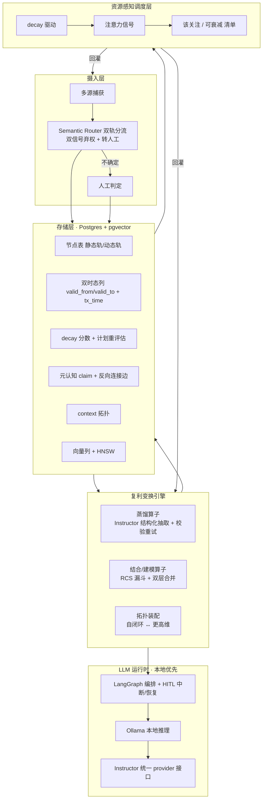

# ZKnowledgeCompounding · 架构设计 v0.1

> 状态：**草案 v0.4**（四份技术调研收敛 + Spike 01 / Spike 02 结论已回填 + **Spike 02 真编码器复核已解决**，待 zj 校准）
> 上游：PRD v0.1（已认可）+ 四份 sealed 调研报告
> 定位：把调研结论固化为**可执行的技术架构与选型决策**，作为进入 spike 的依据。

## 证据来源（可追溯）

| 报告 | 文件 | reportHash |
|---|---|---|
| 开源候选覆盖调研 | `docs/research/oss-coverage-2026-10-28-draft.md` | `50924a7c…` |
| 结论修订说明 | `docs/research/oss-coverage-amendment-2026-10-29.md` | — |
| 存储 / 生命周期载体（T1.1/T1.2/T1.3） | `docs/research/storage-lifecycle-2026-10-28-draft.md` | `0e8de561…` |
| 蒸馏 / LLM 编排（T3.1/T3.3） | `docs/research/distill-llm-2026-10-29-draft.md` | `0d044028…` |
| 分流 / 结合算子（T0.1/T3.2） | `docs/research/combine-classify-2026-10-29-draft.md` | `3e35b70b…` |
| Spike 01 双轨 schema + decay | `spikes/spike-01-dual-track-decay/README.md` | 18 tests passed |
| Spike 02 双轨分流判定（含限定） | `spikes/spike-02-dual-track-routing/README.md` | 9 tests passed（结论带限定，见 §8）；**真编码器复核已完成（Ollama nomic/qwen3，HF 被墙改走本地栈）** |

---

## 1. Know Why：要解决的问题

- 高吞吐积累**两类异构信息**：静态（事实型/长生命周期/可演进）与动态（存活型/短生命周期/快速腐化/占注意力）。
- 复利发生在**变换层**而非存储层：结合 → 建模/方法论；蒸馏 → 元认知 + topic 组织 + 反向连接；拓扑装配 → 自闭环 ↔ 更高维 context。
- 硬约束：**长期时间精力有限、短期注意力有限** → 系统必须自己决定"此刻该关注什么、什么可安全衰减"。
- 现有工具（OneNote / Obsidian / llm-wiki / gbrain / OKF 等）各自只优化单一维度，无一能一站式承担。

## 2. 术语约定（防混用，务必遵守）

- **双轨（dual-track）** = 信息类型 + 生命周期分类（静态 / 动态），核心语义是**衰减率与注意力成本**。
- **双时态（bitemporal）** = 时态数据建模机制（valid time + transaction time），核心语义是**事实演进与溯源审计**。
- 二者**不等价**：双时态只覆盖"静态轨的事实可更新/溯源"，**不覆盖动态轨的腐化与注意力稀缺**。
- 文档中禁止互换；引入双时态 ≠ 解决双轨问题。

## 3. 第一性不变量

1. **两类信息原生双轨建模**，生命周期与操作语义分离，不在同一张"笔记表"里混同。
2. **ZKC 拥有三项核心语义**（任何候选都不提供，必须自建）：双轨标签定义、decay 衰减模型、稀缺注意力调度。
3. **存储是可替换的基础设施 seam**，不是架构中心；变换语义与调度策略属于 ZKC 自己。
4. **所有变换产物必须可溯源**（能回溯到来源条目），否则无法复用，也就无法形成复利。
5. **默认本地/离线优先**（个人数据 + 隐私），云端能力只作为可切换的 provider。

## 4. 总体架构



## 5. 数据模型（草案）

```sql
CREATE TYPE track AS ENUM ('static','dynamic','unrouted');

-- 节点：双轨 + 双时态 + 衰减
CREATE TABLE node (
  id                uuid PRIMARY KEY,
  track             track NOT NULL,
  routing_confidence real,           -- 分流置信度（未校准/弃权时为 NULL）
  title             text, content text,
  -- 双时态（服务静态轨的事实演进与溯源）
  valid_from        timestamptz, valid_to timestamptz,
  tx_from           timestamptz NOT NULL, tx_to timestamptz,
  -- 衰减（服务动态轨的腐化）
  decay_score       real,            -- 0..1，越大越腐化
  review_interval   interval,        -- 计划重评估周期
  last_reviewed_at  timestamptz,
  -- 调度
  attention_signal  real,            -- 该关注程度（ZKC 自研）
  embedding         vector(1024)     -- pgvector
);

-- 元认知 claim（蒸馏产物，必须带来源）
CREATE TABLE meta_claim (
  id uuid PRIMARY KEY,
  statement text NOT NULL,
  level text,                        -- 元 / 方法 / 事实
  confidence real,
  evidence_refs uuid[] NOT NULL      -- 溯源：来源 node id
);

-- 反向连接边（基于元认知建立）
CREATE TABLE edge (
  src uuid REFERENCES node(id),
  dst uuid REFERENCES node(id),
  kind text,                         -- derived_from / reverse_link
  weight real
);

-- context 拓扑
CREATE TABLE context (
  id uuid PRIMARY KEY,
  scope text,                        -- self_loop | higher_dim
  member_nodes uuid[]
);
```

要点：
- 静态轨主要用 `valid_from/valid_to` + `tx_from/tx_to` 表达**事实演进与溯源**；动态轨主要用 `decay_score` 表达**腐化**。两者在同一张表但语义分离，互不替代。
- 图遍历**先用递归 CTE / 邻接表**，不引入图数据库（保持 repository seam 可切 Kuzu / TerminusDB）。
- **decay 阈值（spike 01 已定）**：`SURFACE_THRESHOLD = 0.6`（进入注意力）、`ROT_THRESHOLD = 0.9`（已腐化），两者之间的时间即**行动窗口**。
- **有效复审节奏 = `SURFACE_THRESHOLD × review_interval`**（不是 `review_interval` 本身）→ 注意力需求 = `动态条目数 / (0.6 × interval)`，按 interval 直接算会低估约 40%。
- 该 schema 已在 **PostgreSQL 16 + pgvector** 实测通过（spike 01）：含 `vector(1024)`、enum 类型、`uuid[]` 上的 GIN 索引；静态轨 `decay_score` 恒为 0；`meta_claim` 缺少 `evidence_refs` 会被 schema 拒绝（溯源在存储层强制）。

## 6. 核心子系统与选型

| 子系统 | 选型 | 依据 | 可替换 seam |
|---|---|---|---|
| 存储 | **Postgres + pgvector**（本地/自托管） | 依赖最少、可离线、事务/PITR 成熟；与 Utopia 已验证形态一致 | Kuzu（图变核心）/ TerminusDB（需原生版本控制） |
| 向量 | pgvector HNSW | 与元数据同库、可 JOIN | — |
| 双轨分流 | **Semantic Router**（校准路由 + 双信号弃权） | 唯一提供校准阈值与"弃权返回 None"；spike 02 验证机制可行，且**经 Ollama 真编码器（nomic/qwen3）复核**确认相似度仍不可分模糊/确定，须双信号弃权；建议显式“模糊”路由或 DecisionRouter | Outlines（生成期约束）/ DSPy 优化器 / DecisionRouter |
| 本地推理 | **Ollama** | 唯一原生本地/离线运行时，OpenAI 兼容层 | 任意 OpenAI 兼容端点 |
| 结构化抽取 | **Instructor**（Pydantic + 校验重试） | 唯一提供"文本→校验过的结构化对象"原语 | Outlines |
| 编排 / 人审 | **LangGraph**（图 + PG checkpoint + interrupt/resume） | 唯一提供工作流内人审中断；checkpoint 落在同库 | 自研最小状态机 |
| 蒸馏语义 | **ZKC 自研** | 无候选提供"去繁→元认知+topic+反向连接" | — |
| 结合/建模 | **ZKC 自研程序**（复用 RCS 漏斗 + 双层合并） | 无候选产出建模/方法论产物 | DSPy 作为编程模型 |
| 衰减 decay | **ZKC 自研 · 线性函数**（spike 01 已定） | 所有候选均无原生 TTL/腐化语义；spike 实测线性 rot=0%、行动窗口 6.3 天 | 指数（窗口更大但触发过晚） |
| 注意力调度 | **ZKC 自研** | 所有候选均不覆盖 | — |

### 6.1 蒸馏算子（T3.1）
`条目 → Instructor 结构化抽取（校验失败自动重试） → LangGraph 编排 → interrupt 暂停 → 人工确认/修改 → resume → 写入 meta_claim（带 evidence_refs）`
- 语义契约由 ZKC 定义：蒸馏结果必须是**元认知 claim + topic + 反向连接**，不是摘要。

### 6.2 结合/建模算子（T3.2）
实现为**显式程序**（DSPy 或 LangGraph），复用三种已验证模式：
1. **RCS 漏斗**（源自 PaperQA2）：top-k 检索 → 每源一条 query 条件下的上下文摘要 → LLM 重排打分 → 来源数上限 → 单次生成；
2. **双层合并**（源自 LightRAG）：local（实体级细节）+ global（关系链/更高维）；
3. **层级汇总思路**（源自 GraphRAG，**仅借鉴模式，不引入依赖**——项目处于维护模式）。
- 产出约束：**带来源引用的结构化建模产物**（Instructor 约束结构），非自由文本。

### 6.3 资源感知调度（spike 01 已校准）
- 输入：`decay_score`（腐化）+ `last_reviewed_at` + `attention_signal`。
- 输出：每日/每周「该关注 / 可安全衰减」清单。
- **decay 函数：线性** —— `min(1, elapsed / review_interval)`。spike 01 结论。
- **阈值**：`0.6` 进入注意力，`0.9` 判为已腐化；两者间隔即**行动窗口**（interval=21 天时为 **6.3 天**）。
- **否决阶梯衰减**：它在同一瞬间跨过两个阈值，行动窗口为 **0**——条目被推送时已经腐化（spike 实测 rot=100%）。这是函数形状问题，不是调参问题。
- **指数衰减可用但触发过晚**（interval=21 天时 27.8 天才进入注意力），与"快速腐化"语义相悖；若采用须调小 interval。
- **注意力预算是硬约束**：需求 = `动态条目数 / (0.6 × interval)`。预算低于需求时腐化**无解**（spike 实测 rot=100%），上线前必须反推校验。
- 策略：**保守起步，宁少勿错**——错误推送比不推送更伤注意力。

## 7. 被拒绝 / 延后的选项（含拒绝理由）

| 选项 | 决定 | 约束性理由 |
|---|---|---|
| 整体采纳某个开源知识应用 | 拒绝 | 无候选覆盖双轨/衰减/注意力；只做 unit-capability 复用 |
| Utopia / OpenWiki 作为待验证候选 | 重述为**模式源** | 存储报告已定 substrate，不再验证"适配度"，只迁移其双时态 schema 与 claim 结构 |
| 图数据库（Kuzu / TerminusDB）作为主存储 | 延后 | MVP 图遍历浅，递归 CTE 足够；保持 seam |
| LiteLLM | 延后 | proxy 需 PostgreSQL，MVP 无需多 provider 路由 |
| Argilla | 延后 | 维护模式 + PG/Redis 重依赖；人审先用 LangGraph interrupt |
| Langfuse | 延后 | ClickHouse/Redis 重依赖；先用轻量 score 表 |
| Electric / Automerge（多端同步） | 延后 | MVP 为单人单机 |
| XTDB | 待带外验证 | 最强双时态候选，但 pinned 编译器无法解析其 submodule 树 |

## 8. 风险与未决

- **本地小模型蒸馏质量可能不足** → provider seam 保留：常规抽取本地，元认知步骤可切强模型。
- **分流错判污染生命周期**（spike 02 已细化）→ 强制弃权 + 人工兜底 + 记录置信度（`routing_confidence`，弃权为 NULL）+ 周期性重分类；并新增**双信号弃权**（相似度阈值 OR 信息量下限），因单信号不可分。
- **⚠️ Spike 02 限定条件（必须记账，不得外推）**
    1. **相似度不可分模糊/确定（词法编码器下）**：模糊均值 0.164 vs 明确 0.292，两者重叠（模糊最高 0.285 > 明确最低 0.164）；唯一能完全分离的信号是**信息量（去重 token 数）**（模糊 6.9 / 明确 25.0，模糊≤11、明确≥17）→ 故实现双信号弃权。
    2. **「0% 错判 / 100% 准确率」不可外推**：评估集模糊样本全为短句；对抗探针（长但模糊，ntok 47–58）**3/3 FALSE COMMIT**，且**全部误判为 dynamic** → 长度只是弱代理，信息量门在长模糊句失效。
    3. **系统性单向偏差**：所有 false commit 都指向 dynamic → 沉入动态轨 → 参与 decay → 变噪声并消耗注意力（与"错判污染生命周期"一致，且方向单向，风险被放大）。
    4. **真编码器复核已完成（2026-10-29，经 Ollama，因 HF 被墙）**：量化结论已用**真实语义编码器**复核——HuggingFace / FastEmbed(BGE) 在本环境被 `SSL EOF` / 超时 / 502 阻断，改用 ZKC MVP 栈的 Ollama 本地嵌入（`nomic-embed-text` 768 维 + `qwen3-embedding` 4096 维，`run_spike_ollama.py`）。两模型结果与词法编码器**一致**：① 模糊/确定相似度仍 **OVERLAP**（nomic 模糊 max 0.894 > 明确 min 0.563；qwen3 模糊 max 0.765 > 明确 min 0.477）→ 「相似度不可分」**不是词法假象**，双信号弃权在真编码器下仍必要；② 长模糊句单向误判为 dynamic **3/3 复现**（TF-IDF / nomic / qwen3 三编码器一致）→ 单向偏差真实存在，信息量门不可靠；③ 「0% 错判不可外推」获佐证：nomic 下 routed 准确率降至 80%、错判 20%。
    - 结论升级：**双信号弃权 + 显式"模糊"路由（或 DecisionRouter）在真实编码器下更显必要**，而非继续调阈值；原「词法编码器上成立」限定**撤销**→ 改为「真实语义编码器下同样成立」。
- **结合算子 LLM 成本高** → 来源上限 + 上下文摘要缓存 + 增量更新。
- **LangGraph 正在收敛为 runtime**（agent 构建移到 Deep Agents）→ 只用 graph/checkpoint/interrupt 原语并锁版本。
- **Semantic Router 1.x 有破坏性变更** → 锁版本 + 路由回归测试。
- **注意力预算不足** → 上线前按 `动态条目数 / (0.6 × interval)` 校验预算覆盖需求；不足时必须调大 interval 或减少动态条目，否则腐化无解（spike 实测 rot=100%）。
- **已定（spike 01）**：decay 函数形态 = **线性**；阶梯衰减已否决，指数为备选。
- **已定（spike 02）**：双轨分流**机制可行**——校准化路由 + 双信号弃权可正确分出明确条目（routed 准确率 100%、错判 0%、abstain 28.1%、8/8 模糊样本正确弃权）；弃权路径可转人工。**真编码器（Ollama nomic/qwen3）复核确认双信号弃权与单向偏差结论在真实语义嵌入下仍成立**（见 §8 限定 ④）。
- **未决（spike 02 限定）**：① **已定**——真编码器（Ollama nomic/qwen3）下模糊/确定仍 OVERLAP，双信号弃权在真实嵌入下仍必要、阈值仍适用；② 采用**显式"模糊"路由**还是 **DecisionRouter** 决策模型（二选一，待定）；③ 静态/动态判定是否需要**时间词特征**（纯语义是否够，待定）；④ **已定**——真编码器复核已完成（经 Ollama，HF 被墙），量化结论不再仅限词法编码器。
- **未决（通用）**：`review_interval` 如何按条目自动设定（现为固定值）、注意力信号的加权方式（现仅按 decay 排序）、复利度量的最终口径、到期条目「蒸馏 vs 归档」的分流规则。

## 9. 下一步（spike 清单）

1. ✅ **双轨 schema + decay spike（已完成）** —— 见 `spikes/spike-01-dual-track-decay/README.md`（18 tests passed）。结论：decay 选**线性**；**阶梯否决**（行动窗口 0）；不加调度 rot=100%、加调度后线性降至 0%；预算须覆盖 `n/(0.6×interval)`。DDL 已在 PG16+pgvector 实测通过，静态轨 decay 恒为 0，claim 无 evidence_refs 被拒。
2. ✅ **分流 spike（已完成，真编码器复核已解决）** —— 见 `spikes/spike-02-dual-track-routing/README.md`（9 tests passed）。结论：校准路由 + **双信号弃权**机制可行（routed 准确率 100%、错判 0%、abstain 28.1%、8/8 模糊正确弃权）；**限定条件**见 §8：词法编码器下相似度不可分模糊/确定、0% 错判不可外推（长模糊句 3/3 误判为 dynamic 且单向偏差）。**真编码器复核（2026-10-29）经 Ollama 完成**（HF/FastEmbed(BGE) 被墙改走本地栈）：nomic-embed-text 与 qwen3-embedding 两模型均复现 OVERLAP 与 3/3 单向误判 → 上述结论在真实语义嵌入下仍成立，原「词法编码器上成立」限定撤销。建议下一步用**显式"模糊"路由或 DecisionRouter** 替代继续调阈值。
3. **蒸馏 spike** —— Instructor + Ollama 跑通「条目 → 结构化 claim」全程无外部 API；LangGraph interrupt/resume 实现人审闭环并落 PG。
4. **结合 spike** —— 一组相关条目按 RCS 漏斗产出带引用的建模产物，人工评估"是否真形成方法论而非摘要堆砌"。

> 本文件的选型均可被 spike 结果推翻；被推翻处应记录偏差，不得静默接受。
