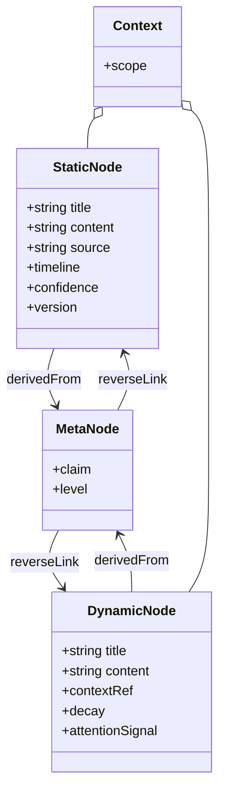
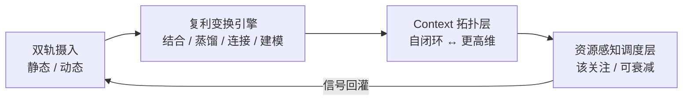

# ZKnowledgeCompounding · 需求蓝图 / PRD

> 状态：v0.2（agreed → calibration round 1）—— 技术调研已完成（4 份 sealed 报告 + Spike 01–05 全 passed），原 v0.1「范围/度量/术语/MVP 栈待回填」项已在本轮校准回填，本文档与架构文档 v0.9 对齐。
> 目的：把立项需求固化为「做什么 / 不做什么 / 怎么算成」，作为后续架构设计与 MVP 的锚。
> 来源：用户立项需求口述（2026-10-28）+ 历史实践 gap 分析 + 2026-10-29 技术调研与 Spike 结论回填。

---

## 1. Know Why（动机与问题）

- 你是高吞吐的信息消费者与生产者：阅读 / 思考 / 分享 + 多主题兴趣 → 囤积大量**静态事实型**信息（时间线客观、此刻可信、可演进、长生命周期）。
- 你躬身入局大量项目、高频协作 → 产生大量**动态存活型**信息（近期注意力驱动、此刻有用、快速腐化、短生命周期）。
- 痛点：现有工具（OneNote → Obsidian + llm-wiki → llm-wiki / v2 / gbrain / OKF）各自只优化单一维度，无法一站式完成「动静双轨 + 复利变换 + 稀缺资源调度」。
- 目标：把它变成**知识复利工具**——让有限的时间精力（长期）与注意力（短期）产生复利，而非「数字仓鼠」。

### 历史实践 gap 分析

| 工具 | 强项 | 对复利而言的缺位 |
|---|---|---|
| OneNote | 捕获、树状组织 | 无结构化变换、无自动连接、偏静态、元认知靠手 |
| Obsidian + llm-wiki | 双向链接 + AI 辅助 | 偏静态笔记；动态存活信息无生命周期 / 衰减处理；蒸馏靠手动 |
| llm-wiki / v2 / gbrain / OKF | 各打一个点（wiki 生成 / 图谱 / 知识库） | 缺「动静双轨 + 复利变换 + 资源调度」的统一层 |

结论：它们各自优化**单一维度**（捕获 / 静态链接 / 自动生成），没有把「双类型 + 生命周期 + 复利变换 + 稀缺调度」作为第一性对象。

---

## 2. 问题模型（第一性原理）

### 2.0 术语护栏（防混用，zj 校准中强调）

- **双轨（dual-track）** = 信息类型 + 生命周期分类（静态 / 动态），核心语义是**衰减率与注意力成本**。
- **双时态（bitemporal）** = 时态数据建模机制（valid time + transaction time），核心语义是**事实演进与溯源审计**。
- 二者**不等价**：双时态只覆盖"静态轨的事实可更新/溯源"，**不覆盖动态轨的腐化与注意力稀缺**。文档中禁止互换；引入双时态 ≠ 解决双轨问题。

### 2.1 两类异构信息（一等公民）

| 维度 | 静态（事实型） | 动态（存活型） |
|---|---|---|
| 来源 | 阅读 / 思考 / 分享沉淀 | 项目参与 / 协作 / 近期关注 |
| 可信度 | 此刻可信、可更新 | 此刻有用、易腐化 |
| 生命周期 | 长 | 短 |
| 核心操作 | 沉淀 / 检索 / 演进 | 捕获 / 绑定当下 context / 防丢失 |

### 2.2 复利变换引擎（价值发生地）

原始捕获 → 经算子产生复利：
- **结合**：动静深度结合 → 系统性建模 / 方法论化
- **蒸馏**：去繁 → 一部分 enrich 元认知层；一部分按 topic 组织 + 基于元认知**反向连接**
- **拓扑装配**：自闭环 context ↔ 共享更高维 context

### 2.3 稀缺资源约束（系统级硬约束）

- 长期时间精力有限 → 降低复利成本
- 短期注意力有限 → 决定「此刻什么值得进入注意力」，而非平等推送
- **（calibration 回填 · Spike 01 已定）注意力是硬预算**：有效复审节奏 = `SURFACE_THRESHOLD × review_interval`（阈值 `SURFACE=0.6` 进入注意力、`ROT=0.9` 已腐化，行动窗口 = 两者间隔）；注意力需求 = `动态条目数 / (0.6 × interval)`。**预算低于需求时腐化无解（rot=100%）**，上线前必须反推校验。详见架构 §6.3。

---

## 3. Do What（目标与非目标）

### 目标（MVP 要证明的）
1. **原生双轨建模**：静态节点与动态节点各自带生命周期元数据，可分别捕获与演进。
2. **可运行的蒸馏路径**：动态 / 静态条目 → 提炼到元认知层 + 按 topic 组织 + 反向连接。
3. **资源感知调度**：基于生命周期 / 衰减给出「该关注 / 可安全衰减」信号。
4. **复利可观测**：有基础度量说明「复利正在发生」。

### 非目标（MVP 不做）
- 全自动 AI 蒸馏 / 连接（先半自动，人仍是回路）
- 复杂图谱可视化、跨设备同步、多人协同、权限体系
- 替代 OneNote / Obsidian 的全部能力

---

## 4. 核心概念与数据模型（草案 → calibration v0.2）

> 本节是**问题空间**模型（双轨语义与生命周期），存储层落地见架构文档 §5 的 SQL schema。两者是同一模型的两个视图，不矛盾：概念上动静双轨分离，存储上收敛为单表 `node` + `track` 枚举（可替换 seam）。

节点类型（第一性对象）：

- `StaticNode`：title, content, source, timeline, confidence, version(可演进), tags —— 存储映射 `node(track='static')`
- `DynamicNode`：title, content, contextRef(绑定的当下 context), **decay_score**(0..1 越大越腐化), review_interval, last_reviewed_at, attentionSignal —— 存储映射 `node(track='dynamic')`
- `MetaNode`（元认知层）：statement, level(元/方法/事实), confidence, **evidence_refs NOT NULL**（溯源强制：无来源的 claim 在存储层被拒）
- `Context`：scope(self-loop | higher-dim), member_nodes[]
- Edge：`derivedFrom`（蒸馏溯源）、`reverseLink`（基于元认知的反向连接）、`produced_by`（变换实例 id，用于级联撤销）

**双时态（calibration 新增，仅服务静态轨事实演进与溯源）**：`valid_from/valid_to` + `tx_from/tx_to`。注意：**双时态 ≠ 双轨**——只覆盖"静态事实可更新/溯源"，不覆盖动态轨的腐化与注意力稀缺（见 §2.0）。

> 权威 schema（含 DDL、阈值、双时态列、decay 列、向量列）见 `docs/architecture/ZKC-architecture-v0.1.md` §5。

> **校准注记**：上图为概念视图，未展开双时态列、decay 列、向量列与 `produced_by` 边——这些是存储层（架构 §5）才需要的字段，概念层刻意省略以保持双轨语义清晰。

---

## 5. 系统架构（草案 → 与架构文档对齐）

> 下图是**概念四层**（摄入 / 变换 / 拓扑 / 调度，信号回灌成闭环）。含组件选型的**详细架构图与数据流向**见 `docs/architecture/ZKC-architecture-v0.1.md` §4（摄入→存储→变换→调度→LLM 运行时五段）。

- **双轨摄入**：两条独立入口，互不拖慢；动态轨自带生命周期与衰减信号。
- **复利变换引擎**：结合 / 蒸馏 / 连接 / 建模四类算子，人可干预（半自动）。
- **Context 拓扑层**：表达「自闭环」与「共享更高维」两种装配方式。
- **资源感知调度层**：依据生命周期 / 衰减 / 注意力信号，决定此刻推送什么、什么可安全衰减。

---

## 6. 关键用户流（MVP）

- **流 A · 捕获动态存活信息**：记一条项目笔记 → 系统标记衰减窗口 → 到点提醒蒸馏。
- **流 B · 蒸馏**：条目 → 提炼元认知 claim + 关联 topic + 反向连接已有节点（溯源可查）。
- **流 C · 调度**：每日 / 每周给出「该关注 / 可衰减」清单，保护短期注意力。

---

## 7. 成功度量（calibration v0.2 校准）

| 指标 | 定义 | 当前口径状态 |
|---|---|---|
| **连接密度** | 动态节点被反向连接的比例 | 口径待定（T6.2/T7.1） |
| **复用率** | 元认知 claim 被后续条目引用的次数 | 口径待定（需引用埋点，T6.2） |
| **方法论产出** | 由动静结合产生的建模 / 方法论条目数 | 口径待定（T3.2 产物计数） |
| **衰减可控** | 到期动态节点被处理（蒸馏或归档）而非静默丢失的比例 | **已校准**：结合 Spike 01 衰减模型，定义 = 到期节点在 `ROT_THRESHOLD=0.9` 前被处理的占比；且须先满足注意力预算 `n/(0.6×interval)` 否则该指标恒为 0（腐化无解） |

- **⚠️ 质量口径缺口（calibration 标注）**：Spike 04/05 显示本地 1.5B 模型蒸馏 / 结合产物为"复述/摘要堆砌"，**非元认知**。故"成功"不仅看管线是否跑通，还看产物语义质量——该质量口径需强模型（≥7B）复测后定义（见架构 §8 / 剩余 spike）。

---

## 8. 风险与 Trade-off

- **半自动 vs 全自动**：MVP 选半自动，避免 AI 蒸馏质量不可控 + 人脱离回路。
- **动静耦合度**：过度耦合会拖累捕获速度；MVP 让两者独立摄入、变换层才结合。
- **调度信号噪声**：错误推送比不推送更伤注意力；MVP 信号从保守起步，宁少勿错。
- **（calibration 回填 · Spike 04/05）本地小模型蒸馏/结合质量不足**：1.5B 产物为复述/摘要堆砌，非元认知。缓解：provider seam 保留，元认知步骤切强模型（≥7B）；强模型下的语义质量口径待复测定义。
- **（calibration 回填 · Spike 02/03）分流单向偏差污染生命周期**：错判一律沉入动态轨 → 参与 decay → 消耗注意力。缓解：DecisionRouter 主方案（编码器无关、F1/F2 完美、覆盖 100%）+ 双信号弃权 + 人工兜底 + 记录 `routing_confidence` + 周期性重分类。
- **（calibration 回填 · Spike 01）注意力预算是硬约束**：预算 < 需求时腐化无解（rot=100%）。缓解：上线前按 `动态条目数/(0.6×interval)` 反推校验，不足则调大 interval 或减动态条目。

---

## 9. 下一步

- [x] **PRD v0.1 已认可（2026-10-28）**：核心问题模型、数据模型、架构方向、MVP 目标/非目标、成功度量框架达成对齐。
- [x] **技术调研 + Spike 01–05（2026-10-29 完成）**：4 份 sealed 报告 + 5 个 spike 全 passed，MVP 技术栈与核心选型已落定（Postgres+pgvector / Ollama / Instructor / LangGraph / 自研 decay+蒸馏语义+结合算子+注意力调度）。详见架构文档 §6。
- [x] **PRD↔架构校准 round 1（2026-10-29）**：回填范围/度量/术语/MVP 栈，锚定「双轨≠双时态」术语护栏，数据模型对齐架构 §5 schema，风险与未决同步。本文档升 v0.2，与架构 v0.9 对齐。
- [ ] **剩余 spike（见架构 §9/§10）**：① 强模型（≥7B）蒸馏/结合质量复测；② `context` 拓扑装配 spike（T4.1/T4.2）；③ 复利度量口径（T7.1）；④ `review_interval` 自动设定；⑤ 到期条目「蒸馏 vs 归档」分流规则；⑥ DecisionRouter 在 7~14B 下的清晰项精度实测 + 混合置信度方案。
- [ ] 选定最小垂直切片（MVP 垂直原型）入手顺序与验收门槛。
- [ ] 进入「架构设计」或「最小垂直切片原型」。

---

_本校准（v0.2）回填了 v0.1 标记为「待技术调研回填」的全部项；所有 decision 均可由 zj 逐项复核后推翻。被推翻处应记为偏差，不得静默接受（见架构文档 §8 同款约定）。_

---

_v0.1 已认可；范围/度量/术语 与 MVP 技术栈暂不敲定，先于技术调研。所有项可由 zj 逐项校准后进入下一阶段。_
