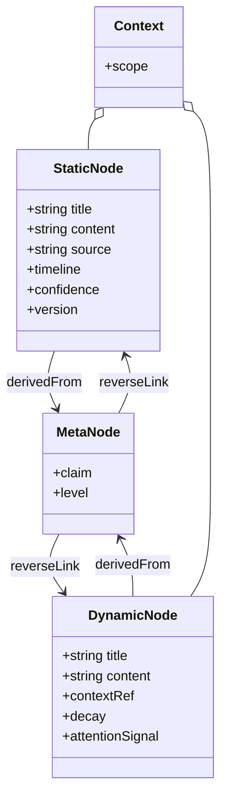
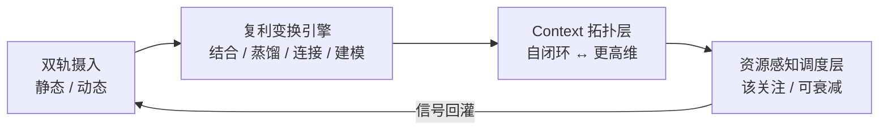

# ZKnowledgeCompounding · 需求蓝图 / PRD

> 状态：v0.1（已认可 · agreed）—— 范围/度量/术语 与 MVP 技术栈暂不敲定，先于技术调研后校准。
> 目的：把立项需求固化为「做什么 / 不做什么 / 怎么算成」，作为后续架构设计与 MVP 的锚。
> 来源：用户立项需求口述（2026-10-28）+ 历史实践 gap 分析。

---

## 1. Know Why（动机与问题）

- 你是高吞吐的信息消费者与生产者：阅读 / 思考 / 分享 + 多主题兴趣 → 囤积大量**静态事实型**信息（时间线客观、此刻可信、可演进、长生命周期）。
- 你躬身入局大量项目、高频协作 → 产生大量**动态存活型**信息（近期注意力驱动、此刻有用、快速腐化、短生命周期）。
- 痛点：现有工具（OneNote → Obsidian + llm-wiki → llm-wiki / v2 / gbrain / OKF）各自只优化单一维度，无法一站式完成「动静双轨 + 复利变换 + 稀缺资源调度」。
- 目标：把它变成**知识复利工具**——让有限的时间精力（长期）与注意力（短期）产生复利，而非「数字仓鼠」。

### 历史实践 gap 分析

| 工具 | 强项 | 对复利而言的缺位 |
|---|---|---|
| OneNote | 捕获、树状组织 | 无结构化变换、无自动连接、偏静态、元认知靠手 |
| Obsidian + llm-wiki | 双向链接 + AI 辅助 | 偏静态笔记；动态存活信息无生命周期 / 衰减处理；蒸馏靠手动 |
| llm-wiki / v2 / gbrain / OKF | 各打一个点（wiki 生成 / 图谱 / 知识库） | 缺「动静双轨 + 复利变换 + 资源调度」的统一层 |

结论：它们各自优化**单一维度**（捕获 / 静态链接 / 自动生成），没有把「双类型 + 生命周期 + 复利变换 + 稀缺调度」作为第一性对象。

---

## 2. 问题模型（第一性原理）

### 2.1 两类异构信息（一等公民）

| 维度 | 静态（事实型） | 动态（存活型） |
|---|---|---|
| 来源 | 阅读 / 思考 / 分享沉淀 | 项目参与 / 协作 / 近期关注 |
| 可信度 | 此刻可信、可更新 | 此刻有用、易腐化 |
| 生命周期 | 长 | 短 |
| 核心操作 | 沉淀 / 检索 / 演进 | 捕获 / 绑定当下 context / 防丢失 |

### 2.2 复利变换引擎（价值发生地）

原始捕获 → 经算子产生复利：
- **结合**：动静深度结合 → 系统性建模 / 方法论化
- **蒸馏**：去繁 → 一部分 enrich 元认知层；一部分按 topic 组织 + 基于元认知**反向连接**
- **拓扑装配**：自闭环 context ↔ 共享更高维 context

### 2.3 稀缺资源约束（系统级硬约束）

- 长期时间精力有限 → 降低复利成本
- 短期注意力有限 → 决定「此刻什么值得进入注意力」，而非平等推送

---

## 3. Do What（目标与非目标）

### 目标（MVP 要证明的）
1. **原生双轨建模**：静态节点与动态节点各自带生命周期元数据，可分别捕获与演进。
2. **可运行的蒸馏路径**：动态 / 静态条目 → 提炼到元认知层 + 按 topic 组织 + 反向连接。
3. **资源感知调度**：基于生命周期 / 衰减给出「该关注 / 可安全衰减」信号。
4. **复利可观测**：有基础度量说明「复利正在发生」。

### 非目标（MVP 不做）
- 全自动 AI 蒸馏 / 连接（先半自动，人仍是回路）
- 复杂图谱可视化、跨设备同步、多人协同、权限体系
- 替代 OneNote / Obsidian 的全部能力

---

## 4. 核心概念与数据模型（草案）

节点类型（第一性对象）：

- `StaticNode`：title, content, source, timeline, confidence, version(可演进), tags
- `DynamicNode`：title, content, contextRef(绑定的当下 context), decay/ expiresAt, attentionSignal
- `MetaNode`（元认知层）：claim, evidenceRefs[], level
- `Context`：scope(self-loop | higher-dim), memberNodes[]
- Edge：`derivedFrom`（蒸馏溯源）、`reverseLink`（基于元认知的反向连接）

---

## 5. 系统架构（草案）

- **双轨摄入**：两条独立入口，互不拖慢；动态轨自带生命周期与衰减信号。
- **复利变换引擎**：结合 / 蒸馏 / 连接 / 建模四类算子，人可干预（半自动）。
- **Context 拓扑层**：表达「自闭环」与「共享更高维」两种装配方式。
- **资源感知调度层**：依据生命周期 / 衰减 / 注意力信号，决定此刻推送什么、什么可安全衰减。

---

## 6. 关键用户流（MVP）

- **流 A · 捕获动态存活信息**：记一条项目笔记 → 系统标记衰减窗口 → 到点提醒蒸馏。
- **流 B · 蒸馏**：条目 → 提炼元认知 claim + 关联 topic + 反向连接已有节点（溯源可查）。
- **流 C · 调度**：每日 / 每周给出「该关注 / 可衰减」清单，保护短期注意力。

---

## 7. 成功度量（待校准）

- **连接密度**：动态节点被反向连接的比例。
- **复用率**：元认知 claim 被后续条目引用的次数。
- **方法论产出**：由动静结合产生的建模 / 方法论条目数。
- **衰减可控**：到期动态节点被处理（蒸馏或归档）而非静默丢失的比例。

---

## 8. 风险与 Trade-off

- **半自动 vs 全自动**：MVP 选半自动，避免 AI 蒸馏质量不可控 + 人脱离回路。
- **动静耦合度**：过度耦合会拖累捕获速度；MVP 让两者独立摄入、变换层才结合。
- **调度信号噪声**：错误推送比不推送更伤注意力；MVP 信号从保守起步，宁少勿错。

---

## 9. 下一步

- [x] **PRD v0.1 已认可（2026-10-28）**：核心问题模型、数据模型、架构方向、MVP 目标/非目标、成功度量框架达成对齐。
- [ ] **技术调研（当前首要动作）**：在敲定范围/度量与 MVP 技术栈之前，先做技术调研，输出候选方案与 trade-off，供后续校准决策。调研重点：
  - 动静双轨存储与生命周期/衰减建模的合适载体（本地优先 vs 服务端）
  - 蒸馏/连接/建模的半自动算子可行性（LLM 编排、人工回路）
  - 是否与 ZAgentic 既有能力（roadmap / agent / ZBrain）复用及边界
  - 参考既有实践（OneNote / Obsidian+llm-wiki / llm-wiki+v2 / gbrain / OKF）的可借鉴点
- [ ] 校准本文档（范围 / 度量 / 术语）—— 待技术调研结论回填
- [ ] 选定 MVP 技术栈与存储 —— 待技术调研结论回填
- [ ] 进入「架构设计」或「最小垂直切片原型」

---

_v0.1 已认可；范围/度量/术语 与 MVP 技术栈暂不敲定，先于技术调研。所有项可由 zj 逐项校准后进入下一阶段。_
