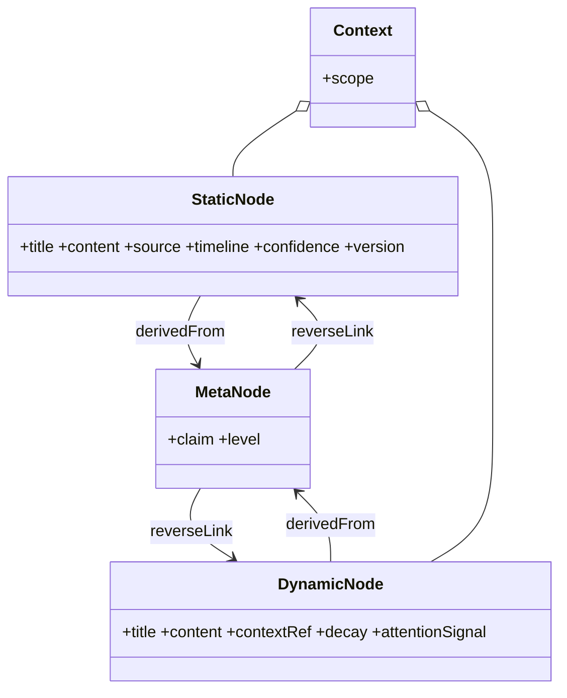

# ZKnowledgeCompounding · 需求蓝图 / PRD

> 状态：v0.2（agreed → calibration round 1）。技术调研已完成（4 份 sealed 报告 + Spike 01–13b 全 passed），v0.1 待回填项已在本轮校准回填，与架构 v1.2 对齐。（A12 修订 2026-10-31：随架构三角审计回填 spike-11/12/13/13b，涉及本文档的 A2/A3/A4/A11/A12 已修订。）
> 目的：把立项需求固化为「做什么 / 不做什么 / 怎么算成」，作为架构设计与 MVP 的锚。
> 来源：用户立项口述（2026-10-28）+ 历史实践 gap 分析 + 2026-10-29 技术调研与 Spike 结论。

---

## 1. Know Why（动机）

- 高吞吐信息消费者/生产者：囤积大量**静态事实型**信息（长生命周期、可演进）与**动态存活型**信息（短生命周期、快速腐化）。
- 痛点：现有工具（OneNote → Obsidian+llm-wiki → llm-wiki/v2/gbrain/OKF）各自只优化单一维度，无法一站式完成「动静双轨 + 复利变换 + 稀缺资源调度」。
- 目标：把它变成**知识复利工具**——让有限的时间精力（长期）与注意力（短期）产生复利，而非「数字仓鼠」。

**历史实践 gap**：各工具只优化单一维度（捕获 / 静态链接 / 自动生成），没有把「双类型 + 生命周期 + 复利变换 + 稀缺调度」作为第一性对象。

---

## 2. 问题模型（第一性原理）

### 2.0 术语护栏
- **双轨（dual-track）** = 信息类型 + 生命周期分类（静态/动态），核心语义是**衰减率与注意力成本**。
- **双时态（bitemporal）** = 时态建模机制（valid + transaction time），核心语义是**事实演进与溯源审计**。
- 二者**不等价**：双时态只覆盖"静态轨事实可更新/溯源"，**不覆盖动态轨腐化与注意力稀缺**。文档禁止互换。

### 2.1 两类异构信息（一等公民）
| 维度 | 静态（事实型） | 动态（存活型） |
|---|---|---|
| 来源 | 阅读/思考/分享沉淀 | 项目参与/协作/近期关注 |
| 可信度 | 此刻可信、可更新 | 此刻有用、易腐化 |
| 生命周期 | 长 | 短 |
| 核心操作 | 沉淀/检索/演进 | 捕获/绑定当下 context/防丢失 |

### 2.2 复利变换引擎（价值发生地）
原始捕获 → 经算子产生复利：
- **结合**：动静深度结合 → 系统性建模/方法论化
- **蒸馏**：去繁 → 一部分 enrich 元认知层；一部分按 topic 组织 + 基于元认知**反向连接**
- **拓扑装配**：自闭环 context ↔ 共享更高维 context

### 2.3 稀缺资源约束（系统级硬约束）
- 长期时间精力有限 → 降低复利成本。
- 短期注意力有限 → 决定「此刻什么值得进入注意力」，而非平等推送。
- **注意力是硬预算**（Spike 01）：有效复审节奏 = `SURFACE_THRESHOLD × review_interval`（SURFACE=0.6 进入注意力、ROT=0.9 已腐化，窗口=两者间隔）；注意力需求 = `动态条目数 / (0.6 × interval)`。**预算低于需求时腐化无解（rot=100%）**，上线前必须反推校验。详见架构 §6.3。

---

## 3. Do What（目标与非目标）

### 目标（MVP 要证明的）
1. **原生双轨建模**：静态/动态节点各自带生命周期元数据，可分别捕获与演进。
2. **可运行蒸馏路径**：动态/静态条目 → 提炼到元认知层 + 按 topic 组织 + 反向连接。
3. **资源感知调度**：基于生命周期/衰减给出「该关注/可安全衰减」信号。
4. **复利可观测**：有基础度量说明「复利正在发生」。
5. **外生锚闭环**（2026-10-29 zj 同意纳入 MVP）：提供**每日复审队列**，作为两个自指闭环唯一的外生锚载体——复审**结果标注**（驱动 `review_interval` 反馈修正）与**每日收口埋点**（驱动 `budget_per_day` 统计估计）。没有它，两个闭环都不携带信息：interval 停基线永不修正，budget 停 warm-up 永不归一化（架构 §6.5/§6.5.1）。

### 非目标（MVP 不做）
- 全自动 AI 蒸馏/连接（先半自动，人仍在回路）
- 复杂图谱可视化、跨设备同步、多人协同、权限体系
- 替代 OneNote/Obsidian 全部能力

---

## 4. 核心概念与数据模型

> 问题空间模型；存储层落地见架构 §5 SQL schema。概念上动静双轨分离，存储收敛为单表 `node` + `track` 枚举（可替换 seam）。

节点类型（第一性对象）：
- `StaticNode`：title, content, source, timeline, confidence, version(可演进) → `node(track='static')`
- `DynamicNode`：title, content, contextRef(当下 context), **decay_score**(0..1), review_interval, last_reviewed_at, attentionSignal → `node(track='dynamic')`
- `MetaNode`（元认知层）：statement, level(元/方法/事实), confidence, **evidence_refs NOT NULL**（溯源强制：无来源 claim 在存储层被拒）
- `Context`：scope(self_loop | higher_dim)，成员关系走 `context_member` junction 表（每行带 `produced_by` + `weight`；`member_nodes[]` 已弃用）
- Edge：`derivedFrom`（蒸馏溯源）、`reverseLink`（基于元认知反向连接）、`produced_by`（变换实例 id，级联撤销）

**双时态**（calibration 新增，仅服务静态轨事实演进与溯源）：`valid_from/valid_to` + `tx_from/tx_to`。**双时态 ≠ 双轨**——只覆盖"静态事实可更新/溯源"，不覆盖动态轨腐化与注意力稀缺（§2.0）。权威 schema 见架构 §5。

---

## 5. 系统架构（概念四层）

- **双轨摄入**：两条独立入口，互不拖慢；动态轨自带生命周期与衰减信号。
- **复利变换引擎**：结合/蒸馏/连接/建模四类算子，人可干预（半自动）。
- **Context 拓扑层**：表达「自闭环」与「共享更高维」两种装配。
- **资源感知调度层**：依据生命周期/衰减/注意力信号，决定此刻推送什么、什么可安全衰减。
- 详细架构图与数据流向见架构 §4（摄入→存储→变换→调度→LLM 运行时五段）。

---

## 6. 关键用户流（MVP）

- **流 A · 捕获动态存活信息**：记一条项目笔记 → 标衰减窗口 → 到点提醒蒸馏。
- **流 B · 蒸馏**：条目 → 提炼元认知 claim + 关联 topic + 反向连接已有节点（溯源可查）。
- **流 C · 每日复审队列（MVP 必选，两外生锚唯一载体）**：
  - 每天一份队列：列 `decay_score ≥ 0.6` 的动态条目（按 decay 降序）。
  - 每条被处理必须带结果标注：`still_valid / changed / stale` → 驱动 L3 interval 反馈修正。
  - 每天收口必须写埋点：`pushed / completed / queue_remaining` → 驱动 `budget_per_day` 统计估计。
  - **验收门槛（缺一即未交付）**：
    1. 每个自然日**恰好 0 或 1 条** `attention_observation`（`day` 唯一）；0 条仅允许"当天无条目进入注意力"。
    2. **未标注复审不得写任何 interval 调整**——宁缺勿错，禁止用 decay 数值冒充标注（恒 0.6 无效信号，架构 §6.5 发现①）。
    3. 连续运行 14 天后 `estimate_budget()` 的 `confidence` 必须离开 `none`；若仍为 `lower_bound` 说明供给未触容量（结构性极限），记为已识别状态而非功能失败。
    4. 至少一次观测到 `confidence='observed'`（饱和日）后 L2 才允许归一化——warm-up 期 L2 保持被动。
    5. **标注完成率 ≥ 70%**（zj 定 2026-10-29）：滚动 7 天 `labeled_completed / completed`；窗口内完成 **< 10 次不判定**（样本不足放行，避免 warm-up 冻结）；**低于 70% → L3 停机**：interval 停基线不改，绝不用无声划过改写节奏。人工显式 verdict 不受限。

---

## 7. 成功度量

| 指标 | 定义 | 口径状态 |
|---|---|---|
| **连接密度** | 动态节点被反向连接比例 | 已定义（Spike 07）：含 `reverse_link`/`derived_from` 边的动态节点占比 |
| **复用率** | 元认知 claim 被后续引用次数 | 已定义（Spike 07+T6.2）：新增 `citation` 表，度量被引用 claim 占比/平均引用强度 |
| **方法论产出** | 动静结合产出的建模/方法论条目数 | 已定义（Spike 07）：`combine` 产出的 `modeling_artifact` 数 |
| **衰减可控** | 到期动态节点被处理（蒸馏/归档）而非静默丢失比例 | 已校准（Spike 01）：到期节点在 `ROT_THRESHOLD=0.9` 前被引用或已归档占比；且须先满足注意力预算否则恒为 0 |
| **复利系数** | 单一可追踪「复利健康度」 | 已定义（Spike 07）+ **设计口径已定（2026-11-06，`source=SIMULATION`）**：四项等权 0.25 归一加权，`method_target=10` 饱和归一；依据与限定见 `docs/evidence/metric-weights-simulation.md`（均匀先验 Bayes 最优 + 受控仿真；真实快照三分量恒 0、权重不可辨识，故数值不改）。**真实行为校准（`CALIBRATED`）仍 open**：需 ≥14d 埋点 + ≥3 饱和日 + zj 对四分量价值的显式外生排序 |

- **⚠️ 质量口径缺口（Spike 10，2026-10-30）**：本地 1.5B 蒸馏/结合产物为"复述/摘要堆砌"非元认知。Spike 10 把该口径变**可自动计算**维度：复述率(LCS)/拼接 overlap(3-gram)/跨源率/引用命中/结构完整度。四臂对照（1.5B → Qwen3.5-4B/9B）结论：**换世代显著降低复述率**（combine 复述率 1.5B 中位 0.649 → 4B 中位 0.10；9B 无多次采样数据不得与 4B 并列），**但跨源综合仍不达标**（4B 跨源 claim 中位 2，仍有 1/3 概率只产 1 条）；**已由 Spike 11 跨源强制算子解决**（4B×3 稳定 3/3）。**强限定**：采样噪声足以翻转单次结果，后续对比须基于多次采样分布。详见架构 §8。
- **MVP 本地模型选型（Spike 10）**：默认 `qwen3.5:4b-mlx`（3.97GB），`qwen3.5:9b-mlx` 仅作可选上限——9B 常驻 10–12GB 触发 swap（单次蒸馏 4.7 分钟），实测 4B 与 9B 质量近乎持平。

---

## 8. 风险与 Trade-off

- **半自动 vs 全自动**：MVP 选半自动，避免 AI 蒸馏质量不可控 + 人脱离回路。
- **动静耦合度**：过度耦合拖累捕获；MVP 独立摄入、变换层才结合。
- **调度信号噪声**：错误推送比不推送更伤注意力；MVP 信号从保守起步。
- **本地小模型质量不足**（Spike 10 已部分解决）：1.5B 产物为复述堆砌；换 Qwen3.5(4B/9B) 复述率显著下降（§7），provider seam 价值被验证。**仍有限定**：跨源综合未达标、单次采样噪声可翻转结论、幻觉/忠实度无法自动判定（需 LLM judge 或人工）。缓解：provider seam 保留，元认知步骤可切更强模型。
- **分流单向偏差污染生命周期**（Spike 02/03）：错判沉入动态轨 → 参与 decay → 消耗注意力。缓解：DecisionRouter（编码器无关、F1/F2 完美、覆盖 100%）+ 双信号弃权 + 人工兜底 + `routing_confidence` + 周期重分类。
- **注意力预算硬约束**（Spike 01/09）：预算<需求时腐化无解（rot=100%）。缓解：上线前按 `动态条目数/(0.6×interval)` 反推校验，不足则调大 interval 或减动态条目。interval 不再人工固定：Spike 09 定三层自动设定（个体基线 × 全局预算因子 × 复审反馈），预算不足时系统报告 `infeasible` 与可承载动态条目上限，而非静默拉长 interval（架构 §6.5）。
- **外生锚依赖产品界面**（2026-10-29 zj 同意）：两个闭环（interval 反馈修正 / budget 统计估计）都不自带信息，必须靠「每日复审队列」人为输入供给外生锚。缺此界面则 interval 永久停基线、budget 永久停 warm-up——这是**范围决策带来的功能性风险**，非实现瑕疵；故该界面列为 MVP 目标 5 与流 C。

---

## 9. 下一步

- [x] **PRD v0.1 认可（2026-10-28）**：核心问题模型、数据模型、架构方向、MVP 目标/非目标、成功度量框架对齐。
- [x] **技术调研 + Spike 01–13b（2026-10-30）**：4 份 sealed 报告 + 13 spike 全 passed，MVP 技术栈落定（Postgres+pgvector / Ollama 原生 `/api/chat` + provider seam（**不引 Instructor/LangGraph**，手写 JSON 校验重试）/ 自研 decay+蒸馏语义+结合算子+注意力调度）。各 spike 验证与回填：
  - Spike 06 context 拓扑装配（10 tests）→ §5 D1/D2
  - Spike 07 复利度量口径+引用埋点（9 tests）→ §5 D3/D4、§7
  - Spike 08 到期分流规则（9 tests）→ §5 D5 `review_queue`
  - Spike 09 `review_interval` 自动设定（44 tests）→ §5 D6–D8、架构 §6.5/§6.5.1；三层：L1 个体基线（self_loop 压过已捕获）/ L2 全局预算归一 / L3 复审反馈 AIMD（×1.5/×0.7）；**decay-only 反馈恒 no-op**（必须带标注），收敛目标 `H/0.6` 非真值 H
  - Spike 10 强模型质量复测+质量口径（8 tests）→ §7
  - Spike 11 跨源强制算子（9 tests + 真实采样）→ 4B 跨源 3/3 稳定
  - Spike 12/13/13b 幻觉判定闸门（14 tests）→ 分解式 LLM-as-judge 可行，但本机 4B/9B 不可用；MVP 定 human-in-the-loop + 字面 rubric 预过滤，`judge.py` 零改动可启用
- [x] **PRD↔架构校准 round 1（2026-10-29）**：回填范围/度量/术语/MVP 栈，锚定「双轨≠双时态」护栏，数据模型对齐架构 §5，升 v0.2 与架构 v1.2 对齐。
- [x] **每日复审队列 UI（MVP 必选，已交付 2026-11-02）**：`decay ≥ 0.6` 清单 + 结果标注（`still_valid`/`changed`/`stale`）+ 每日收口埋点（`pushed`/`completed`/`queue_remaining`）。实现：`src/zkc/web/review.py` + `src/zkc/task_queue.py` + `web/taskqueue.py` + 迁移 0009/0010（tests/test_task_queue.py 5 条）。
- [x] **下版本优先级与 MCP 集成决策（zj-grill-with-docs 收敛，2026-11-03 zj 拍板）**：决策与证据口径以 `docs/zj-adr/0004-mcp-interface-contract.md`（MCP 接口契约边界）、`docs/zj-adr/0005-rec-avoid-mechanical-gate.md`（rec-avoid 机械闸）与 `docs/rec-avoid-gate.md` 为准；过程编排稿不作为长期引用来源（权威边界见 ADR-0008）。核心：
  - **P0 = 跑通已交付复审队列背后的校准闭环**（budget/L3 阈值），DoD = 连续 ≥7 活跃日 + 滚动标注率闸门 ≥70% + budget 估计收敛稳定；此乃捕获摩擦降低/复利面板/MCP 三者共同隐藏前置。
  - **护城河实证化列 P0 验收**：把「复利可观测+蒸馏质量」从设计论点转经验证据，绑两外生锚——锚1 标注率闸门持续 ≥70%（仍由 1-17 跟踪，未达成）；锚2 **zj 人工抽检**蒸馏产物记录漏检/误蒸馏率、给本机 4B/9B 上界估计（**已于 2026-11-06 完成**：合成短语料 9 gold / 17 claim 样本两率 0%，zj 结论暂不需更强模型、蒸馏环节暂不全量 HITL；证据弱、待真实文档复测，不替代 spike 12/13 忠实度闸门 HITL 定案）。任何新功能不得降低衰减+预算可观测性（rec-avoid「经验证伪闸」）。
  - **rec-avoid 机械闸**：去模型化测试 + `check_invariant.py` + 图库主存储 EXCLUDED（ADR-0005 / `docs/rec-avoid-gate.md`）。
  - **MCP 进版本绑「接口契约边界 ADR 存在」**（ADR-0004）：单边 server + transport seam + stdio 默认 + 暴露面白黑名单；`zkc_capture` 须过 DecisionRouter 分流闸（agent 输入文档场景固化于此）。
  - **对外叙事口径统一（E9）**：`caveat: moat-unverified-vs-mem0` + **4 项特征**（双轨 / 衰减 / 双时态 / 注意力预算），任何唯一性表述须带限定，不得回退 3 项口径；活文档（架构 §3、constraints §8.1、rec-avoid-gate）已同步。
  - **证据缺口（6 项 unknown，非证伪）**：governance×4（ZKC / khoj / logseq / SilverBullet 的 LICENSE 未采）+ letta×2（`architecture_storage` / `compounding`，main 为落地页仅 archive 有实现）+ mem0 对照整体排除（编译器 submodule 限制，残余风险「中」）。分层决策：(a) 现在可定——双轨+衰减+注意力为第一性、rec-avoid 守门；(b) 等补 governance 后声明跨项目许可兼容；(c) 永久 unknown——letta 现役实现、mem0 对照。只延迟对外定位叙事、不阻塞任何工程排期；任何「唯一性」表述带 `caveat: moat-unverified-vs-mem0`。

---

_本校准（v0.2）回填了 v0.1 标记「待技术调研回填」的全部项；所有 decision 均可由 zj 逐项复核后推翻。被推翻处应记为偏差，不得静默接受（架构 §8 同款约定）。_

---

_v0.1 已认可；范围/度量/术语 与 MVP 技术栈暂不敲定，先于技术调研。所有项可由 zj 逐项校准后进入下一阶段。_
