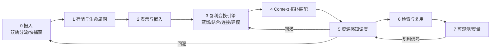

# ZKnowledgeCompounding · 技术调研 Topic 分解（e2e）

> 状态：草案 v0.1（调研未启动）
> 目的：从端到端闭环拆出技术调研 topic，作为调研计划与追踪基线。
> 上游：PRD v0.1（已认可）。本文件是 PRD 第 9 节「技术调研」的展开。

---

## 0. e2e 闭环模型

整条链路**不是线性管道**，而是闭环：调度信号回灌摄入与变换，使「捕获 → 复利 → 复用」自我强化。

---

## 1. 调研 Topic 总览

| # | Stage | Topic | 优先级 | 状态 |
|---|---|---|---|---|
| T0.1 | 0 摄入 | 双轨分流判定（静态/动态） | P1 | 待调研 |
| T0.2 | 0 摄入 | 低摩擦快捕获 UX + 离线可用 | P1 | 待调研 |
| T0.3 | 0 摄入 | 多模态/富文本入口 | P2 | 待调研 |
| T1.1 | 1 存储 | 数据模型载体（图/文档+图/本地/服务端） | **P0** | 待调研 |
| T1.2 | 1 存储 | 生命周期与衰减建模 | **P0** | 待调研 |
| T1.3 | 1 存储 | 本地优先 vs 服务端 | **P0** | 待调研 |
| T2.1 | 2 表示 | 语义表示（embedding 本地/云端） | P1 | 待调研 |
| T2.2 | 2 表示 | topic 组织（LLM/预定义/混合） | P2 | 待调研 |
| T2.3 | 2 表示 | 元认知 claim 结构 | P1 | 待调研 |
| T3.1 | 3 变换 | 半自动蒸馏算子 + human-in-loop | **P0** | 待调研 |
| T3.2 | 3 变换 | 结合/建模算子（prompt/多步 agent） | P1 | 待调研 |
| T3.3 | 3 变换 | LLM 编排与本地化 | **P0** | 待调研 |
| T4.1 | 4 拓扑 | 自闭环 vs 更高维 context 自动发现 | P2 | 待调研 |
| T4.2 | 4 拓扑 | context membership 维护 | P2 | 待调研 |
| T5.1 | 5 调度 | 注意力信号模型 | P1 | 待调研 |
| T5.2 | 5 调度 | 回顾/推送机制（spaced repetition） | P1 | 待调研 |
| T6.1 | 6 复用 | 复利产出检索与浏览 | P2 | 待调研 |
| T6.2 | 6 复用 | 复用率度量支撑（引用埋点） | P2 | 待调研 |
| T7.1 | 7 度量 | 复利度量基础设施 | P1 | 待调研 |
| X.1 | 横切 | 隐私与安全（本地加密/模型本地化） | P1 | 待调研 |
| X.2 | 横切 | 与 ZAgentic 复用边界（WorkBuddy/ZBrain/ZAgenticLoop） | P1 | 待调研 |
| X.3 | 横切 | 既有工具可取点（OneNote/Obsidian/llm-wiki/gbrain/OKF） | P2 | 待调研 |

---

## 2. 逐 Topic 详述

### Stage 0 · 摄入 (Capture)
- **T0.1 双轨分流判定**
  - 目标：确定一条输入如何判定静态/动态，且错判代价可控。
  - 关键问题：显式标注 / 启发式 / 用户即时二选一，哪种在「低摩擦」与「正确率」间最优？
  - 候选：捕获时强制二选一 toggle（最低歧义）；时间敏感关键词启发式；LLM 轻量分类（本地小模型）。
- **T0.2 低摩擦快捕获 + 离线可用**
  - 目标：动态信息「此刻有用易腐化」，摄入必须极快且离线可写。
  - 候选：全局快捷键/剪藏扩展、本地优先写入队列、后台同步。
- **T0.3 多模态/富文本入口**
  - 目标：覆盖纯文本、网页/论文链接、图片、语音、API 导入。
  - 候选：浏览器剪藏、语音转写（本地 Whisper）、链接自动抓取摘要。

### Stage 1 · 存储与生命周期建模
- **T1.1 数据模型载体**【P0】
  - 目标：支撑「两类异构节点 + 元认知层 + context 拓扑 + 反向连接边 + 生命周期/衰减信号」。
  - 候选：
    - 图库：Neo4j / Neptune（原生图，但本地化与轻量性弱）；
    - 文档+图混合：Postgres + `jsonb` + `pgvector`（关系+向量一体，部署重）；
    - 本地优先嵌入式：SQLite + `sqlite-vec` / DuckDB（单文件、零运维、可加向量）；
    - 多模型：ArangoDB（文档+图）。
  - 决策 gate：本选型决定 T2/T3/T4 的实现形态。
- **T1.2 生命周期与衰减建模**【P0】
  - 目标：动态节点 `decay / expiresAt / attentionSignal` 如何表达与随时间演化；静态节点 `version / confidence` 如何演进。
  - 候选：显式 decay 函数（指数/阶梯）、事件溯源记录演进、注意力信号作为可计算字段。
- **T1.3 本地优先 vs 服务端**【P0】
  - 目标：在隐私（个人知识）、离线、同步成本、跨端间权衡。
  - 候选：纯本地（SQLite/单文件）；本地优先 + CRDT 同步（Automerge/Yjs/ElectricSQL）；服务端为中心（Postgres + API）。

### Stage 2 · 表示与嵌入
- **T2.1 语义表示（embedding）**
  - 目标：判断是否用 embedding 支撑相似/反向连接；本地 vs 云端。
  - 候选：本地 embedding（bge-small / nomic 等 via Ollama/MLX）；云端（OpenAI/GLM embeddings）；不依赖向量、纯 LLM 判定连接。
- **T2.2 topic 组织**
  - 目标：节点按 topic 组织的方式与成本。
  - 候选：LLM 抽取 topic 标签；预定义 taxonomy 树；embedding 聚类。
- **T2.3 元认知 claim 结构**
  - 目标：元认知层 claim 的结构化表达，便于溯源与复用。
  - 候选：命题式（subject-predicate-object / 自由文本+置信）；带 `evidenceRefs[]`；带 `level`（元/方法/事实）。

### Stage 3 · 复利变换引擎（最关键技术风险）
- **T3.1 半自动蒸馏算子 + human-in-loop**【P0】
  - 目标：LLM 把条目提炼为元认知 claim + topic + 反向连接，且人审核回路可行、质量可控。
  - 关键问题：蒸馏是单步 prompt 还是多步 agent？审核粒度（逐条/批量）？质量如何评估？
  - 候选：LLM 生成 draft → 人确认/修正；多步 agent（抽取→归纳→连接）；蒸馏质量 rubric（准确度/覆盖/可复用）。
- **T3.2 结合/建模算子**
  - 目标：动静深度结合成方法论/系统建模。
  - 候选：prompt 工程（给定相关节点让 LLM 归纳）；多步 agent（检索→综合→建模）；模板化方法论骨架。
- **T3.3 LLM 编排与本地化**【P0】
  - 目标：在成本/隐私/延迟间选 LLM 策略，并决定是否复用 ZAgentic。
  - 候选：本地模型（Ollama/llama.cpp/MLX，隐私高、能力弱）；云端 API（能力强、有成本/隐私顾虑）；编排框架（LangGraph/自研）；复用 ZAgentic agent 能力。

### Stage 4 · Context 拓扑装配
- **T4.1 自闭环 vs 更高维 context 自动发现**
  - 目标：判断哪些节点应聚成更高维 context，而非各自自闭环。
  - 候选：embedding 聚类 + LLM 命名；用户显式建 context；时间/项目邻近启发式。
- **T4.2 context membership 维护**
  - 目标：context 与节点关系的维护成本与一致性。
  - 候选：显式 membership 表；动态视图（查询时计算）；软归属（带权重）。

### Stage 5 · 资源感知调度
- **T5.1 注意力信号模型**
  - 目标：量化「此刻值得关注」（decay 临近 / 未蒸馏堆积 / 关联突增）。
  - 候选：加权信号函数；规则引擎；LLM 评分。
- **T5.2 回顾/推送机制**
  - 目标：保护短期注意力，宁少勿错。
  - 候选：每日/每周清单；spaced repetition（Anki 算法变体）；保守阈值 + 用户调节。

### Stage 6 · 检索与复用
- **T6.1 复利产出检索与浏览**
  - 目标：用户如何检索/浏览复利产出。
  - 候选：语义检索；反向连接图浏览；context 视图；时间线视图。
- **T6.2 复用率度量支撑**
  - 目标：claim 被后续条目引用的次数埋点，支撑复用率指标。

### Stage 7 · 可观测/度量
- **T7.1 复利度量基础设施**
  - 目标：实现连接密度、复用率、方法论产出、衰减可控率的计算与埋点。
  - 候选：事件日志 + 离线聚合；图查询统计；dashboard。

### 横切 (Cross-cutting)
- **X.1 隐私与安全**
  - 目标：个人知识库的本地加密、模型本地化、导出可携带。
  - 候选：本地加密存储（SQLCipher）；模型全本地化；明文导出备份。
- **X.2 与 ZAgentic 复用边界**
  - 目标：明确是否复用 WorkBuddy / ZBrain / ZAgenticLoop 的能力及边界，避免重复造轮子。
  - 候选：复用 ZAgentic 的 agent 编排与 roadmap；ZBrain 作为 LLM/embedding 后端；本项目专注双轨模型与变换引擎。
- **X.3 既有工具可取点**
  - 目标：从 OneNote/Obsidian+llm-wiki/llm-wiki+v2/gbrain/OKF 提炼可借鉴技术点。
  - 候选：OneNote（低摩擦捕获/树）；Obsidian（双链/本地优先）；llm-wiki（自动 wiki 生成）；gbrain（知识图谱）；OKF（结构化知识框架）。

---

## 3. 建议调研顺序（先打最难回退的决策）

1. **T1.1 / T1.2 / T1.3**（存储与生命周期载体 + 本地优先）— gate 一切数据模型与架构。
2. **T3.3 / T3.1**（LLM 编排与本地化 + 半自动蒸馏）— gate 变换引擎的成本、隐私与可行性。
3. **T0.1**（双轨分流判定）— gate 双轨正确性。
4. 其余（T2 / T4 / T5 / T6 / T7 / X）在以上结论上更可解。

---

## 4. 更新日志

- 2026-10-28：从 PRD 第 9 节「技术调研」展开，初版拆出 22 个 topic（含横切），标注优先级与 e2e 闭环模型。
