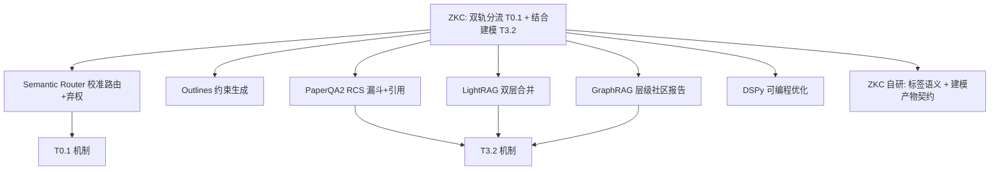
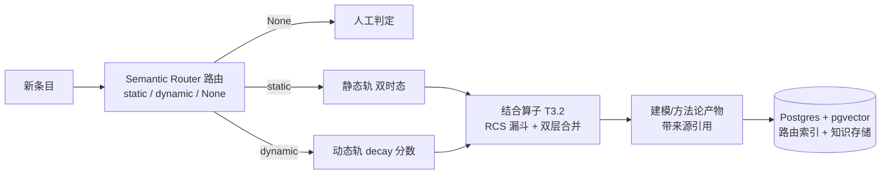

# 调研主题
ZKnowledgeCompounding P0 深挖：双轨分流判定（T0.1）与结合/建模算子（T3.2）

评估 6 个候选：Semantic Router、Outlines、GraphRAG、LightRAG、PaperQA2、DSPy。结论：T0.1 采用 Semantic Router 的校准语义路由并强制启用弃权（不确定转人工），标签语义由 ZKC 自定；T3.2 把结合算子实现为显式程序，复用 PaperQA2 的 RCS 漏斗（上下文摘要+重排+来源上限+引用）、LightRAG 的双层合并、GraphRAG 的层级汇总思路（仅借鉴模式，因其处于维护模式）。没有任何候选实现 ZKC 的双轨语义或建模产物，机制之外仍需自建。Semantic Router 与 LightRAG 均支持 PostgreSQL，与已定 substrate 收敛。

## 输入材料与观察时间
Evidence ledger: `855be48f3ac5fdb11e4d7ee30044a38c5e566de321e9c63f26e1fb78fced7474`
Observed: 2026-10-28T16:55:13.782Z

## Key-Value 概念索引
- Key: `decision-frame` — Choose the mechanisms for ZKC's dual-track classification (T0.1) and combination/modeling operator (T3.2), knowing both semantics are ZKC-owned and no candidate supplies them.
- Key: `fit-model` — Coverage scored native / adapted / absent / unknown per topic; an unobserved capability is reported as unknown, never as absent. Sealed-ledger unknowns are footnoted rather than silently resolved.
- Key: `ownership-model` — Candidates supply mechanisms only. ZKC owns the dual-track label definitions, the abstention policy, and the modeling-artifact contract (structure plus source citations).
- Key: `lifecycle-stage` — problem-discovery / selection phase for the ZKC transform layer; findings are point-in-time and pre-MVP.

Concepts: [[decision-frame]], [[fit-model]], [[ownership-model]], [[lifecycle-stage]]

## C4 System Landscape
### T0.1 / T3.2 landscape: ZKC semantics -> candidate mechanisms -> borrowed patterns

## 候选项目表
| Repository | Stars | Topic match |
|---|---:|---:|
| stanfordnlp/dspy | 38833 | 0 |
| microsoft/graphrag | 36474 | 3 |
| HKUDS/LightRAG | 40391 | 3 |
| Future-House/paper-qa | 9490 | 0 |
| aurelio-labs/semantic-router | 3982 | 3 |
| dottxt-ai/outlines | 15989 | 5 |

## 深读项目卡片
### Semantic Router — calibrated semantic routing with abstention
Routes a request by semantic similarity to declared Routes, and can be calibrated with fit() so a confidence_threshold becomes a real probability and the router can return None (abstain) instead of guessing. Runs fully locally with FastEmbed, supports PostgreSQL production indexes, plus Chain (fast→slow fallthrough) and Merge. The strongest mechanism for ZKC's dual-track decision.

- Claim `C1`
- Claim `C2`

### Outlines — constrained generation
Guarantees structured output during generation by taking an output type (Literal, Pydantic/JSON, regex, grammar) rather than parsing afterwards, across OpenAI / Ollama / vLLM / transformers / llama.cpp. Useful as the deterministic constrained-classification alternative to validate-after-generate approaches.

- Claim `C3`
- Claim `C4`

### GraphRAG — hierarchical community summaries
Extracts entities, relationships and claims, runs hierarchical Leiden community detection, and generates community reports that merge many low-level sources into higher-level summaries with stable ids. Closest existing pattern to ZKC's 'combine many contexts into a higher-dimensional one' — but it is a research project in maintenance mode, so borrow the pattern, not the dependency.

- Claim `C5`
- Claim `C6`

### LightRAG — dual-layer graph + vector with bounded merge summarisation
Dual-layer KG plus vector design: extraction LLM pulls entities/relations, LLM-written descriptions are merged under bounded source limits, and querying offers local (entity detail), global (relation chains), hybrid and default 'mix' (local+global+naive) modes. Local/air-gapped friendly with PostgreSQL as a recommended production backend.

- Claim `C7`
- Claim `C8`

### PaperQA2 — evidence-grounded multi-source synthesis
Documented synthesis funnel: retrieve top-k, write a query-conditioned contextual summary per passage, re-score and filter, cap sources entering the prompt, and emit one answer with in-text citations. The closest pattern to ZKC's 'combine into a model while keeping provenance', and it echoes the Grounded-Claims finding from the coverage report.

- Claim `C9`
- Claim `C10`

### DSPy — programming, not prompting
Compose modular AI systems in Python and optimise their prompts and weights instead of hand-tuning prompts; docs cover embeddings, a local interpreter and caching. Useful as the programming model for ZKC's own classification and combination operators rather than as an off-the-shelf feature.

- Claim `C11`

## 方案族及适用场景对比
### comp-t01-mechanism
T0.1 分流机制有三条可选路线：**Semantic Router**（向量空间语义路由 + fit() 校准 + 阈值 + **弃权返回 None**，可完全本地 FastEmbed 运行，生产索引可用 PostgreSQL）、**Outlines**（生成期用 Literal/grammar 约束，保证输出合法，跨 Ollama/vLLM/transformers）、**DSPy**（类型化 classifier 模块 + 优化器，可随标注数据自我改进）。ZKC 需要的是「静态/动态/不确定」三路判定，因此**首选 Semantic Router**：它的校准阈值 + 弃权能力正好对应「判不准就不要猜」这一要求。Outlines 可作为「生成期约束」的补充（与 Instructor 的「生成后校验重试」互补）。

Claims: `C1`, `C2`, `C3`, `C4`, `C11`

### comp-t01-abstention
T0.1 最关键的设计不是分类准确率，而是**弃权能力**。此前的调研已确认：错判会污染生命周期（把动态信息当静态会让它长期滞留，反之会让它过早腐化）。Semantic Router 的 fit() 把分数校准为真实概率，并允许返回 None（即「这些路由都不匹配」），从而把不确定的条目转交人工或更慢的模型（Chain 的快速→慢速回退）。这是 ZKC 双轨分流**必须**具备的安全属性，而 Outlines/DSPy 本身不提供。

Claims: `C1`, `C2`

### comp-t32-combine
T3.2 结合/建模算子的三种可借鉴模式：**GraphRAG** 的层级社区报告（把实体/关系/claim/文本单元合并成更高层摘要，带 stable id）——最接近 ZKC「多个自闭环 context → 更高维共享 context」，但项目处于维护模式，**只借鉴模式不引入依赖**；**LightRAG** 的双层合并（local 实体细节 + global 关系链，mix 模式三者合一）——更轻量、可增量、本地友好；**PaperQA2** 的 RCS（query 条件下的上下文摘要 + LLM 重排 + top-N 来源漏斗）——提供「去繁 + 有界综合」的具体漏斗参数。三者互补，都只是机制。

Claims: `C5`, `C6`, `C7`, `C9`

### comp-t32-provenance
T3.2 必须带溯源：PaperQA2 的 in-text citations 与「先摘要后综合」的漏斗，和上一份覆盖调研中 OpenWiki 的 Grounded Claims 是同一思路——**综合产物必须能回溯到来源条目**。ZKC 的结合算子产出（建模/方法论）应同样携带来源引用，否则无法被复用和检验，也就无法形成复利。

Claims: `C9`, `C10`

### comp-substrate-convergence
Substrate 收敛信号：Semantic Router 提供 **PostgreSQL 生产索引**，LightRAG 把 **PostgreSQL 作为生产推荐后端**（单后端即可服务 KV/向量/图/文档状态四类存储）。两个独立候选都收敛到 Postgres，与已定的 Postgres+pgvector substrate 形成强协同——T0.1 路由索引与 T3.2 知识存储可以落在同一个 Postgres 实例，无需引入额外数据库。

Claims: `C2`, `C8`

### comp-semantics-gap
语义缺口确认：没有任何候选实现 ZKC 自己的语义——没有静态/动态双轨分类，也没有产出「系统性建模/方法论」产物。它们只提供机制（校准路由、约束分类、多源综合、层级汇总）。因此 T0.1 的**标签定义**与 T3.2 的**建模产物契约**必须由 ZKC 自己写清，工具只承担机制部分。这与前三份报告「差异化必须自建」的结论一致。

Claims: `C12`

## C4 Context/Container 与子主题图
### Dual-track routing and combination operator on the Postgres substrate

## 关键技术指标矩阵
| Metric | Definition | Unit | Method | Condition | Expected |
|---|---|---|---|---|---|
| abstention-supported | candidates supporting calibrated confidence with an explicit abstain (return-none) path | count | inspection for calibration fit, probability thresholds and a none-of-these outcome | required safety property for dual-track routing | 1 (semantic-router) |
| combination-pattern-native | candidates combining multiple sources into a higher-level synthesized artifact | count | inspection for summarisation, merging or synthesis across sources | pattern sources for the T3.2 operator | 3 (graphrag, lightrag, paper-qa) |
| dual-track-semantics-native | candidates implementing ZKC's static/dynamic semantics or a methodology artifact | count | inspection for dual-track labels and modeling/methodology output | confirms the semantics must be built in-house | 0 |
| postgres-backend-candidates | candidates offering PostgreSQL as a supported production backend | count | inspection of documented storage/index backends | convergence with the chosen substrate | 2 (semantic-router, lightrag) |

## 建议、限制与待验证事项
### rec-t01
T0.1 双轨分流：采用 **Semantic Router** 作为判定机制——声明 static / dynamic 两条 Route，用 fit() 在标注样本上校准阈值，并**强制启用弃权**（低于阈值返回 None，转人工或经 Chain 回退到更慢的模型）。标签语义（什么算静态、什么算动态）由 ZKC 自己定义并写成可测试的判据。Outlines 作为「生成期约束分类」的备选/补充（与 Instructor 的生成后校验重试互补），DSPy 留待后续用标注数据优化分类器。路由索引直接用 **PostgreSQL**，落在已定 substrate 同库。**硬性要求：必须支持弃权，绝不允许强行二选一。**

Comparisons: `comp-t01-mechanism`, `comp-t01-abstention`, `comp-substrate-convergence`

### rec-t32
T3.2 结合/建模算子：把结合算子实现为一个**显式的程序**（DSPy 或 LangGraph），内部复用三种已验证模式——① **PaperQA2 的 RCS 漏斗**（query 条件下的上下文摘要 → LLM 重排 → top-N 来源上限），实现「去繁」与有界综合；② **LightRAG 的双层合并**（local 实体级细节 + global 关系链），覆盖「自闭环 ↔ 更高维」两个层次；③ **GraphRAG 的层级汇总思路**（仅借鉴模式，不引入依赖，因其处于维护模式）。产出必须是**带来源引用的结构化建模/方法论产物**（用 Instructor 约束结构），而非一段自由文本。成本护栏：限制进入综合的来源数、缓存上下文摘要、支持增量更新。

Comparisons: `comp-t32-combine`, `comp-t32-provenance`, `comp-semantics-gap`

### rec-validate
动手验证清单：(1) **分流 spike** —— 用 Semantic Router 建 static/dynamic 双路由，本地 FastEmbed 跑通，标注 30 条样本校准阈值，测出「弃权率」与「错判率」，确认弃权路径真的能转人工；(2) **结合 spike** —— 取一组相关静态+动态条目，按 RCS 漏斗产出一份带引用的建模产物，人工评估「是否真的形成了方法论而非摘要堆砌」；(3) **成本护栏** —— 记录每次综合的 LLM 调用数与延迟，确认在来源上限与摘要缓存下的可接受区间。

Comparisons: `comp-t01-abstention`, `comp-t32-combine`, `comp-t32-provenance`

- Unknown: stanfordnlp/dspy / storage_backend
- Unknown: aurelio-labs/semantic-router / constrained_output
- Unknown: aurelio-labs/semantic-router / graph_context_topology
- Unknown: dottxt-ai/outlines / classification_routing
- Unknown: dottxt-ai/outlines / incremental_update
- Unknown: dottxt-ai/outlines / local_offline
- Unknown: dottxt-ai/outlines / storage_backend

## 来源清单
- [stanfordnlp/dspy@39dd3e5df9ede98578e6d9d7f53d3c7ee388c6c0:docs/docs/api/tools/Embeddings.md](https://github.com/stanfordnlp/dspy/blob/39dd3e5df9ede98578e6d9d7f53d3c7ee388c6c0/docs/docs/api/tools/Embeddings.md) — Evidence `3f1bb5e562c3ee4107162411`
- [stanfordnlp/dspy@39dd3e5df9ede98578e6d9d7f53d3c7ee388c6c0:docs/docs/api/tools/LocalInterpreter.md](https://github.com/stanfordnlp/dspy/blob/39dd3e5df9ede98578e6d9d7f53d3c7ee388c6c0/docs/docs/api/tools/LocalInterpreter.md) — Evidence `d1e563fca27b9baf81aa3ddc`
- [stanfordnlp/dspy@39dd3e5df9ede98578e6d9d7f53d3c7ee388c6c0:docs/docs/api/utils/configure_cache.md](https://github.com/stanfordnlp/dspy/blob/39dd3e5df9ede98578e6d9d7f53d3c7ee388c6c0/docs/docs/api/utils/configure_cache.md) — Evidence `7e16ee178b481931de638523`
- [stanfordnlp/dspy@39dd3e5df9ede98578e6d9d7f53d3c7ee388c6c0:docs/docs/community/built-with-dspy.md](https://github.com/stanfordnlp/dspy/blob/39dd3e5df9ede98578e6d9d7f53d3c7ee388c6c0/docs/docs/community/built-with-dspy.md) — Evidence `9099f94cf8d5ba223b328c6d`
- [stanfordnlp/dspy@39dd3e5df9ede98578e6d9d7f53d3c7ee388c6c0:docs/docs/community/built-with-dspy.md](https://github.com/stanfordnlp/dspy/blob/39dd3e5df9ede98578e6d9d7f53d3c7ee388c6c0/docs/docs/community/built-with-dspy.md) — Evidence `041ecc523d3a3041fe9e1919`
- [stanfordnlp/dspy@39dd3e5df9ede98578e6d9d7f53d3c7ee388c6c0:docs/docs/community/built-with-dspy.md](https://github.com/stanfordnlp/dspy/blob/39dd3e5df9ede98578e6d9d7f53d3c7ee388c6c0/docs/docs/community/built-with-dspy.md) — Evidence `6a200b97bfc86f9ab6a95f00`
- [microsoft/graphrag@c600ff80b77b9b62c47d539a3ac9569e95d8949b:docs/query/local_search.md](https://github.com/microsoft/graphrag/blob/c600ff80b77b9b62c47d539a3ac9569e95d8949b/docs/query/local_search.md) — Evidence `8f7d2b3bd768a286d5d486e1`
- [microsoft/graphrag@c600ff80b77b9b62c47d539a3ac9569e95d8949b:docs/query/local_search.md](https://github.com/microsoft/graphrag/blob/c600ff80b77b9b62c47d539a3ac9569e95d8949b/docs/query/local_search.md) — Evidence `e9d3a0fa99c1b8e9991586e0`
- [microsoft/graphrag@c600ff80b77b9b62c47d539a3ac9569e95d8949b:docs/query/local_search.md](https://github.com/microsoft/graphrag/blob/c600ff80b77b9b62c47d539a3ac9569e95d8949b/docs/query/local_search.md) — Evidence `83a0aab6b19415b8245fdba8`
- [microsoft/graphrag@c600ff80b77b9b62c47d539a3ac9569e95d8949b:docs/query/local_search.md](https://github.com/microsoft/graphrag/blob/c600ff80b77b9b62c47d539a3ac9569e95d8949b/docs/query/local_search.md) — Evidence `1926f4a2ea2ef00aa2be1020`
- [microsoft/graphrag@c600ff80b77b9b62c47d539a3ac9569e95d8949b:packages/graphrag-cache/README.md](https://github.com/microsoft/graphrag/blob/c600ff80b77b9b62c47d539a3ac9569e95d8949b/packages/graphrag-cache/README.md) — Evidence `98e439ab1c42a34737428b7c`
- [microsoft/graphrag@c600ff80b77b9b62c47d539a3ac9569e95d8949b:packages/graphrag-cache/README.md](https://github.com/microsoft/graphrag/blob/c600ff80b77b9b62c47d539a3ac9569e95d8949b/packages/graphrag-cache/README.md) — Evidence `8d034932d45748d1f458c1d1`
- [microsoft/graphrag@c600ff80b77b9b62c47d539a3ac9569e95d8949b:packages/graphrag-cache/README.md](https://github.com/microsoft/graphrag/blob/c600ff80b77b9b62c47d539a3ac9569e95d8949b/packages/graphrag-cache/README.md) — Evidence `6fddb19cd58a3b771bd87d81`
- [HKUDS/LightRAG@aaebfe1bb8d55deb6a4304d357a3bf4c92fcd40a:docs/AsymmetricEmbedding.md](https://github.com/HKUDS/LightRAG/blob/aaebfe1bb8d55deb6a4304d357a3bf4c92fcd40a/docs/AsymmetricEmbedding.md) — Evidence `da5d72b377bc58694fef1988`
- [HKUDS/LightRAG@aaebfe1bb8d55deb6a4304d357a3bf4c92fcd40a:docs/AsymmetricEmbedding.md](https://github.com/HKUDS/LightRAG/blob/aaebfe1bb8d55deb6a4304d357a3bf4c92fcd40a/docs/AsymmetricEmbedding.md) — Evidence `737aeeadc1cab5bea329a7ca`
- [HKUDS/LightRAG@aaebfe1bb8d55deb6a4304d357a3bf4c92fcd40a:docs/AsymmetricEmbedding.md](https://github.com/HKUDS/LightRAG/blob/aaebfe1bb8d55deb6a4304d357a3bf4c92fcd40a/docs/AsymmetricEmbedding.md) — Evidence `5565c6da6e6db7675e85c4d0`
- [HKUDS/LightRAG@aaebfe1bb8d55deb6a4304d357a3bf4c92fcd40a:docs/AsymmetricEmbedding.md](https://github.com/HKUDS/LightRAG/blob/aaebfe1bb8d55deb6a4304d357a3bf4c92fcd40a/docs/AsymmetricEmbedding.md) — Evidence `676a13d14f5f817b48c3c3c8`
- [HKUDS/LightRAG@aaebfe1bb8d55deb6a4304d357a3bf4c92fcd40a:docs/AsymmetricEmbedding.md](https://github.com/HKUDS/LightRAG/blob/aaebfe1bb8d55deb6a4304d357a3bf4c92fcd40a/docs/AsymmetricEmbedding.md) — Evidence `dde7fa761847a77608041768`
- [HKUDS/LightRAG@aaebfe1bb8d55deb6a4304d357a3bf4c92fcd40a:docs/ParagraphSemanticChunking-zh.md](https://github.com/HKUDS/LightRAG/blob/aaebfe1bb8d55deb6a4304d357a3bf4c92fcd40a/docs/ParagraphSemanticChunking-zh.md) — Evidence `522e3473f9ce6473ad7acac4`
- [HKUDS/LightRAG@aaebfe1bb8d55deb6a4304d357a3bf4c92fcd40a:docs/ParagraphSemanticChunking.md](https://github.com/HKUDS/LightRAG/blob/aaebfe1bb8d55deb6a4304d357a3bf4c92fcd40a/docs/ParagraphSemanticChunking.md) — Evidence `36531411a743b22fac6b96ca`
- [Future-House/paper-qa@c692d0dfeac4a0296599f7fe21a253a58b7ac12a:README.md](https://github.com/Future-House/paper-qa/blob/c692d0dfeac4a0296599f7fe21a253a58b7ac12a/README.md) — Evidence `ba185f2805e1314a32253c60`
- [Future-House/paper-qa@c692d0dfeac4a0296599f7fe21a253a58b7ac12a:README.md](https://github.com/Future-House/paper-qa/blob/c692d0dfeac4a0296599f7fe21a253a58b7ac12a/README.md) — Evidence `7a56a4322d1624e0ce1e970d`
- [Future-House/paper-qa@c692d0dfeac4a0296599f7fe21a253a58b7ac12a:README.md](https://github.com/Future-House/paper-qa/blob/c692d0dfeac4a0296599f7fe21a253a58b7ac12a/README.md) — Evidence `4efa612370f7c7cf30fcebe2`
- [Future-House/paper-qa@c692d0dfeac4a0296599f7fe21a253a58b7ac12a:README.md](https://github.com/Future-House/paper-qa/blob/c692d0dfeac4a0296599f7fe21a253a58b7ac12a/README.md) — Evidence `a65540c3ff5012666008b9d0`
- [Future-House/paper-qa@c692d0dfeac4a0296599f7fe21a253a58b7ac12a:README.md](https://github.com/Future-House/paper-qa/blob/c692d0dfeac4a0296599f7fe21a253a58b7ac12a/README.md) — Evidence `b0eefa30786f156c8b2f3051`
- [Future-House/paper-qa@c692d0dfeac4a0296599f7fe21a253a58b7ac12a:README.md](https://github.com/Future-House/paper-qa/blob/c692d0dfeac4a0296599f7fe21a253a58b7ac12a/README.md) — Evidence `6cba77c9777635cf1c246779`
- [Future-House/paper-qa@c692d0dfeac4a0296599f7fe21a253a58b7ac12a:pyproject.toml](https://github.com/Future-House/paper-qa/blob/c692d0dfeac4a0296599f7fe21a253a58b7ac12a/pyproject.toml) — Evidence `240344e66849ba290ab95219`
- [aurelio-labs/semantic-router@1fa1937e390fe57fb85ee3bbb8b3db593a4145db:docs/indexes/postgres/Dockerfile](https://github.com/aurelio-labs/semantic-router/blob/1fa1937e390fe57fb85ee3bbb8b3db593a4145db/docs/indexes/postgres/Dockerfile) — Evidence `b1f0da66df25cbfcd5724be9`
- [aurelio-labs/semantic-router@1fa1937e390fe57fb85ee3bbb8b3db593a4145db:docs/indexes/postgres/Dockerfile](https://github.com/aurelio-labs/semantic-router/blob/1fa1937e390fe57fb85ee3bbb8b3db593a4145db/docs/indexes/postgres/Dockerfile) — Evidence `075f6b03696d1705dae22da6`
- [aurelio-labs/semantic-router@1fa1937e390fe57fb85ee3bbb8b3db593a4145db:docs/integrations/local.md](https://github.com/aurelio-labs/semantic-router/blob/1fa1937e390fe57fb85ee3bbb8b3db593a4145db/docs/integrations/local.md) — Evidence `7f55270b020b3263d3e1396b`
- [aurelio-labs/semantic-router@1fa1937e390fe57fb85ee3bbb8b3db593a4145db:docs/integrations/local.md](https://github.com/aurelio-labs/semantic-router/blob/1fa1937e390fe57fb85ee3bbb8b3db593a4145db/docs/integrations/local.md) — Evidence `bfc5216c1515fcff7890db24`
- [aurelio-labs/semantic-router@1fa1937e390fe57fb85ee3bbb8b3db593a4145db:docs/user-guide/components/routers.md](https://github.com/aurelio-labs/semantic-router/blob/1fa1937e390fe57fb85ee3bbb8b3db593a4145db/docs/user-guide/components/routers.md) — Evidence `5e5655a252e65aaf021113d2`
- [dottxt-ai/outlines@c52af8472c6fe8a607a733ec11b709476af77a96:docs/community/examples.md](https://github.com/dottxt-ai/outlines/blob/c52af8472c6fe8a607a733ec11b709476af77a96/docs/community/examples.md) — Evidence `b6be887900d7acb987aa6db5`
- [dottxt-ai/outlines@c52af8472c6fe8a607a733ec11b709476af77a96:docs/community/examples.md](https://github.com/dottxt-ai/outlines/blob/c52af8472c6fe8a607a733ec11b709476af77a96/docs/community/examples.md) — Evidence `17d13fba63e558931ade48f6`
- [dottxt-ai/outlines@c52af8472c6fe8a607a733ec11b709476af77a96:docs/community/examples.md](https://github.com/dottxt-ai/outlines/blob/c52af8472c6fe8a607a733ec11b709476af77a96/docs/community/examples.md) — Evidence `01e0fdb614b86d25a36d5906`
