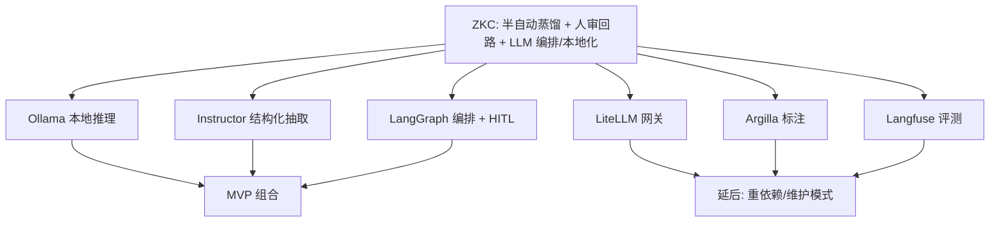
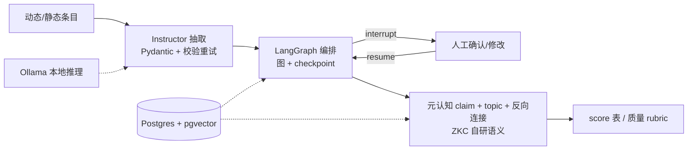

# 调研主题
ZKnowledgeCompounding P0 深挖：半自动蒸馏（T3.1）与 LLM 编排/本地化（T3.3）

评估 6 个直接对应 T3.1/T3.3 的候选：Ollama、LiteLLM、LangGraph、Argilla、Instructor、Langfuse。结论：MVP 采用 Ollama（本地/离线推理）+ Instructor（结构化抽取与校验重试）+ LangGraph（编排 + 人审中断/恢复 + Postgres checkpoint，与已定 substrate 同库）；provider 统一收敛到 Instructor 接口以保留切云能力。延后 LiteLLM、Argilla、Langfuse。关键提醒：没有任何候选提供 ZKC 的蒸馏语义（去繁 → 元认知 + topic + 反向连接），管线原语之外的语义必须由 ZKC 自建。

## 输入材料与观察时间
Evidence ledger: `cb7d53e4af481f57f33f42b5047f5a66468adfc8f2c5649b738aa9e03ecc2979`
Observed: 2026-10-28T16:40:44.388Z

## Key-Value 概念索引
- Key: `decision-frame` — Select the LLM orchestration and semi-automatic distillation stack for ZKC (T3.1 human-in-the-loop distillation, T3.3 LLM orchestration and localization) under privacy/offline and low-dependency constraints.
- Key: `fit-model` — Coverage scored native / adapted / absent / unknown per topic; an unobserved capability is reported as unknown, never as absent. Sealed-ledger unknowns are footnoted rather than silently resolved.
- Key: `ownership-model` — Candidates supply pipeline primitives only. ZKC owns the distillation semantics (去繁 → 元认知 + topic + 反向连接), the review policy, and the quality rubric.
- Key: `lifecycle-stage` — problem-discovery / selection phase for the ZKC LLM stack; findings are point-in-time and pre-MVP.

Concepts: [[decision-frame]], [[fit-model]], [[ownership-model]], [[lifecycle-stage]]

## C4 System Landscape
### T3.1 / T3.3 landscape: ZKC distillation needs -> candidate capabilities -> MVP composition

## 候选项目表
| Repository | Stars | Topic match |
|---|---:|---:|
| ollama/ollama | 185116 | 2 |
| BerriAI/litellm | 62242 | 5 |
| langchain-ai/langgraph | 44051 | 7 |
| argilla-io/argilla | 5185 | 7 |
| 567-labs/instructor | 14069 | 10 |
| langfuse/langfuse | 36651 | 12 |

## 深读项目卡片
### Ollama — local model runtime
Runs open models locally/offline (llama.cpp GGUF + MLX safetensors), local REST API on :11434 plus OpenAI-compatible layer, tool calling and structured output, CUDA/ROCm/Vulkan/CPU/MLX. This is the piece that makes a fully private, offline distillation pipeline possible.

- Claim `C1`
- Claim `C2`

### LiteLLM — multi-provider AI gateway
Unifies 100+ LLM APIs in OpenAI format with routing, fallbacks, retries, cost tracking, guardrails and logging; supports local endpoints (Ollama, vLLM). Powerful, but its proxy requires PostgreSQL and adds a service — closer to infrastructure than to a distillation primitive.

- Claim `C3`
- Claim `C4`

### LangGraph — orchestration runtime with human-in-the-loop
Low-level runtime for stateful, long-running agents: durable execution (checkpoint/resume), human-in-the-loop (inspect and modify state mid-execution), memory, and a Postgres checkpoint backend. This is the natural seam for ZKC's 'distill → pause → human confirms → continue' loop, and it shares the chosen Postgres substrate.

- Claim `C5`
- Claim `C6`

### Argilla — human annotation / review platform
Open-source human-feedback tool (Apache 2.0) with Dataset/Settings/Fields/Questions/Records, record status, filters, semantic search and AI suggestions; self-hosted with PostgreSQL + Redis. Rich review UI, but heavy for MVP and the sealed evidence could not verify its human-in-the-loop criterion.

- Claim `C9`

### Instructor — structured extraction primitive
Turns LLM output into validated Pydantic objects with automatic retries on validation failure, streaming partials and nested models, across a unified provider interface that includes local Ollama. This is the closest thing to a distillation primitive (text → validated structured claim).

- Claim `C7`
- Claim `C8`

### Langfuse — evals and observability
Open-source trace/evaluate/improve platform: traces, generation facts, token/cost accounting, score configs, evaluation rules, dataset items, LLM-based trace clustering (Topics). Self-hostable but brings ClickHouse/Redis/Node; the sealed evidence could not verify several of its criteria.

- Claim `C10`

## 方案族及适用场景对比
### comp-t33-local
T3.3 本地化：Ollama 是唯一原生本地推理运行时（下载后完全离线、隐私），且提供 OpenAI 兼容层；Instructor 通过 `ollama/...` provider 可直接调用它；LiteLLM 能把本地端点纳入路由（deployment type 'local'）但自身不是运行时。结论：本地化由 **Ollama** 承担，provider 抽象由 **Instructor 的统一接口**承担，二者组合即可满足 ZKC 的隐私/离线约束。

Claims: `C1`, `C2`, `C7`, `C8`

### comp-t33-orchestration
T3.3 编排：只有 LangGraph 提供真正的多步工作流编排（图 + 持久化 + 故障恢复 + 中断续跑），并有 Postgres checkpoint 后端——与已选定的 Postgres+pgvector substrate 同库，是显著协同。LiteLLM 只做单调用的路由/回退/重试，不是工作流引擎。结论：编排层选 **LangGraph**，并只用其明确的 runtime 原语（graph / checkpoint / interrupt-resume）。

Claims: `C5`, `C6`, `C3`

### comp-t31-hitl
T3.1 人审回路有两个层次：**工作流内中断**（LangGraph 的 human-in-the-loop，可在执行中检视并修改状态后恢复）适合「蒸馏过程中逐步确认」；**批量标注 UI**（Argilla）适合「事后集中审查」。MVP 应选前者——它与编排同源、无需额外服务；Argilla 需 PG+Redis 且处于维护模式，延后。注意 sealed ledger 未能验证 Argilla 的人审能力。

Claims: `C5`, `C9`

### comp-t31-distill
T3.1 蒸馏：Instructor 是唯一提供「文本 → 经过校验的结构化对象」的原语（Pydantic + 校验失败自动重试 + 嵌套 + 流式），这正是蒸馏出元认知 claim 所需的机械部分。但**没有任何候选提供 ZKC 的蒸馏语义**（去繁 → 元认知 + topic 组织 + 反向连接）。因此 Instructor 只是蒸馏管线里的抽取/校验原语，**语义必须 ZKC 自己定义并实现**。

Claims: `C7`, `C11`

### comp-eval-defer
评测/可观测：Langfuse 提供完整的 trace / score / eval-rules / dataset / Topics 聚类，但自带 ClickHouse + Redis + Node 栈，对单人 MVP 偏重，且 sealed ledger 未验证其核心 criteria。建议 MVP 先用一张轻量 score 表 + 蒸馏质量 rubric 自建最小度量，等评测需求真实增长再引入 Langfuse；LiteLLM 的 cost tracking 同理延后。

Claims: `C10`, `C3`

### comp-mvp-stack
MVP 组合建议：**Ollama（本地推理）+ Instructor（结构化抽取与校验重试）+ LangGraph（编排 + 人审中断 + Postgres checkpoint）**，并把 provider 收敛到 Instructor 的统一接口以保持可切云。延后：LiteLLM（需 PG、MVP 不需要多 provider 路由）、Argilla（维护模式 + 重依赖）、Langfuse（重依赖，先自建轻量 score）。这与已定的 Postgres+pgvector substrate 高度协同（LangGraph 的 PG checkpoint 落在同一库）。

Claims: `C1`, `C3`, `C5`, `C6`, `C7`

## C4 Context/Container 与子主题图
### MVP distillation pipeline and where each primitive sits

## 关键技术指标矩阵
| Metric | Definition | Unit | Method | Condition | Expected |
|---|---|---|---|---|---|
| local-offline-distillation | distillation pipeline that runs with no external LLM API call | boolean | run extraction end-to-end against a local Ollama runtime with network disabled | privacy/offline constraint satisfied | true (ollama + instructor) |
| hitl-interrupt-native | candidates offering in-workflow human interrupt/resume with state modification | count | inspection for human-in-the-loop interrupt, resume and state editing | seam for the human review step | 1 (langgraph) |
| structured-extraction-native | candidates producing schema-validated outputs with automatic retries | count | inspection for response models, validation and retry behaviour | distillation primitive selection | 1 (instructor) |
| distillation-semantics-native | candidates implementing ZKC's distillation semantics (meta-cognition + topic + reverse link) | count | inspection for meta-cognition, topic organisation and reverse linking | confirms the transform semantics must be built in-house | 0 |

## 建议、限制与待验证事项
### rec-stack
采用 **Ollama + Instructor + LangGraph** 作为 T3.1/T3.3 的 MVP 组合：Ollama 承担本地/离线推理（满足隐私约束），Instructor 承担「文本 → 校验过的结构化 claim」的蒸馏原语（含自动重试），LangGraph 承担多步编排与 human-in-the-loop 中断/恢复，并用其 **Postgres checkpoint 后端**落在已选定的 Postgres+pgvector 同一实例上。Provider 统一收敛到 Instructor 的 provider 接口，保留切云能力。**延后** LiteLLM（需 PostgreSQL、MVP 无需多 provider 路由）、Argilla（维护模式 + PG/Redis 重依赖）、Langfuse（ClickHouse/Redis 重依赖，先用轻量 score 表自建度量）。**关键提醒**：三者都不提供 ZKC 的蒸馏语义（去繁 → 元认知 + topic + 反向连接），该语义必须由 ZKC 自己定义并实现，它们只是管线原语。

Comparisons: `comp-mvp-stack`, `comp-t33-local`, `comp-t33-orchestration`, `comp-t31-hitl`, `comp-t31-distill`, `comp-eval-defer`

### rec-validate
动手验证清单：(1) **离线抽取 spike** —— 用 Instructor + Ollama 跑通「一条动态条目 → 结构化 claim」且全程无外部 API，记录校验重试率；(2) **人审回路 spike** —— 用 LangGraph 的 interrupt/resume 实现「蒸馏产出 → 暂停 → 人工确认/修改 → 继续」的最小闭环，并把状态持久化到 Postgres；(3) **质量基线** —— 定义蒸馏质量 rubric（准确性/去繁程度/可复用性），落地一张最小 score 表，作为后续是否引入 Langfuse 的判断依据。

Comparisons: `comp-t31-hitl`, `comp-t31-distill`, `comp-eval-defer`

- Unknown: BerriAI/litellm / orchestration
- Unknown: BerriAI/litellm / human_in_the_loop
- Unknown: argilla-io/argilla / orchestration
- Unknown: argilla-io/argilla / human_in_the_loop
- Unknown: argilla-io/argilla / local_inference
- Unknown: argilla-io/argilla / structured_extraction
- Unknown: argilla-io/argilla / eval_observability
- Unknown: langfuse/langfuse / orchestration
- Unknown: langfuse/langfuse / human_in_the_loop
- Unknown: langfuse/langfuse / eval_observability

## 来源清单
- [ollama/ollama@3fbc609be4b3ac5af8061bef6b0013a32e50d17f:Dockerfile](https://github.com/ollama/ollama/blob/3fbc609be4b3ac5af8061bef6b0013a32e50d17f/Dockerfile) — Evidence `361d410612858aa2bdee7c5e`
- [ollama/ollama@3fbc609be4b3ac5af8061bef6b0013a32e50d17f:Dockerfile](https://github.com/ollama/ollama/blob/3fbc609be4b3ac5af8061bef6b0013a32e50d17f/Dockerfile) — Evidence `6f8f7c9648f0ebdd5906aa4f`
- [ollama/ollama@3fbc609be4b3ac5af8061bef6b0013a32e50d17f:Dockerfile](https://github.com/ollama/ollama/blob/3fbc609be4b3ac5af8061bef6b0013a32e50d17f/Dockerfile) — Evidence `ffc3369101602e80ade08975`
- [ollama/ollama@3fbc609be4b3ac5af8061bef6b0013a32e50d17f:app/ui/app/package.json](https://github.com/ollama/ollama/blob/3fbc609be4b3ac5af8061bef6b0013a32e50d17f/app/ui/app/package.json) — Evidence `6f8e17433b8973ebc85333e6`
- [ollama/ollama@3fbc609be4b3ac5af8061bef6b0013a32e50d17f:app/ui/app/package.json](https://github.com/ollama/ollama/blob/3fbc609be4b3ac5af8061bef6b0013a32e50d17f/app/ui/app/package.json) — Evidence `18d4b052f6351895665dfa88`
- [ollama/ollama@3fbc609be4b3ac5af8061bef6b0013a32e50d17f:app/ui/app/package.json](https://github.com/ollama/ollama/blob/3fbc609be4b3ac5af8061bef6b0013a32e50d17f/app/ui/app/package.json) — Evidence `770b4e26898a0c19e481a578`
- [ollama/ollama@3fbc609be4b3ac5af8061bef6b0013a32e50d17f:README.md](https://github.com/ollama/ollama/blob/3fbc609be4b3ac5af8061bef6b0013a32e50d17f/README.md) — Evidence `44d595df855abb603d7579fc`
- [BerriAI/litellm@3d7b94b34f15c56123790436b1880f62291370bf:Dockerfile](https://github.com/BerriAI/litellm/blob/3d7b94b34f15c56123790436b1880f62291370bf/Dockerfile) — Evidence `92babd7d63cff3eab3fc2a20`
- [BerriAI/litellm@3d7b94b34f15c56123790436b1880f62291370bf:Dockerfile](https://github.com/BerriAI/litellm/blob/3d7b94b34f15c56123790436b1880f62291370bf/Dockerfile) — Evidence `887e03b9126540e59d7a4985`
- [BerriAI/litellm@3d7b94b34f15c56123790436b1880f62291370bf:Dockerfile](https://github.com/BerriAI/litellm/blob/3d7b94b34f15c56123790436b1880f62291370bf/Dockerfile) — Evidence `4a49bdb12c2c348838e76cb9`
- [BerriAI/litellm@3d7b94b34f15c56123790436b1880f62291370bf:Dockerfile](https://github.com/BerriAI/litellm/blob/3d7b94b34f15c56123790436b1880f62291370bf/Dockerfile) — Evidence `03ad3466baf47d8a42c7f527`
- [BerriAI/litellm@3d7b94b34f15c56123790436b1880f62291370bf:cookbook/litellm_proxy_server/grafana_dashboard/dashboard_all_metrics/readme.md](https://github.com/BerriAI/litellm/blob/3d7b94b34f15c56123790436b1880f62291370bf/cookbook/litellm_proxy_server/grafana_dashboard/dashboard_all_metrics/readme.md) — Evidence `0c8c82333bc0b90e68d836f6`
- [langchain-ai/langgraph@5a3e5dd73982a8ac81fb2c71c15b22ca982838de:libs/checkpoint-conformance/README.md](https://github.com/langchain-ai/langgraph/blob/5a3e5dd73982a8ac81fb2c71c15b22ca982838de/libs/checkpoint-conformance/README.md) — Evidence `a5283dca5513e88e9f3538a4`
- [langchain-ai/langgraph@5a3e5dd73982a8ac81fb2c71c15b22ca982838de:libs/checkpoint-conformance/README.md](https://github.com/langchain-ai/langgraph/blob/5a3e5dd73982a8ac81fb2c71c15b22ca982838de/libs/checkpoint-conformance/README.md) — Evidence `416c44fb9879944b6aebc48b`
- [langchain-ai/langgraph@5a3e5dd73982a8ac81fb2c71c15b22ca982838de:libs/checkpoint-conformance/README.md](https://github.com/langchain-ai/langgraph/blob/5a3e5dd73982a8ac81fb2c71c15b22ca982838de/libs/checkpoint-conformance/README.md) — Evidence `2eb96718eecc743c7fa1f362`
- [langchain-ai/langgraph@5a3e5dd73982a8ac81fb2c71c15b22ca982838de:libs/checkpoint-conformance/README.md](https://github.com/langchain-ai/langgraph/blob/5a3e5dd73982a8ac81fb2c71c15b22ca982838de/libs/checkpoint-conformance/README.md) — Evidence `926ffad73adb8d25af67c051`
- [langchain-ai/langgraph@5a3e5dd73982a8ac81fb2c71c15b22ca982838de:libs/checkpoint-conformance/README.md](https://github.com/langchain-ai/langgraph/blob/5a3e5dd73982a8ac81fb2c71c15b22ca982838de/libs/checkpoint-conformance/README.md) — Evidence `f98e930bb54ac91aa8694bc3`
- [langchain-ai/langgraph@5a3e5dd73982a8ac81fb2c71c15b22ca982838de:libs/checkpoint-conformance/pyproject.toml](https://github.com/langchain-ai/langgraph/blob/5a3e5dd73982a8ac81fb2c71c15b22ca982838de/libs/checkpoint-conformance/pyproject.toml) — Evidence `d03d279196793b39d328f5a8`
- [langchain-ai/langgraph@5a3e5dd73982a8ac81fb2c71c15b22ca982838de:libs/checkpoint-postgres/README.md](https://github.com/langchain-ai/langgraph/blob/5a3e5dd73982a8ac81fb2c71c15b22ca982838de/libs/checkpoint-postgres/README.md) — Evidence `6f52f74040495679e504bb3f`
- [argilla-io/argilla@5338519accb13ae422f8bf9c0642651c249c49af:argilla-frontend/package.json](https://github.com/argilla-io/argilla/blob/5338519accb13ae422f8bf9c0642651c249c49af/argilla-frontend/package.json) — Evidence `719591f11d935d8fa103a4ab`
- [argilla-io/argilla@5338519accb13ae422f8bf9c0642651c249c49af:argilla-frontend/package.json](https://github.com/argilla-io/argilla/blob/5338519accb13ae422f8bf9c0642651c249c49af/argilla-frontend/package.json) — Evidence `ab7e336b0c5c4b4679cf81b6`
- [567-labs/instructor@6cd771c5254a69f6a6cf9cdf357fb2f9523f0b85:docs/blog/posts/aisummit-2023.md](https://github.com/567-labs/instructor/blob/6cd771c5254a69f6a6cf9cdf357fb2f9523f0b85/docs/blog/posts/aisummit-2023.md) — Evidence `3473bf5f6e6886ceeddac8ae`
- [567-labs/instructor@6cd771c5254a69f6a6cf9cdf357fb2f9523f0b85:docs/blog/posts/aisummit-2023.md](https://github.com/567-labs/instructor/blob/6cd771c5254a69f6a6cf9cdf357fb2f9523f0b85/docs/blog/posts/aisummit-2023.md) — Evidence `0cd9f5d39b798c127490f16d`
- [567-labs/instructor@6cd771c5254a69f6a6cf9cdf357fb2f9523f0b85:docs/blog/posts/aisummit-2023.md](https://github.com/567-labs/instructor/blob/6cd771c5254a69f6a6cf9cdf357fb2f9523f0b85/docs/blog/posts/aisummit-2023.md) — Evidence `072ff6a5ef3353d523d8a3ae`
- [567-labs/instructor@6cd771c5254a69f6a6cf9cdf357fb2f9523f0b85:docs/blog/posts/announcing-unified-provider-interface.md](https://github.com/567-labs/instructor/blob/6cd771c5254a69f6a6cf9cdf357fb2f9523f0b85/docs/blog/posts/announcing-unified-provider-interface.md) — Evidence `a88292fbc70c4f7914fd9930`
- [567-labs/instructor@6cd771c5254a69f6a6cf9cdf357fb2f9523f0b85:docs/blog/posts/announcing-unified-provider-interface.md](https://github.com/567-labs/instructor/blob/6cd771c5254a69f6a6cf9cdf357fb2f9523f0b85/docs/blog/posts/announcing-unified-provider-interface.md) — Evidence `97da8f570233d6a6447b18ce`
- [567-labs/instructor@6cd771c5254a69f6a6cf9cdf357fb2f9523f0b85:docs/blog/posts/announcing-unified-provider-interface.md](https://github.com/567-labs/instructor/blob/6cd771c5254a69f6a6cf9cdf357fb2f9523f0b85/docs/blog/posts/announcing-unified-provider-interface.md) — Evidence `d18823e3225082dd6b15f721`
- [567-labs/instructor@6cd771c5254a69f6a6cf9cdf357fb2f9523f0b85:docs/blog/posts/anthropic-web-search-structured.md](https://github.com/567-labs/instructor/blob/6cd771c5254a69f6a6cf9cdf357fb2f9523f0b85/docs/blog/posts/anthropic-web-search-structured.md) — Evidence `c54783fb0cd87079e3827a5c`
- [langfuse/langfuse@7e5c843908b3b49bb3d98e4137b1a37fae6a15b0:.cursor/Dockerfile](https://github.com/langfuse/langfuse/blob/7e5c843908b3b49bb3d98e4137b1a37fae6a15b0/.cursor/Dockerfile) — Evidence `67afc994203fc3b35e618152`
- [langfuse/langfuse@7e5c843908b3b49bb3d98e4137b1a37fae6a15b0:.cursor/Dockerfile](https://github.com/langfuse/langfuse/blob/7e5c843908b3b49bb3d98e4137b1a37fae6a15b0/.cursor/Dockerfile) — Evidence `6ac8f5f2c6b1c90b5c1f58cc`
- [langfuse/langfuse@7e5c843908b3b49bb3d98e4137b1a37fae6a15b0:.cursor/Dockerfile](https://github.com/langfuse/langfuse/blob/7e5c843908b3b49bb3d98e4137b1a37fae6a15b0/.cursor/Dockerfile) — Evidence `ba46ab74d436228e3a8066ad`
- [langfuse/langfuse@7e5c843908b3b49bb3d98e4137b1a37fae6a15b0:.devcontainer/Dockerfile](https://github.com/langfuse/langfuse/blob/7e5c843908b3b49bb3d98e4137b1a37fae6a15b0/.devcontainer/Dockerfile) — Evidence `9074b913d1e8a02d934de822`
