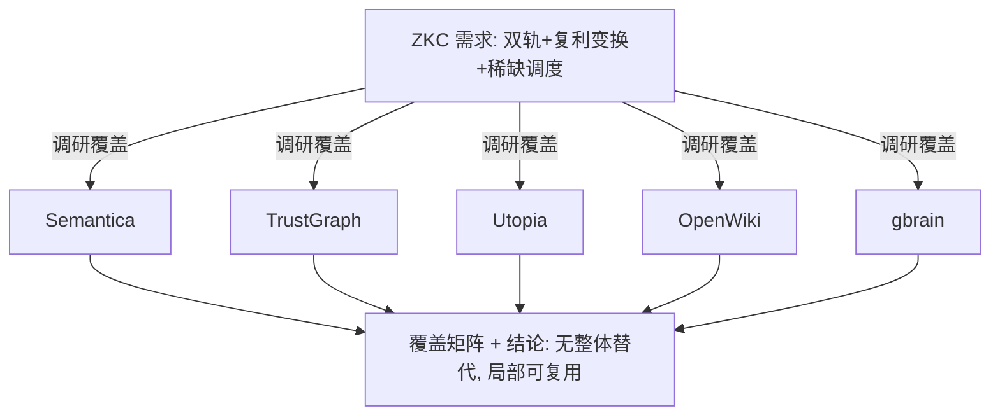
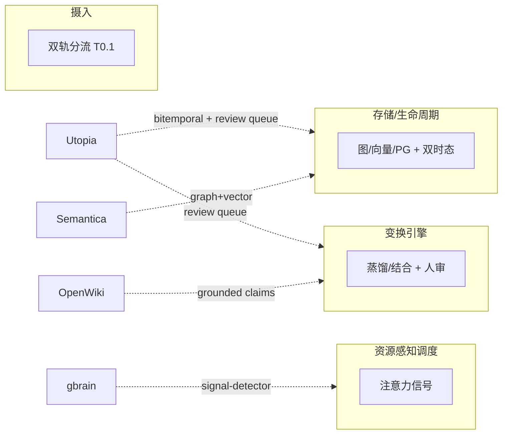

# 调研主题
ZKnowledgeCompounding 开源候选覆盖调研

调研 5 个开源项目（Semantica / TrustGraph / Utopia / OpenWiki / gbrain）对 ZKC 22 个技术调研 topic 的覆盖情况。结论：无整体替代方案；Utopia（双时态/本地优先/人审蒸馏）、OpenWiki（OKF/Grounded Claims）、gbrain（混合检索/信号探测）在若干子系统可直接借鉴；双轨静态/动态建模与稀缺注意力调度无人覆盖，需自建。

## 输入材料与观察时间
Evidence ledger: `03f51d004eafbfdc0f6e658c749448015f7b5b45ad2e4cfc5bb3c330d1ff0697`
Observed: 2026-10-28T14:43:01.515Z

## Key-Value 概念索引
- Key: `decision-frame` — ZKC needs dual-track (static/dynamic) capture + compounding transform (distill/combine/connect/model) + scarce-resource scheduling; this report evaluates OSS coverage of the 22 derived topics.
- Key: `fit-model` — Coverage scored native / adapted / absent / unknown per topic; an unobserved capability is reported as unknown, never as absent.
- Key: `ownership-model` — Whole-product adoption is rejected; unit-capability reuse is the preferred ownership posture.
- Key: `lifecycle-stage` — problem-discovery / selection phase for the ZKC architecture; findings are point-in-time and pre-MVP.

Concepts: [[decision-frame]], [[fit-model]], [[ownership-model]], [[lifecycle-stage]]

## C4 System Landscape
### Research landscape: ZKC requirements -> 5 OSS candidates -> coverage findings

## 候选项目表
| Repository | Stars | Topic match |
|---|---:|---:|
| semantica-agi/semantica | 14288 | 20 |
| trustgraph-ai/trustgraph | 2845 | 15 |
| deeplethe/utopia | 8584 | 30 |
| langchain-ai/openwiki | 17542 | 3 |
| garrytan/gbrain | 31301 | 3 |

## 深读项目卡片
### Semantica — graph-native KG infrastructure
Graph + triplet + vector stores, LLM ontology generation, PROV-O provenance. Strong on T1.1/T2.1/T2.2/T6.1; absent on T0.1 (dual-track) and T5.x (attention). Server/Docker oriented.

- Claim `C1`

### TrustGraph — semantic agent governance platform
RDF 1.2 named graphs + OWL enforcement + PROV-O; Knowledge Lifecycle Management at collection level; self-host open-weight inference. Scheduling & local-first unverified.

- Claim `C2`

### Utopia — enterprise world model / bitemporal KG
Bitemporal knowledge graph (fact validity + provenance), one Rust binary + one Postgres, air-gapped, human review queue for extraction merges. Strongest coverage of T1.2/T1.3/T3.1.

- Claim `C3`
- Claim `C7`
- Claim `C8`

### OpenWiki — owned linked Markdown wiki (OKF implementation)
Distills multi-source raw into owned linked Markdown wiki; Grounded Claims bound to source (OKF v0.2); scheduled CI updates; 14 LLM providers. Concrete implementation of the PRD's OKF reference.

- Claim `C4`
- Claim `C8`

### gbrain — agent brain / hybrid retrieval
Hybrid retrieval (vector + keyword + graph, RRF), embedded PGLite/SQLite, signal-detector for attention-like signals, cron source pulls, LongMemEval eval. Closest to T5.1/T6.1.

- Claim `C5`
- Claim `C9`

## 方案族及适用场景对比
### comp-coverage-matrix
ZKC 22 topics × 5 candidates coverage matrix (native / adapted / absent / unknown):

| Topic | Semantica | TrustGraph | Utopia | OpenWiki | gbrain |
|---|---|---|---|---|---|
| T0.1 双轨分流判定 | absent | absent | absent | absent | absent |
| T0.2 低摩擦快捕获 | adapted | adapted | native | native | adapted |
| T0.3 多模态入口 | adapted | adapted | native | adapted | unknown |
| T1.1 数据模型载体 | native(graph+triplet+vector) | native(RDF named graphs) | adapted(PG+pgvector+Tantivy) | adapted(Markdown+claims) | native(PGLite+sqlite+vector) |
| T1.2 生命周期/衰减 | absent | adapted(collection级) | native(bitemporal) | adapted(claim stale_after) | adapted(version/autocut) |
| T1.3 本地优先 vs 服务端 | adapted(Docker/K8s) | adapted(Docker/on-prem) | native(单二进制+PG, air-gapped) | adapted(local CLI) | adapted(embedded PGLite) |
| T2.1 语义表示/embedding | native(fastembed) | adapted(NL+rerank) | native(pgvector) | unknown | native(vector cols) |
| T2.2 topic/ontology | native(LLM ontology) | native(OWL) | native(editable ontology) | adapted(OKF frontmatter) | adapted(typed-edge) |
| T2.3 元认知 claim | absent | absent | adapted(facts+provenance) | native(grounded claims) | absent |
| T3.1 半自动蒸馏+人审 | adapted(extraction) | adapted(ontology extraction) | native(review queue) | native(automated distillation) | adapted(skill curation) |
| T3.2 结合/建模算子 | adapted(causal chain) | adapted(policy/governance) | adapted(decision intelligence dev) | adapted(wiki synthesis) | adapted(agent) |
| T3.3 LLM 编排/本地化 | adapted | native(open-weight self-host) | native(any OpenAI-compat, air-gapped) | native(14 providers) | native(gateway+multi-agent) |
| T4.1 context 拓扑 | adapted(ContextGraph) | adapted(workspaces/collections) | adapted(graph+timeline) | adapted(workspace linking) | adapted(graph pages) |
| T4.2 membership 维护 | adapted(graph rel) | adapted(collections) | adapted(multi-tenant KB) | adapted(workspace) | adapted(graph adjacency) |
| T5.1 注意力信号 | absent | unknown | absent | absent | adapted(signal-detector) |
| T5.2 回顾/调度 | absent | unknown | adapted(scheduled ingest) | adapted(CI cron) | adapted(cron pull) |
| T6.1 检索与复用 | native(SPARQL+vector) | native(NL retrieval) | native(RRF fusion) | adapted(search/read) | native(hybrid RRF) |
| T6.2 复用率度量 | adapted(PROV-O) | adapted(PROV-O) | adapted(citations/ledger) | adapted(grounded citations) | adapted(graph citations) |
| T7.1 复利度量基建 | absent | unknown | absent | adapted(LEDGER eval) | adapted(LongMemEval) |
| X.1 隐私/安全 | native(auth/audit) | native(on-prem/RDF portability) | native(air-gapped/ACL) | adapted(user-owned) | adapted(source-guard) |
| X.2 与 ZAgentic 复用 | unknown | unknown | unknown | unknown | unknown |
| X.3 既有工具可取点 | KG 基础设施参照 | 治理型 KG 参照 | 世界模型参照 | OKF 具体实现 | Agent 大脑参照 |

Claims: `C1`, `C2`, `C3`, `C4`, `C5`, `C6`, `C7`, `C8`, `C9`, `C10`

### comp-storage
Storage models diverge: Semantica and TrustGraph are native graph systems (Neo4j/Neptune; RDF named graphs); Utopia and gbrain use a relational core + vector (Postgres/pgvector, PGLite/SQLite); OpenWiki is document-based (Markdown + claim sidecars). No candidate is a single-file local-first store.

Claims: `C1`, `C3`, `C4`, `C5`

### comp-lifecycle
Lifecycle/decay is the weakest shared area. Only Utopia models node-level temporality (bitemporal validity + provenance + append-only decision ledger). TrustGraph offers collection-level lifecycle; OpenWiki offers claim-level stale_after; Semantica and gbrain do not model knowledge decay.

Claims: `C3`, `C7`

### comp-distill
Distillation with a human-in-the-loop exists only in Utopia (review queue for reversible merges) and OpenWiki (Grounded Claims evidence reconciliation). Semantica/TrustGraph/gbrain automate extraction without an explicit review loop, so ZKC's required human-in-loop distillation is not covered off-the-shelf.

Claims: `C4`, `C8`

### comp-local
Local-first / offline capability: Utopia runs air-gapped as one binary + one Postgres; gbrain embeds PGLite/SQLite locally; Semantica/TrustGraph target Docker/K8s server deployment; OpenWiki is a local CLI writing to ~/.openwiki. None is a zero-dependency single-file store.

Claims: `C3`, `C5`, `C10`

## C4 Context/Container 与子主题图
### ZKC subsystems and the candidates that cover them

## 关键技术指标矩阵
| Metric | Definition | Unit | Method | Condition | Expected |
|---|---|---|---|---|---|
| dual-track-coverage | candidates that natively model the static/dynamic split | count | matrix cell T0.1 == native | confirms ZKC differentiator is unaddressed | 0 |
| attention-scheduling-coverage | candidates with native attention-signal + recall scheduling | count | matrix T5.1/T5.2 == native | gap confirmation | 0 |
| local-offline-capable | candidates that run air-gapped / offline | count | matrix T1.3 == native | shortlist for local-first | 1 (utopia) |
| lifecycle-native | candidates with node-level temporality | count | matrix T1.2 == native | shortlist for lifecycle backbone | 1 (utopia) |

## 建议、限制与待验证事项
### rec-overall
No candidate is a drop-in replacement for ZKC. Recommend a unit-capability reuse strategy, not whole-product adoption: borrow Utopia's bitemporal storage + human-in-loop distillation as the lifecycle backbone, OpenWiki's Grounded-Claims/OKF pattern for the meta-cognition claim layer, and gbrain's hybrid retrieval + signal-detector for the scheduling/attention seam. The dual-track static/dynamic capture model and the scarce-attention scheduler must be built in-house — they are ZKC's core differentiator and are unaddressed by all five.

Comparisons: `comp-coverage-matrix`, `comp-storage`, `comp-lifecycle`, `comp-distill`, `comp-local`

### rec-next
Before committing architecture, run a hands-on spike on the two most-aligned candidates (Utopia for bitemporal + human-in-loop; OpenWiki for OKF/Grounded Claims) to validate personal-use fitness, and resolve the two unknown TrustGraph criteria by direct inspection. Keep the ZKC dual-track and attention layers decoupled so they can sit on top of any chosen storage.

Comparisons: `comp-lifecycle`, `comp-distill`

- Unknown: trustgraph-ai/trustgraph / scheduling
- Unknown: trustgraph-ai/trustgraph / local_first

## 来源清单
- [semantica-agi/semantica@7e1c1ccfb38bb30449ba9d90fea5a066c1115cfc:Dockerfile](https://github.com/semantica-agi/semantica/blob/7e1c1ccfb38bb30449ba9d90fea5a066c1115cfc/Dockerfile) — Evidence `725e3db4c7d3c03f1f2a6836`
- [semantica-agi/semantica@7e1c1ccfb38bb30449ba9d90fea5a066c1115cfc:Dockerfile](https://github.com/semantica-agi/semantica/blob/7e1c1ccfb38bb30449ba9d90fea5a066c1115cfc/Dockerfile) — Evidence `8cdb24e1bfe2b9ff558bf534`
- [semantica-agi/semantica@7e1c1ccfb38bb30449ba9d90fea5a066c1115cfc:Dockerfile](https://github.com/semantica-agi/semantica/blob/7e1c1ccfb38bb30449ba9d90fea5a066c1115cfc/Dockerfile) — Evidence `0a44edbd540c716614b44cf8`
- [semantica-agi/semantica@7e1c1ccfb38bb30449ba9d90fea5a066c1115cfc:Dockerfile](https://github.com/semantica-agi/semantica/blob/7e1c1ccfb38bb30449ba9d90fea5a066c1115cfc/Dockerfile) — Evidence `7927bee8e24eb28d45e9113c`
- [semantica-agi/semantica@7e1c1ccfb38bb30449ba9d90fea5a066c1115cfc:Dockerfile](https://github.com/semantica-agi/semantica/blob/7e1c1ccfb38bb30449ba9d90fea5a066c1115cfc/Dockerfile) — Evidence `4809d4acf28d295f4a4e341a`
- [semantica-agi/semantica@7e1c1ccfb38bb30449ba9d90fea5a066c1115cfc:Dockerfile](https://github.com/semantica-agi/semantica/blob/7e1c1ccfb38bb30449ba9d90fea5a066c1115cfc/Dockerfile) — Evidence `6ad4a14a47c5c6875bcc5083`
- [semantica-agi/semantica@7e1c1ccfb38bb30449ba9d90fea5a066c1115cfc:Dockerfile](https://github.com/semantica-agi/semantica/blob/7e1c1ccfb38bb30449ba9d90fea5a066c1115cfc/Dockerfile) — Evidence `6f7ea90c68b97b5aa5847eed`
- [semantica-agi/semantica@7e1c1ccfb38bb30449ba9d90fea5a066c1115cfc:docs/guides/agent-memory.md](https://github.com/semantica-agi/semantica/blob/7e1c1ccfb38bb30449ba9d90fea5a066c1115cfc/docs/guides/agent-memory.md) — Evidence `02a82357a0c8eea7724c44fa`
- [trustgraph-ai/trustgraph@562434cbc8bd352cc0dc853cfe6d2190add65410:docs/tech-specs/agent-explainability.md](https://github.com/trustgraph-ai/trustgraph/blob/562434cbc8bd352cc0dc853cfe6d2190add65410/docs/tech-specs/agent-explainability.md) — Evidence `029bf802db0a507d6822b502`
- [trustgraph-ai/trustgraph@562434cbc8bd352cc0dc853cfe6d2190add65410:docs/tech-specs/agent-explainability.md](https://github.com/trustgraph-ai/trustgraph/blob/562434cbc8bd352cc0dc853cfe6d2190add65410/docs/tech-specs/agent-explainability.md) — Evidence `185f240272ae165c20ee2e94`
- [trustgraph-ai/trustgraph@562434cbc8bd352cc0dc853cfe6d2190add65410:docs/tech-specs/agent-explainability.md](https://github.com/trustgraph-ai/trustgraph/blob/562434cbc8bd352cc0dc853cfe6d2190add65410/docs/tech-specs/agent-explainability.md) — Evidence `b9dc432c0f3e363556529e63`
- [trustgraph-ai/trustgraph@562434cbc8bd352cc0dc853cfe6d2190add65410:docs/tech-specs/agent-explainability.md](https://github.com/trustgraph-ai/trustgraph/blob/562434cbc8bd352cc0dc853cfe6d2190add65410/docs/tech-specs/agent-explainability.md) — Evidence `c28d3e0031931dc51e981bc5`
- [trustgraph-ai/trustgraph@562434cbc8bd352cc0dc853cfe6d2190add65410:docs/tech-specs/agent-explainability.md](https://github.com/trustgraph-ai/trustgraph/blob/562434cbc8bd352cc0dc853cfe6d2190add65410/docs/tech-specs/agent-explainability.md) — Evidence `079dfe1c93354983b51e3e9c`
- [trustgraph-ai/trustgraph@562434cbc8bd352cc0dc853cfe6d2190add65410:docs/tech-specs/agent-explainability.md](https://github.com/trustgraph-ai/trustgraph/blob/562434cbc8bd352cc0dc853cfe6d2190add65410/docs/tech-specs/agent-explainability.md) — Evidence `e6bf7bc6d874f1adbcd31b70`
- [deeplethe/utopia@7ecf9915545a56ad485c16fc658ed6bdb41889b2:crates/utopia-llm/Cargo.toml](https://github.com/deeplethe/utopia/blob/7ecf9915545a56ad485c16fc658ed6bdb41889b2/crates/utopia-llm/Cargo.toml) — Evidence `7cbc20374c7c0179c7768765`
- [deeplethe/utopia@7ecf9915545a56ad485c16fc658ed6bdb41889b2:crates/utopia-llm/Cargo.toml](https://github.com/deeplethe/utopia/blob/7ecf9915545a56ad485c16fc658ed6bdb41889b2/crates/utopia-llm/Cargo.toml) — Evidence `1ad530f7db02cb5e005ebf1e`
- [deeplethe/utopia@7ecf9915545a56ad485c16fc658ed6bdb41889b2:crates/utopia-search/Cargo.toml](https://github.com/deeplethe/utopia/blob/7ecf9915545a56ad485c16fc658ed6bdb41889b2/crates/utopia-search/Cargo.toml) — Evidence `2d75628c6a109087690bbe78`
- [deeplethe/utopia@7ecf9915545a56ad485c16fc658ed6bdb41889b2:docker-compose.yml](https://github.com/deeplethe/utopia/blob/7ecf9915545a56ad485c16fc658ed6bdb41889b2/docker-compose.yml) — Evidence `937ebe9dd6de9e27a4afccda`
- [deeplethe/utopia@7ecf9915545a56ad485c16fc658ed6bdb41889b2:docker-compose.yml](https://github.com/deeplethe/utopia/blob/7ecf9915545a56ad485c16fc658ed6bdb41889b2/docker-compose.yml) — Evidence `b9fbe6f9ef38bf9df58f96f3`
- [deeplethe/utopia@7ecf9915545a56ad485c16fc658ed6bdb41889b2:docker/Dockerfile](https://github.com/deeplethe/utopia/blob/7ecf9915545a56ad485c16fc658ed6bdb41889b2/docker/Dockerfile) — Evidence `12f3cca0083e5a3f40e93ee1`
- [deeplethe/utopia@7ecf9915545a56ad485c16fc658ed6bdb41889b2:docs/decisions/0001-ontology-import-and-governance.md](https://github.com/deeplethe/utopia/blob/7ecf9915545a56ad485c16fc658ed6bdb41889b2/docs/decisions/0001-ontology-import-and-governance.md) — Evidence `8104be9d7b14df4b289173ed`
- [deeplethe/utopia@7ecf9915545a56ad485c16fc658ed6bdb41889b2:docs/decisions/0001-ontology-import-and-governance.md](https://github.com/deeplethe/utopia/blob/7ecf9915545a56ad485c16fc658ed6bdb41889b2/docs/decisions/0001-ontology-import-and-governance.md) — Evidence `d03b2267fa51c916c199bc1b`
- [langchain-ai/openwiki@305599f8e44203f9ca6b74bb6b38eebaf0b0405e:AGENTS.md](https://github.com/langchain-ai/openwiki/blob/305599f8e44203f9ca6b74bb6b38eebaf0b0405e/AGENTS.md) — Evidence `4f598be411abd4d9b68acbd4`
- [langchain-ai/openwiki@305599f8e44203f9ca6b74bb6b38eebaf0b0405e:AGENTS.md](https://github.com/langchain-ai/openwiki/blob/305599f8e44203f9ca6b74bb6b38eebaf0b0405e/AGENTS.md) — Evidence `f5a6a71eabb2bb2f4797686a`
- [langchain-ai/openwiki@305599f8e44203f9ca6b74bb6b38eebaf0b0405e:evals/ledger/README.md](https://github.com/langchain-ai/openwiki/blob/305599f8e44203f9ca6b74bb6b38eebaf0b0405e/evals/ledger/README.md) — Evidence `d953447ebe121218cc9fe137`
- [langchain-ai/openwiki@305599f8e44203f9ca6b74bb6b38eebaf0b0405e:evals/ledger/README.md](https://github.com/langchain-ai/openwiki/blob/305599f8e44203f9ca6b74bb6b38eebaf0b0405e/evals/ledger/README.md) — Evidence `56e65ad3ed8c126e1e3cf7e0`
- [langchain-ai/openwiki@305599f8e44203f9ca6b74bb6b38eebaf0b0405e:evals/ledger/README.md](https://github.com/langchain-ai/openwiki/blob/305599f8e44203f9ca6b74bb6b38eebaf0b0405e/evals/ledger/README.md) — Evidence `86c375ac22cd10c3a6519f60`
- [langchain-ai/openwiki@305599f8e44203f9ca6b74bb6b38eebaf0b0405e:evals/ledger/README.md](https://github.com/langchain-ai/openwiki/blob/305599f8e44203f9ca6b74bb6b38eebaf0b0405e/evals/ledger/README.md) — Evidence `d9b8aa396bc79c4dc803bb0a`
- [langchain-ai/openwiki@305599f8e44203f9ca6b74bb6b38eebaf0b0405e:evals/ledger/README.md](https://github.com/langchain-ai/openwiki/blob/305599f8e44203f9ca6b74bb6b38eebaf0b0405e/evals/ledger/README.md) — Evidence `47ac6b189f1e62231b1eb331`
- [langchain-ai/openwiki@305599f8e44203f9ca6b74bb6b38eebaf0b0405e:openwiki/architecture/agent-runtime.md](https://github.com/langchain-ai/openwiki/blob/305599f8e44203f9ca6b74bb6b38eebaf0b0405e/openwiki/architecture/agent-runtime.md) — Evidence `0446d6b394931b05f4d82b5b`
- [garrytan/gbrain@613400c3fa9b0635da8c4cd0bae640543cb3e2c6:AGENTS.md](https://github.com/garrytan/gbrain/blob/613400c3fa9b0635da8c4cd0bae640543cb3e2c6/AGENTS.md) — Evidence `d84bbfbc7275b10b17701e7b`
- [garrytan/gbrain@613400c3fa9b0635da8c4cd0bae640543cb3e2c6:AGENTS.md](https://github.com/garrytan/gbrain/blob/613400c3fa9b0635da8c4cd0bae640543cb3e2c6/AGENTS.md) — Evidence `0a51c8f6a60afa67d96bb871`
- [garrytan/gbrain@613400c3fa9b0635da8c4cd0bae640543cb3e2c6:AGENTS.md](https://github.com/garrytan/gbrain/blob/613400c3fa9b0635da8c4cd0bae640543cb3e2c6/AGENTS.md) — Evidence `1897dcdddceea01f7083474f`
- [garrytan/gbrain@613400c3fa9b0635da8c4cd0bae640543cb3e2c6:AGENTS.md](https://github.com/garrytan/gbrain/blob/613400c3fa9b0635da8c4cd0bae640543cb3e2c6/AGENTS.md) — Evidence `59e79e24b95784eaa567840e`
- [garrytan/gbrain@613400c3fa9b0635da8c4cd0bae640543cb3e2c6:AGENTS.md](https://github.com/garrytan/gbrain/blob/613400c3fa9b0635da8c4cd0bae640543cb3e2c6/AGENTS.md) — Evidence `7bd640b1602682b8a1376a5c`
- [garrytan/gbrain@613400c3fa9b0635da8c4cd0bae640543cb3e2c6:AGENTS.md](https://github.com/garrytan/gbrain/blob/613400c3fa9b0635da8c4cd0bae640543cb3e2c6/AGENTS.md) — Evidence `8f1ee2c6a41c16debd68e032`
- [garrytan/gbrain@613400c3fa9b0635da8c4cd0bae640543cb3e2c6:AGENTS.md](https://github.com/garrytan/gbrain/blob/613400c3fa9b0635da8c4cd0bae640543cb3e2c6/AGENTS.md) — Evidence `6e82b99843b6e6d9ba6363a9`
- [garrytan/gbrain@613400c3fa9b0635da8c4cd0bae640543cb3e2c6:AGENTS.md](https://github.com/garrytan/gbrain/blob/613400c3fa9b0635da8c4cd0bae640543cb3e2c6/AGENTS.md) — Evidence `afee34b4d1ec19e00e8673f7`
