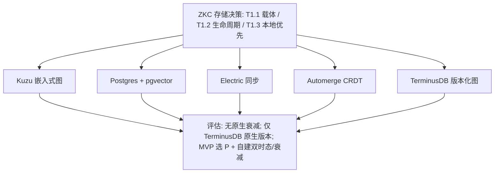
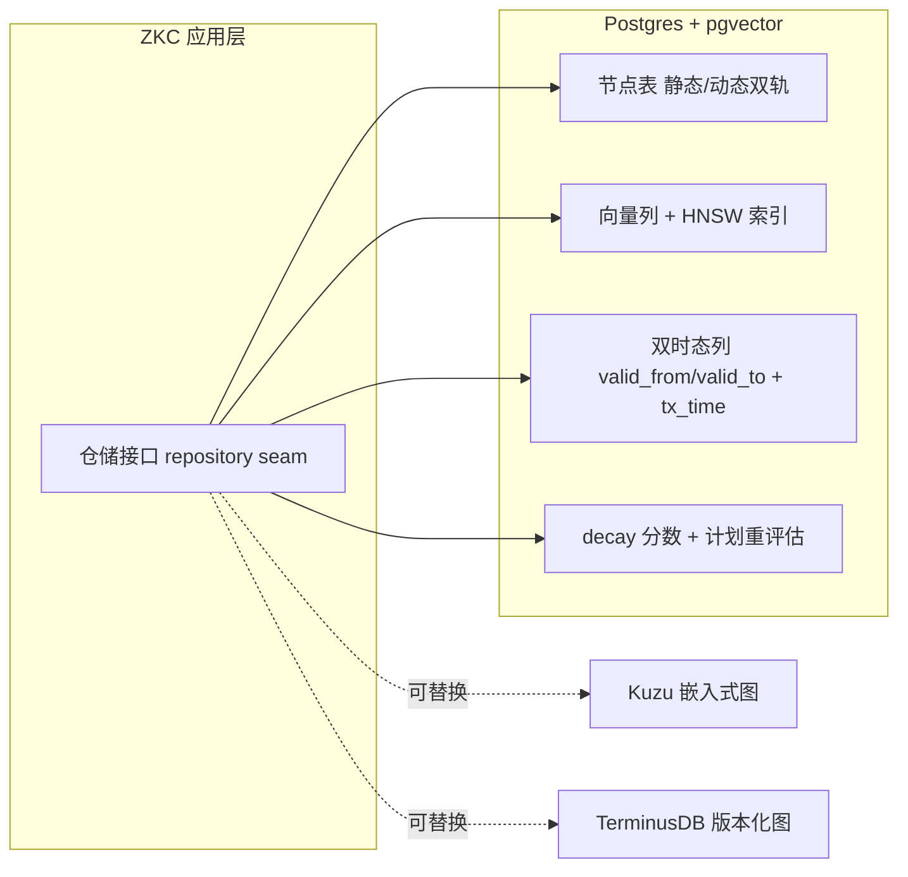

# 调研主题
ZKnowledgeCompounding P0 深挖：存储与生命周期载体

针对 P0 三项（T1.1 数据模型载体 / T1.2 生命周期与衰减建模 / T1.3 本地优先 vs 服务端）评估 5 个存储候选：Kuzu、pgvector(+Postgres)、Electric、Automerge、TerminusDB。结论：MVP 采用 Postgres+pgvector 并在 schema 自建双时态与衰减；图遍历先用递归 CTE；保持仓储层可替换以平滑切到 Kuzu 或 TerminusDB；同步/多端延后。所有候选均无原生衰减语义，衰减必须在应用层建模。XTDB 因编译器无法解析 submodule 树被排除，需带外验证。

## 输入材料与观察时间
Evidence ledger: `1c3f3412e1d5f85dfe91b6bc638bc8f72a3227c043f8f093f48d8530b4cdfa5b`
Observed: 2026-10-28T15:31:10.966Z

## Key-Value 概念索引
- Key: `decision-frame` — Choose the storage and lifecycle substrate for ZKC (T1.1 data-model carrier, T1.2 lifecycle/decay modeling, T1.3 local-first vs server) under personal-data, offline-capable, low-dependency constraints.
- Key: `fit-model` — Coverage scored native / adapted / absent / unknown per topic; an unobserved capability is reported as unknown, never as absent.
- Key: `ownership-model` — Store choice is a swappable infrastructure seam; ZKC owns the dual-track schema, the temporal/validity model, and the decay semantics regardless of substrate.
- Key: `lifecycle-stage` — problem-discovery / selection phase for the ZKC storage substrate; findings are point-in-time and pre-MVP.

Concepts: [[decision-frame]], [[fit-model]], [[ownership-model]], [[lifecycle-stage]]

## C4 System Landscape
### Storage substrate landscape: ZKC decisions (T1.1/T1.2/T1.3) -> candidate stores -> assessment

## 候选项目表
| Repository | Stars | Topic match |
|---|---:|---:|
| kuzudb/kuzu | 4017 | 12 |
| pgvector/pgvector | 23515 | 2 |
| electric-sql/electric | 10420 | 9 |
| automerge/automerge | 6694 | 5 |
| terminusdb/terminusdb | 3461 | 12 |

## 深读项目卡片
### Kuzu — embedded property graph with vector search
Embedded (serverless) property-graph database, Cypher, native vector index + full-text search, columnar disk storage, WASM bindings for in-browser execution, MIT licensed. Strongest fit where graph traversal and vector search must live in one local process; no temporal/versioning model.

- Claim `C3`

### pgvector — vector search inside Postgres
Postgres extension giving embeddings, metadata, joins, ACID and PITR in one local/self-hosted store; HNSW/IVFFlat indexes. Hard limit: ANN index caps at 2,000 dims (float) / 4,000 (halfvec). No graph traversal or temporal model of its own — those must be built in schema (recursive CTE / adjacency, valid_from/valid_to).

- Claim `C1`
- Claim `C2`

### Electric — Postgres partial replication for local-first clients
Syncs filtered Postgres 'shapes' to clients over HTTP with cursor resume, enabling local-first/offline reads; writes round-trip through the server. Sync engine is 1.x stable, but adds a self-hosted Elixir service + Postgres dependency. Its new Agents platform is churning.

- Claim `C4`
- Claim `C5`

### Automerge — CRDT document store for offline-first
CRDT library (JSON-like docs, Rust core → WASM/JS/C) with compression format and sync protocol, aimed at local-first apps. Gives conflict-free offline merge and history, but is a document/event store, not a graph or vector store — query and retrieval must be built on top.

- Claim `C6`

### TerminusDB — knowledge graph with git-like version control
Document/knowledge-graph database (JSON-LD) with commits per update, JSON diff/patch, push/pull/clone, and time-travel queries at any commit; WOQL Datalog, v12 temporal interval reasoning, 12.1-rc vector search. Closest to ZKC's lifecycle/versioning need, but is a server deployment, not embedded.

- Claim `C7`

## 方案族及适用场景对比
### comp-t11-carrier
T1.1 数据模型载体的三类路线：(a) 嵌入式图库 Kuzu —— 图遍历 + 向量 + 全文在一个进程内，无服务依赖，但关系/时态能力弱；(b) Postgres + pgvector —— 关系 + 向量 + 事务 + PITR 一体，最成熟，图与时态需在 schema 自建；(c) 版本化知识图 TerminusDB —— 原生 commit/时间旅行/JSON diff，但为服务端部署。对 ZKC MVP，(b) 的依赖最少、可本地运行、且与上一份报告结论（Utopia 用 Postgres+pgvector+双时态）一致。

Claims: `C1`, `C3`, `C7`

### comp-t12-lifecycle
T1.2 生命周期与衰减：只有 TerminusDB 提供原生 commit/时间旅行版本控制（git-like），最接近 ZKC 需要的「事实随时间演进」；pgvector/Postgres 需自建 valid_from/valid_to + 事务时间的双时态 schema；Kuzu 与 Electric 无任何时态模型。而**衰减(decay)语义在所有 5 个候选中都缺失** —— 存储层只提供保留/回放等存储级生命周期，不提供知识腐化模型。结论：ZKC 的双时态可在 Postgres 上自建，衰减必须在应用层建模。

Claims: `C7`, `C8`

### comp-t13-local
T1.3 本地优先 vs 服务端：Kuzu 与 Automerge 是真正的嵌入式/离线优先（库形态，无服务进程）；Postgres+pgvector 可完全本地自托管但需要一个数据库实例；Electric 与 TerminusDB 引入服务进程。ZKC 的约束是个人数据 + 隐私 + 离线可用，因此 MVP 应优先「单进程/少依赖」形态。注意：sealed ledger 未能验证任一候选的 local_first_offline（见信息缺口），该结论需动手验证。

Claims: `C3`, `C4`, `C6`

### comp-decay-gap
衰减是共性缺口：所有候选都没有 TTL/知识腐化语义（C8）。这意味着 ZKC 不能把「动态信息会腐化」这一核心语义外包给存储 —— 必须在 schema 中显式建模 decay 分数 + 计划重评估，并由调度层驱动。这与上一份报告的发现一致（稀缺注意力调度无人覆盖，需自建）。

Claims: `C8`

### comp-sync-defer
同步/多端（Electric 的 shape 复制、Automerge 的 CRDT 合并）能力成熟，但对 ZKC MVP 属于**非必要复杂度**：MVP 是单人单机场景。Electric 还会引入 Elixir 服务 + Postgres 的额外依赖，且其 Agents 平台正在破坏性变更（C5）。建议延后到多端成为真实需求时再评估。

Claims: `C4`, `C5`

## C4 Context/Container 与子主题图
### ZKC storage layer on the recommended substrate and its swappable seams

## 关键技术指标矩阵
| Metric | Definition | Unit | Method | Condition | Expected |
|---|---|---|---|---|---|
| decay-native-count | candidates providing native knowledge decay or TTL semantics | count | inspection of each candidate for decay/TTL/retention semantics | confirms decay must be built in the application layer | 0 |
| version-history-native | candidates with native commit/time-travel versioning | count | inspection for commits, time-travel queries, diff/patch | shortlist for the lifecycle/versioning layer | 1 (terminusdb) |
| embedded-graph-with-vector | candidates providing embedded graph traversal and vector search in one process | count | inspection for embedded deployment plus native vector index | alternative if graph traversal becomes central | 1 (kuzu) |
| local-first-sealed-verified | candidates whose local-first/offline capability is confirmed by sealed ledger evidence | count | sealed ledger unknownCriteria for local_first_offline | gap confirmation; requires hands-on spike | 0 |

## 建议、限制与待验证事项
### rec-substrate
MVP 存储载体选 **Postgres + pgvector**（本地/自托管，单依赖），并在 schema 层自建双时态（valid_from/valid_to + 事务时间）与 decay 分数；图遍历先用递归 CTE/邻接表，不引入图数据库。理由：依赖最少、可离线运行、事务与 PITR 成熟、且与上一份报告中 Utopia（Postgres+pgvector+双时态+人审蒸馏）验证过的形态一致。同时**保持仓储层接口可替换**（repository seam），使后续可平滑切到 Kuzu（若图遍历成为核心）或 TerminusDB（若需要原生版本控制/时间旅行）。

Comparisons: `comp-t11-carrier`, `comp-t12-lifecycle`, `comp-t13-local`, `comp-decay-gap`

### rec-validate
动手验证清单（在承诺架构前）：(1) 离线捕获 spike —— 在断网/无服务进程条件下验证 Postgres+pgvector 与 Kuzu 的可用性，补齐 ledger 未验证的 local_first_offline；(2) 衰减模型 spike —— 用 50 条动态条目验证 decay 分数 + 计划重评估是否真的能防止腐化；(3) 带外验证 XTDB —— 它是最强的双时态候选，但被 pinned 编译器因 submodule 树解析失败而排除，需另行 inspect 后再决定是否替换时态层。

Comparisons: `comp-t13-local`, `comp-decay-gap`, `comp-t12-lifecycle`

- Unknown: kuzudb/kuzu / local_first_offline
- Unknown: kuzudb/kuzu / decay_lifecycle
- Unknown: pgvector/pgvector / local_first_offline
- Unknown: electric-sql/electric / local_first_offline
- Unknown: automerge/automerge / local_first_offline
- Unknown: terminusdb/terminusdb / local_first_offline
- Unknown: terminusdb/terminusdb / decay_lifecycle
- Unknown: terminusdb/terminusdb / sync_replication

## 来源清单
- [kuzudb/kuzu@89f0263cc7a1fd9c396d2c4953747a013556a7f9:.github/docs/pull_request_template.md](https://github.com/kuzudb/kuzu/blob/89f0263cc7a1fd9c396d2c4953747a013556a7f9/.github/docs/pull_request_template.md) — Evidence `fa5da9bb675bbc9392356541`
- [kuzudb/kuzu@89f0263cc7a1fd9c396d2c4953747a013556a7f9:.github/docs/pull_request_template.md](https://github.com/kuzudb/kuzu/blob/89f0263cc7a1fd9c396d2c4953747a013556a7f9/.github/docs/pull_request_template.md) — Evidence `6c02f938972ec67f731a4c1d`
- [kuzudb/kuzu@89f0263cc7a1fd9c396d2c4953747a013556a7f9:examples/README.md](https://github.com/kuzudb/kuzu/blob/89f0263cc7a1fd9c396d2c4953747a013556a7f9/examples/README.md) — Evidence `ed73dc2825c88daccc6d3ecf`
- [kuzudb/kuzu@89f0263cc7a1fd9c396d2c4953747a013556a7f9:scripts/extension/Dockerfile](https://github.com/kuzudb/kuzu/blob/89f0263cc7a1fd9c396d2c4953747a013556a7f9/scripts/extension/Dockerfile) — Evidence `def9dc9512fad26b9c75f24d`
- [kuzudb/kuzu@89f0263cc7a1fd9c396d2c4953747a013556a7f9:tools/wasm/examples/browser_in_memory/README.md](https://github.com/kuzudb/kuzu/blob/89f0263cc7a1fd9c396d2c4953747a013556a7f9/tools/wasm/examples/browser_in_memory/README.md) — Evidence `f31ab481ed4915c507adda2d`
- [pgvector/pgvector@3fc275dab27818f4b327ddf8b85b90b274584540:Dockerfile](https://github.com/pgvector/pgvector/blob/3fc275dab27818f4b327ddf8b85b90b274584540/Dockerfile) — Evidence `95a74949bf9aaa52925b3ec3`
- [pgvector/pgvector@3fc275dab27818f4b327ddf8b85b90b274584540:Dockerfile](https://github.com/pgvector/pgvector/blob/3fc275dab27818f4b327ddf8b85b90b274584540/Dockerfile) — Evidence `55fa2079dee3be2eae4cc588`
- [pgvector/pgvector@3fc275dab27818f4b327ddf8b85b90b274584540:Dockerfile](https://github.com/pgvector/pgvector/blob/3fc275dab27818f4b327ddf8b85b90b274584540/Dockerfile) — Evidence `b5cd7f3897ce0f4ba8a7892d`
- [pgvector/pgvector@3fc275dab27818f4b327ddf8b85b90b274584540:README.md](https://github.com/pgvector/pgvector/blob/3fc275dab27818f4b327ddf8b85b90b274584540/README.md) — Evidence `4c424282928c3072228a5069`
- [pgvector/pgvector@3fc275dab27818f4b327ddf8b85b90b274584540:README.md](https://github.com/pgvector/pgvector/blob/3fc275dab27818f4b327ddf8b85b90b274584540/README.md) — Evidence `deaae459b374b9ed981acdf5`
- [pgvector/pgvector@3fc275dab27818f4b327ddf8b85b90b274584540:README.md](https://github.com/pgvector/pgvector/blob/3fc275dab27818f4b327ddf8b85b90b274584540/README.md) — Evidence `1993345c9db4e250cf432323`
- [electric-sql/electric@3f9809fb0bd894cb74470d434749673492ad7acf:.support/docker-compose.yml](https://github.com/electric-sql/electric/blob/3f9809fb0bd894cb74470d434749673492ad7acf/.support/docker-compose.yml) — Evidence `b12ca06ce2b79631e905e361`
- [electric-sql/electric@3f9809fb0bd894cb74470d434749673492ad7acf:.support/docker-compose.yml](https://github.com/electric-sql/electric/blob/3f9809fb0bd894cb74470d434749673492ad7acf/.support/docker-compose.yml) — Evidence `f029f9bc775986a3621dbdb3`
- [electric-sql/electric@3f9809fb0bd894cb74470d434749673492ad7acf:.support/docker-compose.yml](https://github.com/electric-sql/electric/blob/3f9809fb0bd894cb74470d434749673492ad7acf/.support/docker-compose.yml) — Evidence `a911e587e89fea7d97b4f65a`
- [electric-sql/electric@3f9809fb0bd894cb74470d434749673492ad7acf:examples/agents-chat-starter/AGENTS.md](https://github.com/electric-sql/electric/blob/3f9809fb0bd894cb74470d434749673492ad7acf/examples/agents-chat-starter/AGENTS.md) — Evidence `0907e73179447a011fe861f4`
- [electric-sql/electric@3f9809fb0bd894cb74470d434749673492ad7acf:examples/agents-chat-starter/README.md](https://github.com/electric-sql/electric/blob/3f9809fb0bd894cb74470d434749673492ad7acf/examples/agents-chat-starter/README.md) — Evidence `beb933560140d2431dab8535`
- [electric-sql/electric@3f9809fb0bd894cb74470d434749673492ad7acf:examples/agents-chat-starter/README.md](https://github.com/electric-sql/electric/blob/3f9809fb0bd894cb74470d434749673492ad7acf/examples/agents-chat-starter/README.md) — Evidence `38569134d0060a0f659db021`
- [automerge/automerge@5bae7757ef7b92c8cd6850def388f22767305ccb:javascript/examples/create-react-app/README.md](https://github.com/automerge/automerge/blob/5bae7757ef7b92c8cd6850def388f22767305ccb/javascript/examples/create-react-app/README.md) — Evidence `da8a45e33339097282c392d4`
- [automerge/automerge@5bae7757ef7b92c8cd6850def388f22767305ccb:javascript/examples/create-react-app/README.md](https://github.com/automerge/automerge/blob/5bae7757ef7b92c8cd6850def388f22767305ccb/javascript/examples/create-react-app/README.md) — Evidence `241f47bd07074cfcbc392777`
- [automerge/automerge@5bae7757ef7b92c8cd6850def388f22767305ccb:javascript/examples/create-react-app/README.md](https://github.com/automerge/automerge/blob/5bae7757ef7b92c8cd6850def388f22767305ccb/javascript/examples/create-react-app/README.md) — Evidence `677e6c4531b474420c3c3992`
- [automerge/automerge@5bae7757ef7b92c8cd6850def388f22767305ccb:javascript/examples/create-react-app/package.json](https://github.com/automerge/automerge/blob/5bae7757ef7b92c8cd6850def388f22767305ccb/javascript/examples/create-react-app/package.json) — Evidence `82b01fcf0e01951bea06d48a`
- [automerge/automerge@5bae7757ef7b92c8cd6850def388f22767305ccb:javascript/examples/vite/README.md](https://github.com/automerge/automerge/blob/5bae7757ef7b92c8cd6850def388f22767305ccb/javascript/examples/vite/README.md) — Evidence `17da4a69cd332e74b370a2bc`
- [automerge/automerge@5bae7757ef7b92c8cd6850def388f22767305ccb:javascript/examples/webpack/README.md](https://github.com/automerge/automerge/blob/5bae7757ef7b92c8cd6850def388f22767305ccb/javascript/examples/webpack/README.md) — Evidence `6e1695cfd33befbb66c185f0`
- [terminusdb/terminusdb@b5f20cd0064e99e096e67e6db341911a669c2d27:Dockerfile](https://github.com/terminusdb/terminusdb/blob/b5f20cd0064e99e096e67e6db341911a669c2d27/Dockerfile) — Evidence `c59c05a86e409305ed928af5`
- [terminusdb/terminusdb@b5f20cd0064e99e096e67e6db341911a669c2d27:Dockerfile](https://github.com/terminusdb/terminusdb/blob/b5f20cd0064e99e096e67e6db341911a669c2d27/Dockerfile) — Evidence `e2920e23f4c3198bc6d158e3`
- [terminusdb/terminusdb@b5f20cd0064e99e096e67e6db341911a669c2d27:Dockerfile](https://github.com/terminusdb/terminusdb/blob/b5f20cd0064e99e096e67e6db341911a669c2d27/Dockerfile) — Evidence `3c08f3a916d888961da7afff`
- [terminusdb/terminusdb@b5f20cd0064e99e096e67e6db341911a669c2d27:Dockerfile](https://github.com/terminusdb/terminusdb/blob/b5f20cd0064e99e096e67e6db341911a669c2d27/Dockerfile) — Evidence `23eb31e4dd70d9d2303ebf52`
